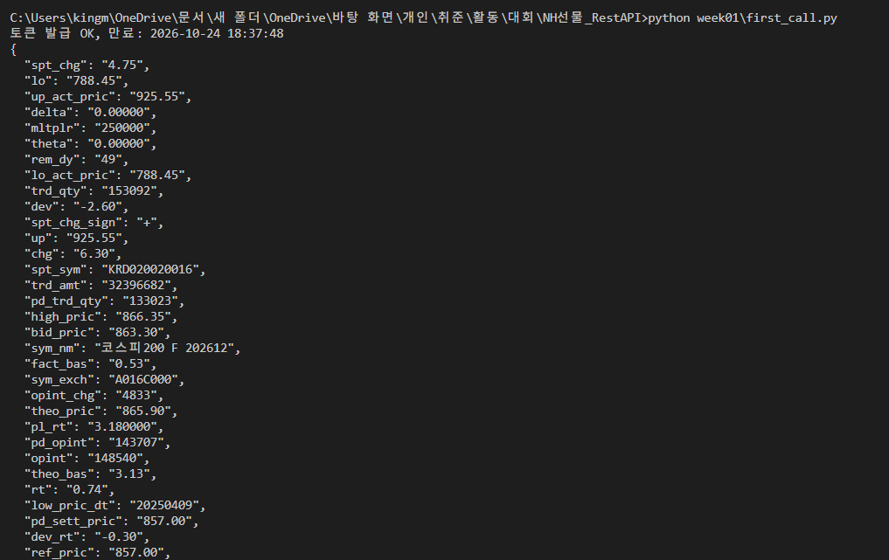

# 1주차 · 팀 GitHub 준비

**제출일: 2026/10/23(금) 23:59**

## 체크리스트

- [x] APP Key·Secret Key 발급
- [x] 발급받은 키로 API 한 번 호출해 응답 확인
- [x] 팀 GitHub 저장소 생성
- [x] README에 팀명과 간단한 소개 작성
- [ ] 운영진의 저장소 접근 가능 여부 확인
- [ ] 팀 Discord 방에 저장소 링크 올리기

## API 첫 호출

| 항목 | 내용 |
| --- | --- |
| 호출한 API | 접근토큰 발급 `POST /auth-service/v1/token` → 국내 현재가 `POST /trade/v1/domestic/price` |
| 종목 | 코스피200 F 202612 (`A016C000`) |
| 환경 | 모의 |
| 코드 | [first_call.py](first_call.py) |
| 응답 원본 | [results/price_response.json](results/price_response.json) |

실행: `python week01/first_call.py`
실행 결과:

[전체 일정으로](../README.md)
