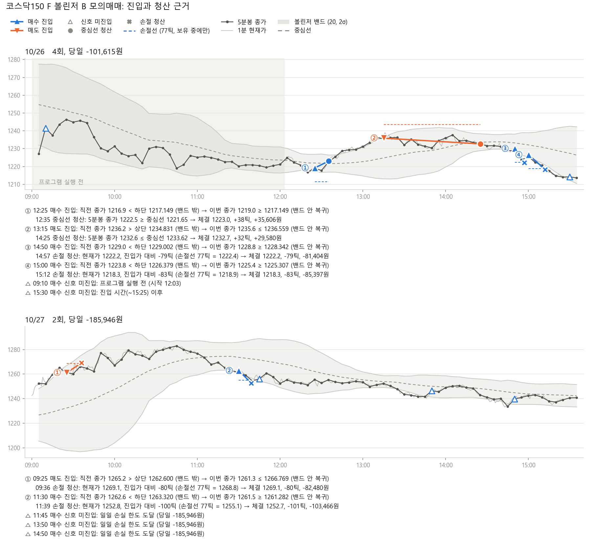
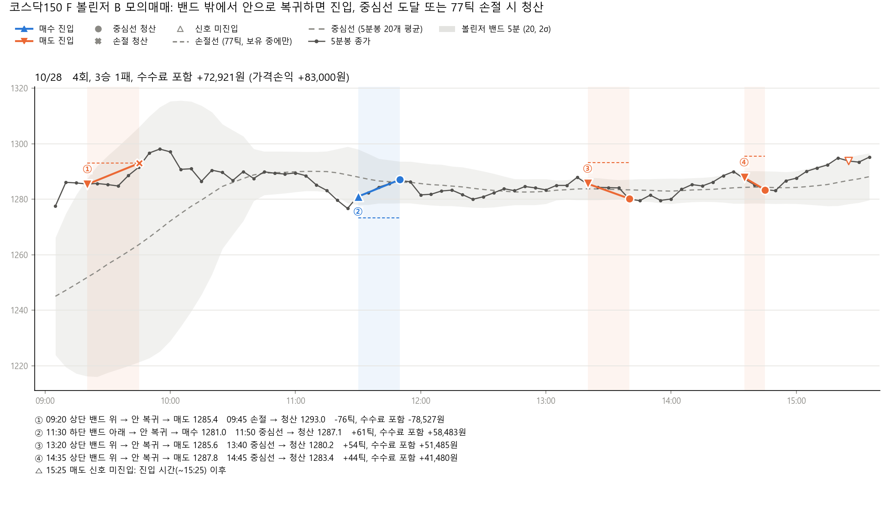
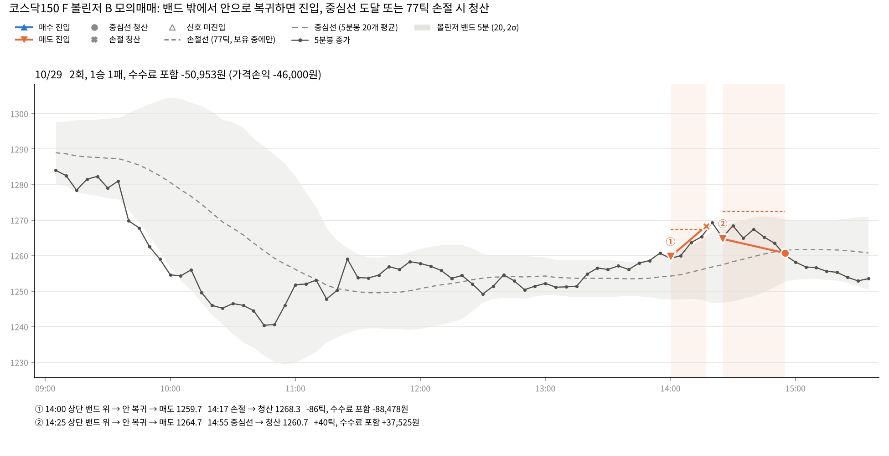
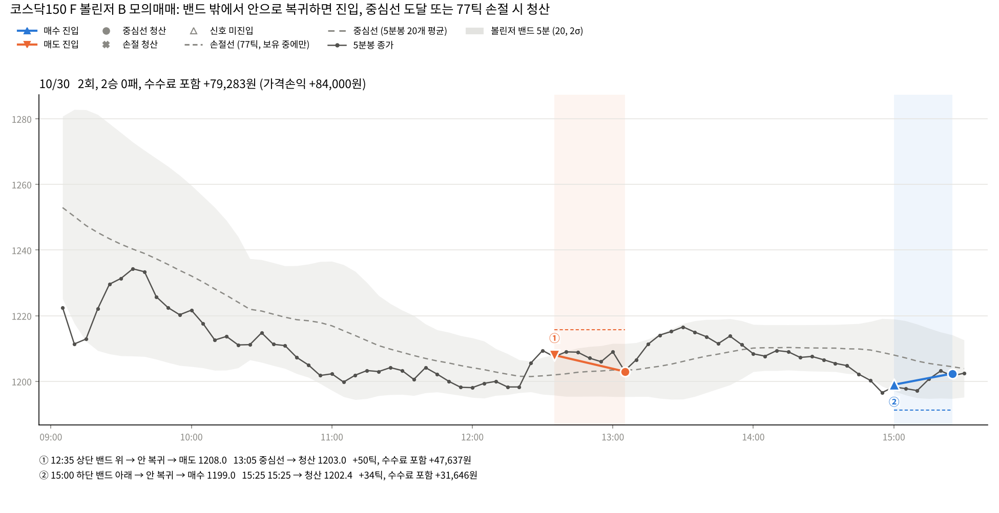

# 2주차 국내상품 전략 구현: 코스닥150 선물 볼린저 평균회귀

**제출일: 2026/10/30(금) 23:59**

| 항목 | 내용 |
| --- | --- |
| 대상 | 코스닥150 F 2026년 12월물 `A066C000` |
| 전략 | 5분봉 볼린저 밴드(20개, 2표준편차) 평균회귀, 1계약 |
| 실행 환경 | NH선물 **모의계좌 실제 주문** (프로그램 내부 시뮬레이션이 아님) |
| 실행 기간 | 10/26(월) 12:03 \~ 10/30(금) 15:25, 5거래일 |
| 결과 | 14회 거래, 8승 6패, **-186,310원** (수수료 추정치 34,310원 포함) |
| 규칙 변경 전후 | 10/26\~28 10회 -214,640원 → 10/29\~30 4회 +28,330원 (3절, 6절 9번) |

## 1. 과제 개요

국내 선물 1종목에 규칙 기반 전략을 하나 정하고, 모의계좌로 실제 주문을 내서 그 결과를 기록하고 분석했다.

목표는 다음 세 가지다.

1. 후보 전략 3개를 과거 분봉으로 비교해 하나를 선택한다. 파라미터는 비교 전에 고정하고, 결과를 본 뒤 바꾸지 않는다.
2. 백테스트와 실전 프로그램이 같은 신호 함수([strategy.py](strategy.py))를 쓰게 해서 규칙과 코드가 일치하도록 한다.
3. 시세 조회, 신호 계산, 주문, 체결 확인, 위험관리, 기록을 프로그램 하나가 자동으로 실행한다.

### 대상 상품

| 항목 | 값 | 출처 |
| --- | --- | --- |
| 종목 | 코스닥150 F 202612 (`A066C000`) | 모의 `price` 응답 (10/24 조회) |
| 거래승수 | 10,000 | `price` 응답 `mltplr` |
| 호가 단위 | 0.1포인트 (1틱 = 1,000원) | `product-detail` 응답 |
| 최종거래일 | 2026-12-10 (과제 기간 중 월물 교체 없음) | `price` 응답 `lst_trd_dt` |
| 운영 구간 | 09:00 \~ 15:25, 15:25에 전량 청산 | 모의계좌 운영 시간(09:00\~15:45)과 종료 단일가(15:35\~) 기준으로 결정 |

## 2. 전략 설명

5분봉 종가가 볼린저 밴드 밖으로 벗어났다가 다시 밴드 안으로 복귀하면, 가격이 이동평균(중심선)으로 돌아간다고 가정하고 반대 방향으로 진입한다. 하단 밴드 아래에서 복귀하면 매수, 상단 밴드 위에서 복귀하면 매도한다. 중심선에 도달하면 청산한다.

### 후보 비교

과거 1분봉과 5분봉으로 후보 3개를 비교했다. 데이터는 `chart-minute` API로 받았다([fetch_bars.py](fetch_bars.py)).

- 선택 구간: 9/11 \~ 10/08 (17거래일). 후보를 비교하고 하나를 선택하는 데 썼다.
- 검증 구간: 10/12 \~ 10/23 (10거래일). 선택한 전략이 다른 기간에도 비슷하게 움직이는지 확인했다.
- 공통 가정: 손절 77틱, 일일 손실 한도 154,000원, 진입과 청산마다 1틱 불리하게 체결, 수수료 0원(실측 전), 1계약.

| 후보 | 규칙 요지 | 선택 구간 | 검증 구간 |
| --- | --- | --- | --- |
| A. EMA 교차 | 1분봉 EMA(5)와 EMA(20) 교차 시 진입, 반대 교차 시 청산 | 179회, 승률 30%, +235,000원 | 58회, 승률 17%, -1,194,000원 |
| **B. 볼린저 평균회귀** | 위 설명 | 50회, 승률 56%, -472,000원 | 29회, 승률 31%, -595,000원 |
| B + 미결제약정 증가 시만 진입 | | 32회, -682,000원 | 27회, -316,000원 |
| B + 미결제약정 감소 시만 진입 | | 31회, -134,000원 | 10회, -304,000원 |
| C. 시가 범위 돌파 | 09:00\~09:30 고가/저가를 종가로 돌파하면 진입, 하루 1회 | 16회, 승률 31%, +324,000원 | 10회, 승률 30%, +369,000원 |

출처: [results/backtest_summary.json](results/backtest_summary.json), 거래별 내역은 [results/backtest_trades.csv](results/backtest_trades.csv).

### B를 선택한 이유

- A는 선택 구간에서 이익이었지만 검증 구간에서 -1,194,000원으로 손실이 가장 컸다. 두 구간의 결과가 반대 방향이었다.
- C는 두 구간 모두 이익이었지만 거래가 26회뿐이고, 이익 상위 2회를 빼면 두 구간 모두 손실이었다(선택 -637,000원, 검증 -390,000원). 하루 최대 1회이므로 실전 4일 동안 주문 기록이 4회 안팎에 그친다.
- B는 두 구간 모두 손실이었다. 대신 하루 약 3회 거래해서 실전 4일 동안 주문과 체결 기록을 10회 넘게 남길 수 있고, 손실 원인이 두 구간에서 같았다(손절 각 19회). 이번 주차는 수익보다 주문부터 기록까지 프로그램이 계획대로 동작하는지와 결과를 설명할 수 있는지를 우선해 B를 선택했다.
- 미결제약정 필터는 증가 조건과 감소 조건 모두 두 구간의 결과가 일관되지 않아 붙이지 않았다.

파라미터는 10/24 [results/params_bollinger.json](results/params_bollinger.json)에 고정했고(커밋 `f6dabe0`), 백테스트 결과를 본 뒤 바꾸지 않았다. 10/28 실전 결과를 분석한 뒤 진입 제외 조건 하나를 추가했다(3절 규칙 변경).

## 3. 매매 로직

### 규칙

| 구분 | 규칙 |
| --- | --- |
| 밴드 | 5분봉 종가 20개의 평균 ± 2 × 표준편차(모표준편차). 전일 봉을 이어서 계산한다 |
| 매수 진입 | 직전 5분봉 종가 < 직전 하단 밴드, 그리고 이번 5분봉 종가 ≥ 하단 밴드 |
| 매도 진입 | 직전 5분봉 종가 > 직전 상단 밴드, 그리고 이번 5분봉 종가 ≤ 상단 밴드 |
| 진입 제외 | 09:00 전, 15:25 이후, 종료 단일가 봉, 당일 봉 20개가 쌓이기 전 (10/28까지는 하루 첫 봉만 제외) |
| 중심선 청산 | 매수 보유 중 5분봉 종가 ≥ 중심선, 매도 보유 중 5분봉 종가 ≤ 중심선 |
| 손절 | 매 분 현재가가 진입가보다 77틱 이상 불리하면 청산 |
| 시간 청산 | 15:25에 전량 청산 |
| 일일 손실 한도 | 그날 실현 손실이 154,000원(손절 2회분)에 도달하면 신규 진입 중지 |
| 수량 | 1계약. 보유 중에는 추가 진입하지 않는다 |

### 규칙 변경 (10/29부터)

10/28까지는 하루 첫 봉만 진입에서 뺐다. 10/29부터는 당일 봉이 20개 쌓인 뒤 21번째 봉부터 진입한다. 장이 08:45에 열리면 10:30 마감 봉부터 진입할 수 있다. 이렇게 하면 신호를 판단하는 이번 봉과 직전 봉의 밴드가 모두 당일 봉으로만 계산된다.

- 이유: 10/27과 10/28 아침 손절 2회가 전일 봉이 섞인 밴드에서 나왔다(6절 3번).
- 20개: 밴드 계산 기간과 같은 값이다. 아래 백테스트를 실행하기 전에 정했다.
- 밴드 폭, 손절, 일일 한도 숫자는 바꾸지 않았다.
- 구현: [strategy.py](strategy.py)의 `WARMUP`, `WARMUP_FROM`. 10/28 이전 날짜에는 기존 조건이 적용되어 백테스트와 10/26\~10/28 차트가 그대로 재현된다.

같은 조건을 기존 백테스트 구간에 적용한 결과다(수수료 0원, 1틱 슬리피지 등 2절과 같은 가정).

| 구간 | 변경 전 | 변경 후 |
| --- | --- | --- |
| 선택 9/11 \~ 10/08 | 50회, 승률 56%, -472,000원 | 39회, 승률 64%, +26,000원 |
| 검증 10/12 \~ 10/23 | 29회, 승률 31%, -595,000원 | 27회, 승률 41%, -211,000원 |

두 구간 모두 손실이 줄었다. 다만 이 조건은 두 구간의 결과를 본 뒤에 추가했기 때문에, 검증 구간도 더는 미리 보지 않은 데이터가 아니다. 그래서 효과는 10/29\~10/30 실전 결과로 다시 확인했다.

**10/29\~10/30 실전 확인**: 4회 거래, 3승 1패, +28,330원. 이 조건 때문에 진입하지 않은 신호가 이틀에 1개씩 있었고(10/29 10:05 매수, 10/30 09:15 매수), 두 신호 모두 이후 5분봉 종가가 손절선 아래로 내려갔다(6절 9번). 거래가 4회뿐이라 효과가 있다고 결론 내리지는 않는다.

10/26\~10/28 실전에 이 조건이 있었다면 10/27 09:25와 10/28 09:20 진입이 없었다(두 거래 합계 -161,007원). 10/27은 일일 한도 때문에 진입하지 않은 11:45, 13:50, 14:50 매수 신호가 허용됐을 수 있어 그날 손익이 어떻게 바뀌었을지는 계산하지 않았다.

손절 77틱은 선택 구간 5분봉 ATR(14)의 중앙값 38.36틱의 2배다. 근거 계산은 [params_bollinger.ipynb](params_bollinger.ipynb)에 있다.

### 실행 흐름

```
08:50  작업 스케줄러가 run_trade.bat 실행 (화~금)
       시작 시 잔고와 당일 기록을 읽어 보유 포지션과 실현 손익을 복원
매 분 +5초 (봉 확정 대기)
  1. 현재가 조회 (손절 판단용)
  2. 5분 단위 시각이면 5분봉 60개 조회 → strategy.bollinger()로 신호 계산
  3. 판정 순서: 15:25 청산 → 손절 → 중심선 청산 → 진입
  4. 주문이 필요하면 최우선 호가 기록 → 시장가 1계약 주문
     → 주문내역으로 체결가 확인 → 잔고로 포지션 확인
  5. 모든 판정과 주문을 results/journal_YYYYMMDD.jsonl에 한 줄씩 기록
15:25  보유 포지션 청산 후 종료
```

week02 폴더에 `STOP` 파일을 만들면 다음 분에 청산하고 종료한다.

## 4. API 활용

| 용도 | API | 사용 위치 |
| --- | --- | --- |
| 접근토큰 | `POST /auth-service/v1/token` | 한 번 발급해 재사용하고, 만료 오류(`EGW018`, `EGW052`)를 받으면 다시 발급 |
| 분봉 | `/trade/v1/domestic/chart-minute` | 과거 1분봉, 5분봉 수집(`fetch_bars.py`), 실전 5분봉 신호(`trade.py`) |
| 현재가 | `/trade/v1/domestic/price` | 손절 판단, 베이시스와 괴리율 기록 |
| 호가 | `/trade/v1/domestic/price-bid` | 주문 직전 최우선 호가 기록 (체결가와 비교) |
| 투자자 동향 | `/trade/v1/domestic/trend-investor` | 외국인 순매수 기록 |
| 주문 | `/trade/v1/domestic/order` | 시장가 1계약, 체결조건 FAS |
| 주문내역 | `/trade/v1/domestic/order-history` | 주문번호로 체결가와 거부 사유 확인 |
| 잔고 | `/trade/v1/domestic/open-interest` | 주문 후 포지션 확인, 재시작 시 복원 |
| 예수금 | `/trade/v1/domestic/deposit` | 주문 전후 수수료 증가분으로 수수료율 실측 |

공통 처리는 [nh.py](nh.py)에 있다.

- **호출 간격**: 종류별 최소 간격을 둔다. 시세 0.1초, 계좌 0.1초, 주문 0.2초, 인증 0.34초(운영안내 17p의 초당 한도 10, 10, 5, 3회 기준).
- **재시도**: 시세와 계좌 조회는 응답 지연, 5xx, 호출량 초과(`EGW020`, `EGW036`, HTTP 429) 시 0.5, 1, 2초 간격으로 최대 3회 재시도한다.
- **주문은 재전송하지 않는다**: 주문 응답을 못 받으면 체결됐을 수 있으므로 다시 보내지 않고, 주문내역과 잔고를 먼저 조회한다(운영안내 22p).
- **실계좌 주문 차단**: `NH_ENV=paper`가 아니면 주문 API를 호출하지 않는다.
- **응답 로그**: 모든 요청과 응답을 `results/api_log/YYYYMMDD.jsonl`에 남긴다. 계좌번호, 계좌명, IP는 `***`로 가린다.

## 5. 실행 결과

### 일별 요약

| 날짜 | 실행 구간 | 거래 | 승/패 | 당일 손익 |
| --- | --- | --- | --- | --- |
| 10/26(월) | 12:03 \~ 15:25 (오전 수동 점검 후 시작) | 4 | 2 / 2 | -101,615원 |
| 10/27(화) | 08:50 \~ 15:25 (스케줄러 자동 실행) | 2 | 0 / 2 | -185,946원 |
| 10/28(수) | 08:50 \~ 15:25 (스케줄러 자동 실행) | 4 | 3 / 1 | +72,921원 |
| 10/29(목) | 08:50 \~ 15:25 (스케줄러 자동 실행, 당일 봉 대기 조건 적용) | 2 | 1 / 1 | -50,953원 |
| 10/30(금) | 08:50 \~ 15:25 (스케줄러 자동 실행, 당일 봉 대기 조건 적용) | 2 | 2 / 0 | +79,283원 |
| **합계** | | **14** | **8 / 6** | **-186,310원** |

### 거래 내역

| 날짜 | 진입 | 방향 | 진입가 | 청산 | 청산가 | 사유 | 틱 | 손익 |
| --- | --- | --- | --- | --- | --- | --- | --- | --- |
| 10/26 | 12:25 | 매수 | 1219.2 | 12:35 | 1223.0 | 중심선 | +38 | +35,606원 |
| 10/26 | 13:15 | 매도 | 1235.9 | 14:25 | 1232.7 | 중심선 | +32 | +29,580원 |
| 10/26 | 14:50 | 매수 | 1230.1 | 14:57 | 1222.2 | 손절 | -79 | -81,404원 |
| 10/26 | 15:00 | 매수 | 1226.6 | 15:12 | 1218.3 | 손절 | -83 | -85,397원 |
| 10/27 | 09:25 | 매도 | 1261.1 | 09:36 | 1269.1 | 손절 | -80 | -82,480원 |
| 10/27 | 11:30 | 매수 | 1262.8 | 11:39 | 1252.7 | 손절 | -101 | -103,466원 |
| 10/28 | 09:20 | 매도 | 1285.4 | 09:45 | 1293.0 | 손절 | -76 | -78,527원 |
| 10/28 | 11:30 | 매수 | 1281.0 | 11:50 | 1287.1 | 중심선 | +61 | +58,483원 |
| 10/28 | 13:20 | 매도 | 1285.6 | 13:40 | 1280.2 | 중심선 | +54 | +51,485원 |
| 10/28 | 14:35 | 매도 | 1287.8 | 14:45 | 1283.4 | 중심선 | +44 | +41,480원 |
| 10/29 | 14:00 | 매도 | 1259.7 | 14:17 | 1268.3 | 손절 | -86 | -88,478원 |
| 10/29 | 14:25 | 매도 | 1264.7 | 14:55 | 1260.7 | 중심선 | +40 | +37,525원 |
| 10/30 | 12:35 | 매도 | 1208.0 | 13:05 | 1203.0 | 중심선 | +50 | +47,637원 |
| 10/30 | 15:00 | 매수 | 1199.0 | 15:25 | 1202.4 | 시간 청산 | +34 | +31,646원 |









- 손익 = (청산가 - 진입가) × 방향 × 10,000 - 수수료. 수수료는 아래 수동 점검에서 실측한 비율(거래금액의 0.0098%)로 계산한 추정치이며, 14회 합계 34,310원이다.
- 체결가는 `order-history` 응답 값이다.
- 다섯 날 모두 실행 중 오류, 봉 지연, 주문 거부, 청산 실패 기록은 0건이다. 매일 08:50에 시작해 15:25에 종료했다.
- 원본: [results/journal_20261026.jsonl](results/journal_20261026.jsonl), [results/journal_20261027.jsonl](results/journal_20261027.jsonl), [results/journal_20261028.jsonl](results/journal_20261028.jsonl), [results/journal_20261029.jsonl](results/journal_20261029.jsonl), [results/journal_20261030.jsonl](results/journal_20261030.jsonl). 차트는 [plot_journal.py](plot_journal.py)로 그렸다(10/28\~10/30은 `--simple` 옵션). 10/29\~10/30 5분봉은 그날 `api_log`에 남은 `chart-minute` 응답을 합쳐 [results/bars_A066C000_5m_20261029_20261030.json](results/bars_A066C000_5m_20261029_20261030.json)으로 저장했다.

### 수동 왕복 점검 (10/26 12:00)

자동 실행 전에 [manual_roundtrip.py](manual_roundtrip.py)로 1계약을 직접 사고팔아 주문, 체결, 잔고, 수수료를 확인했다.

| 단계 | 결과 |
| --- | --- |
| 시장가 FAK 매수 | 거부. HTTP 400, `5039` "시장가는 FOK, FAK 주문불가" |
| 시장가 FAS 매수 | 1221.0 체결, 잔고 매수 1계약 확인 |
| 시장가 FAS 매도 | 1220.3 체결, 잔고 0건 확인 |
| 예수금 `fee` | 0원 → 2,393원 |

수수료율 = 2,393원 ÷ ((1221.0 + 1220.3) × 10,000) = 0.0098%. 가격 손익은 -7,000원이며 위 자동매매 합계에는 넣지 않았다. 원본: [results/manual_roundtrip_20261026_120013.json](results/manual_roundtrip_20261026_120013.json)

## 6. 결과 분석

**1. 손절 1회 평균 손실은 검증 구간 백테스트와 비슷했고, 승률은 10/28 이후 검증 구간보다 높아졌다.**
손절 1회 평균 손실은 실전 -86,625원(6회), 검증 구간 평균 손실 -89,850원이다. 실전 승률은 10/27까지 33%(6회 중 2회)로 검증 구간 31%와 비슷했으나, 10/28 이후 8회 중 6승을 더해 57%(14회 중 8회)가 됐다. 실전 거래가 14회뿐이라 이 차이를 전략 성과로 판단하기는 이르다. 실전 손익에는 수수료가 들어 있고 백테스트에는 없다.

**2. 손절 6회는 모두 가격이 한 방향으로 계속 움직이는 중에 반대로 진입한 거래였다.**

- 10/29 14:00 매도: 13:00 이후 1250 부근에서 14:20 1269대까지 오르는 중이었다.
- 10/28 09:20 매도: 09:00 1258.1에서 09:57 1301.5까지 오르는 중이었다.
- 10/27 09:25 매도: 09:00 1242.5에서 10:44 1282.9까지 오르는 중이었다.
- 10/27 11:30 매수: 고점 1282.9 이후 14:43 1233.2까지 내리는 중이었다.
- 10/26 14:50, 15:00 매수: 13:16 1239.0에서 15:25 1214.0까지 내리는 중이었다.

밴드 밖으로 벗어났다가 복귀하는 신호는 추세 중간에도 발생한다. 전략에는 추세 구간의 신호를 제외하는 조건이 없다. 백테스트에서 손절이 많았던 원인과 같다. 반대로 10/28 중심선 청산 3회는 모두 10:30 이후 가격이 1276.4\~1294.9 사이에서 등락한 구간에서 발생했다. 10/30 두 거래도 12:00\~15:25 가격이 1196\~1217 사이에서 등락한 구간이었다.

**3. 10/27과 10/28 아침 손절 2회는 전일 봉이 섞인 밴드에서 나온 신호였다.**
밴드는 최근 5분봉 20개로 계산하고 전일 봉을 이어서 쓴다. 그래서 당일 9번째 봉까지는 20개 중 절반 넘게 전일 봉이다. 10/28 09:20 봉의 밴드는 당일 봉 7개와 전일 봉 13개로 계산됐다.

10/28은 전일 마지막 종가 1241.1보다 16.8포인트 높은 1257.9에서 시작해 09:10에 1286.1까지 올랐다. 중심선은 전일 봉의 가격이 남아 있어 1251.72에 머물렀다. 매도 신호가 나온 두 봉은 다음과 같다.

| 5분봉 마감 | 종가 | 상단 밴드 | 중심선 |
| --- | --- | --- | --- |
| 09:15 | 1285.9 | 1281.66 | 1249.42 |
| 09:20 | 1285.5 | 1287.20 | 1251.72 |

종가는 0.4포인트 내렸지만 상단 밴드가 5.54포인트 올라가서 종가가 밴드 안에 들어왔다. 계산 대상에서 전일 봉이 하나씩 제외되고 당일의 높은 가격이 추가되면서 표준편차가 커졌기 때문이다. 가격이 중심선 쪽으로 돌아온 것이 아니라 밴드가 넓어져서 진입 조건이 충족됐다. 진입 뒤에도 가격은 계속 올라 09:45 현재가 1293.1에서 손절선(진입가 + 77틱)에 도달했고, 손절 뒤 09:57에 1301.5까지 올랐다.

10/27도 같았다. 전일 마지막 종가 1213.4보다 24.5포인트 높은 1237.9에서 시작했고, 09:25 매도 신호의 밴드는 당일 봉 8개와 전일 봉 12개로 계산됐다. 종가가 1265.2에서 1261.3으로 3.9포인트 내리는 동안 상단 밴드는 1262.60에서 1266.77로 4.17포인트 올랐다.

이런 신호를 제외하기 위해 10/29부터 당일 봉이 20개 쌓이기 전에는 진입하지 않는다(3절 규칙 변경).

**4. 손절선은 77틱이지만 실제 손절 6회 중 5회는 79\~101틱에서 체결됐다.**
현재가를 1분에 한 번만 확인하기 때문에 확인 사이에 움직인 만큼 손실이 커진다. 10/27 11:39 손절은 손절선보다 24틱(24,000원) 더 불리한 가격에 체결됐다. 10/29 14:17 손절도 손절선 1267.4보다 9틱 불리한 1268.3에 체결됐다. 10/28 09:45 손절만 현재가가 손절선(1293.1)에 정확히 도달한 분에 주문해 76틱에 체결됐다.

**5. 10/27 손실이 일일 한도 154,000원을 31,946원 넘었다.**
첫 손절 후 실현 손익이 -82,480원으로 한도에 도달하지 않아 두 번째 진입이 허용됐고, 두 번째 거래도 손절되어 -185,946원으로 마감했다. 현재 규칙은 이미 실현된 손실만 보고 진입 여부를 정하기 때문에, 다음 거래 한 번의 손실이 한도를 넘기는 경우를 막지 못한다.

**6. 체결가는 백테스트 가정보다 유리했다.**
시장가 주문 28건 중 18건은 주문 직전 최우선 호가와 같은 가격에, 7건은 1\~2틱 유리한 가격에, 3건(10/28 13:40 청산 매수, 10/29 14:00 진입 매도, 10/30 15:00 진입 매수)은 1틱 불리한 가격에 체결됐다. 백테스트는 진입과 청산마다 1틱 불리하게 가정했다. 모의 서버의 체결 방식이 실제 시장과 같은지는 확인하지 못했다.

**7. 백테스트에 수수료가 빠져 있다.**
실측 수수료는 왕복 1회에 약 2,400원(2.4틱)이다. 백테스트에 왕복 2,400원을 넣어 다시 계산했다(다른 가정은 2절과 같음).

| 구간 | 규칙 | 수수료 0원 | 수수료 2,400원 |
| --- | --- | --- | --- |
| 선택 9/11 \~ 10/08 | 변경 전 (50회) | -472,000원 | -592,000원 |
| 선택 9/11 \~ 10/08 | 변경 후 (39회) | +26,000원 | -67,600원 |
| 검증 10/12 \~ 10/23 | 변경 전 (29회) | -595,000원 | -664,600원 |
| 검증 10/12 \~ 10/23 | 변경 후 (27회) | -211,000원 | -275,800원 |

수수료를 넣으면 변경 후 선택 구간도 손실이 된다. 거래 1회 평균 이익이 수수료(2.4틱)보다 크지 않으면 거래가 많을수록 손실이 커지는 구조다.

**8. 같은 기간 후보 C도 손실이었다.**
10/26\~10/27 1분봉으로 후보 C를 같은 백테스트 코드로 계산하면 2회 모두 손절, -168,000원(수수료 제외)이다([results/bars_A066C000_1m_20261026_20261027.json](results/bars_A066C000_1m_20261026_20261027.json)). 10/27은 오전에 오르고 오후에 내린 날이었고, 추세를 따르는 C와 반대로 가는 B가 모두 손절됐다. 이틀 결과만으로는 C와 B의 우열을 판단할 수 없다.

**9. 규칙 변경(당일 봉 20개 대기) 전후 실전 결과**

| 구분 | 기간 | 거래 | 승/패 | 손익 | 손절 | 09:00\~10:30 진입 |
| --- | --- | --- | --- | --- | --- | --- |
| 변경 전 | 10/26 \~ 10/28 | 10 | 5 / 5 | -214,640원 | 5 | 2회 (둘 다 손절) |
| 변경 후 | 10/29 \~ 10/30 | 4 | 3 / 1 | +28,330원 | 1 | 0회 |

변경 후 진입하지 않은 신호는 2개였다. 같은 5분봉에 변경 전 조건(하루 첫 봉만 제외)을 적용해 찾았다.

- 10/29 10:05 매수 신호 (종가 1254.3, 손절선 1246.6): 이후 10:45 종가 1240.4까지 내렸다.
- 10/30 09:15 매수 신호 (종가 1212.9, 손절선 1205.2): 09:35 1234.3까지 올랐지만 중심선에 닿지 못했고, 10:55 종가 1201.8까지 내렸다.

두 신호 모두 5분봉 종가 기준으로 손절선 아래까지 내려갔다. 실전은 1분마다 손절을 확인하므로 실제로 진입했다면 손절됐을 가능성이 높지만, 1분봉으로 확인하지는 않았다. 변경 후 거래가 4회뿐이라 승률과 손익 차이를 규칙 변경의 효과로 단정하지 않는다. 남은 손절 1회(10/29 14:00)는 장 초반이 아니라 오후 추세 중의 역진입이었다(2번).

## 7. 오류 제보

### 우리 코드의 개선 사항 (3주차 전에 반영)

| 문제 | 영향 | 개선 방향 |
| --- | --- | --- |
| 5분봉 조회가 실패하면 그 분의 손절과 15:25 청산 판단도 건너뛴다 | 조회 장애 중 손실 확대 가능 (10/26\~30 발생 0건) | 손절과 시간 청산을 차트 조회보다 먼저 판단 |
| 손절을 1분에 한 번만 확인 | 손절 6회 중 5회가 손절선보다 2\~24틱 더 손실 | 확인 간격 단축 검토 |
| 일일 한도가 실현 손실만 봄 | 10/27 한도 31,946원 초과 | 다음 손절 1회분 손실을 미리 더해 진입 여부 판단 |
| 주문 결과를 확인하지 못한 경우 다음 신호에서 다시 주문할 수 있음 | 중복 포지션 가능 (발생 0건) | 미확인 주문이 있으면 자동 주문 중지 |
| 백테스트 수수료 0원 | 백테스트 손익 과대평가 | 실측 수수료율 반영 |
| 장 초반 밴드에 전일 봉이 섞여, 갭으로 시작한 날 밴드가 넓어지면서 진입 조건이 충족됨 | 10/27, 10/28 아침 손절 2회 | 10/29 반영: 당일 봉 20개가 쌓이기 전에는 진입하지 않음. 10/29\~10/30 장 초반 진입 0회, 막힌 신호 2개 (6절 9번) |
| 추세 중 역진입 손절 (10/29 14:00 포함 6회) | 손절 6회 합계 -519,752원 | 추세 구간 신호 제외 조건 검토 (예: 중심선 기울기, 밴드 폭 확대 중 진입 금지). 백테스트 선택 구간에서 먼저 확인 |
| 수수료가 거래당 평균 이익에 비해 큼 | 수수료 반영 시 변경 후 선택 구간도 손실 (6절 7번) | 거래 수를 줄이는 조건과 함께 검토 |

## 8. 소스코드

| 파일 | 내용 |
| --- | --- |
| [strategy.py](strategy.py) | 후보 A, B, C 신호 함수. 백테스트와 실전이 함께 쓴다 |
| [fetch_bars.py](fetch_bars.py) | 과거 분봉 수집, 저장본을 DataFrame으로 읽기 |
| [params_bollinger.ipynb](params_bollinger.ipynb) | B의 밴드, 손절, 일일 한도 숫자를 정한 근거 |
| [backtest.py](backtest.py) | 후보 비교 백테스트. 1분봉을 따라가며 매 분 손절을 확인한다 |
| [nh.py](nh.py) | API 클라이언트: 토큰, 호출 간격, 재시도, 응답 로그, 실계좌 주문 차단 |
| [trade.py](trade.py) | 모의계좌 실전 루프 |
| [manual_roundtrip.py](manual_roundtrip.py) | 수동 1계약 왕복과 수수료 실측 |
| [repro_errors.py](repro_errors.py) | `chart-minute`의 `req_qty` 2000건 상한 재현 |
| [plot_journal.py](plot_journal.py) | 실전 기록 차트. `--simple`이면 하루 한 장 |
| [run_trade.bat](run_trade.bat) | 작업 스케줄러 실행용 |

### 실행 방법

```bash
pip install pandas numpy matplotlib
# 저장소 루트의 .env.example을 .env로 복사하고 모의 키를 입력한다 (NH_ENV=paper)

python week02/fetch_bars.py                   # 과거 분봉 수집 (저장본이 있으면 건너뜀)
python week02/backtest.py                     # 후보 비교 → results/backtest_summary.json
python week02/trade.py                        # 모의계좌 실전 (NH_ENV=paper에서만 실행)
python week02/plot_journal.py 20261026 20261027
python week02/plot_journal.py 20261028 --simple   # results/trades_20261028.png
python week02/plot_journal.py 20261029 20261030 --simple   # results/trades_20261029.png, trades_20261030.png
```

작업 스케줄러 등록: `schtasks /Create /TN "NH_trade" /TR "<경로>\week02\run_trade.bat" /SC WEEKLY /D TUE,WED,THU,FRI /ST 08:50`

외부 코드: 없음. API 호출부([nh.py](nh.py))는 Python 표준 라이브러리 `urllib`로 직접 작성했고, 운영진 [nh-futures-open-api](https://github.com/PetterChanHyuk/nh-futures-open-api) 코드는 사용하지 않았다. 사용 패키지: pandas, numpy, matplotlib.

[전체 일정으로](../README.md)
