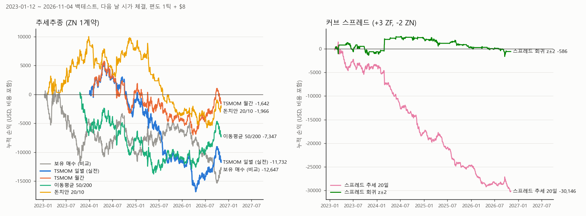

# 3주차 해외상품 전략 구현: 미국 10년 국채선물(ZN) 추세추종

**제출일: 2026/11/06(금) 23:59**

| 항목 | 내용 |
| --- | --- |
| 거래소, 종목, 월물 | CME 미국 10년 국채선물(10-Year T-Note) 2026년 12월물 `ZNZ26`. API 거래소코드 `FCME`. 커브 전략 백테스트에는 5년 국채선물 `ZFZ26`도 사용 |
| 전략 | 시계열 모멘텀(TSMOM) 12개월: 직전 일봉 종가가 252거래일 전보다 낮으면 매도 1계약, 높으면 매수 1계약 |
| 실행 환경 | NH선물 **모의계좌 실제 주문**(5절) + 과거 일봉 **백테스트**(시뮬레이션, 2절과 6절). 두 결과를 구분해 적었다 |
| 거래 단위 | 1계약 = 액면 $100,000. 가격 1포인트 = $1,000, 1틱(1/64포인트) = $15.625. 수수료 편도 $8 (11/02, 11/05 실측) |
| 실전 | 11/05(목) 18:44 시장가 매도 1계약, 106.9375 체결. 11/05 19:51 현재가 106.9375로 평가손익 $0, 수수료 $8 |
| 백테스트 | 잘 알려진 채권선물 전략 7개를 2023-01-12\~2026-11-04 일봉으로 비교. 비용을 포함하면 7개 모두 손실, 실전 규칙은 -$11,732 |

### 필수 기능과 구현 위치

| 필수 기능 | 이번 주에 한 것 | 코드 | 실행 근거 |
| --- | --- | --- | --- |
| 해외 시세 조회 | 현재가, 1분봉과 5분봉, 월물 일봉과 연결 일봉, 상품 정보, 거래시간 조회 | [nh_os.py](nh_os.py#L36) `price`, [`chart_minute`](nh_os.py#L40), [`chart_daily`](nh_os.py#L49), [`product_detail`](nh_os.py#L54), [`market_operations`](nh_os.py#L58) | `results/api_log/YYYYMMDD.jsonl`, `results/bars_*.json`, `results/specs_FG1_20261101.json` |
| 전략 비교 | 7개 전략을 같은 비용과 체결 가정으로 백테스트 | [strategies.py](strategies.py#L198) `main` | `results/strategies_summary.json`, `strategies_daily_usd.csv`, `strategies_equity.png` |
| 신호 판정 | 백테스트와 실전이 같은 함수(`tsmom`, `adjust`, `roll_days`)를 사용 | [strategies.py](strategies.py#L115) `tsmom` / [trend_live.py](trend_live.py#L17) `main` | `results/trend_live_*.json`의 `신호` 기록 |
| 주문 처리 | 목표 포지션과 잔고를 비교해 차이만큼 시장가 주문 → 주문내역으로 체결가 확인 → 잔고 재확인 | [nh_os.py](nh_os.py#L100) `order`, [`find_fill`](nh_os.py#L83), [`position`](nh_os.py#L77) | `results/trend_live_20261105_184439.json` (주문번호 1645) |
| 위험 관리 | 1계약 고정, 주문 수량이 2계약을 넘으면 중단, 11/25부터 자동 주문 중지(12월물 만기 전 교체), 모의계좌가 아니면 주문 차단 | [trend_live.py](trend_live.py#L40) 40행, [14행](trend_live.py#L14) / `week02/nh.py` 실계좌 차단 | 5절 |
| 실행 기록 | 판정과 주문을 파일로 남기고, API 요청과 응답 원본은 계좌번호, 계좌명, IP, 사용자 ID를 가려 저장 | [nh_os.py](nh_os.py#L11) `MASK_SUFFIX` | `results/api_log/*.jsonl` |

## 1. 과제 개요

해외 선물 1종목에 규칙 기반 전략을 정하고, 모의계좌로 실제 주문을 내서 결과를 기록했다. 이번 주 주제는 미국 국채(CME ZN, ZF)였다(Discord 공지).

진행 순서는 다음과 같다.

1. 2주차 볼린저 평균회귀 전략을 ZN 분봉에 그대로 적용했다. 비용 기준(2절)을 통과하지 못했다.
2. 지표 발표 전후 매매와 5년, 10년 커브 스프레드를 검토했다. 둘 다 비용 기준을 통과하지 못했다.
3. 잘 알려진 채권선물 전략 7개를 과거 일봉으로 비교했다. 실전 규칙은 손익을 보기 전에 TSMOM 12개월로 정했다.
4. 11/05 모의계좌에서 TSMOM 신호대로 ZN 1계약을 매도했다.

### 대상 상품

`product-detail`, `market-operations` 응답 기준이다(2026-11-01 조회, `results/specs_FG1_20261101.json`).

| 항목 | ZN (10년) | ZF (5년) |
| --- | --- | --- |
| 월물 | `ZNZ26` (2026년 12월물) | `ZFZ26` (2026년 12월물) |
| 액면 | $100,000 | $100,000 |
| 틱 크기 | 0.015625 (1/64) | 0.0078125 (1/128) |
| 1틱 가치 | $15.625 | $7.8125 |
| 거래시간 (한국 시간) | 08:00\~다음 날 07:00 | 08:00\~다음 날 07:00 |
| 결제 | 실물인수도, USD | 실물인수도, USD |

거래소는 하루 23시간 열려 있지만 모의 서버는 07:00\~24:00에만 운영한다(과제 공지). 그래서 실제로 모의 주문을 낼 수 있는 시간은 08:00\~24:00이고, 00:00\~07:00에는 보유 포지션을 정리하거나 손절 주문을 낼 수 없다.

## 2. 전략 설명

### 비용 기준 (11/01, 손익을 보기 전에 정함)

전략을 선택하기 전에 **왕복 비용이 거래당 가격 움직임 중앙값의 20% 이하인가**를 먼저 확인했다. 움직임은 방향과 관계없이 크기만 본다. 비용이 움직임에 비해 크면 신호가 맞아도 수익이 남지 않기 때문이다. 손익을 본 뒤 이 기준을 바꾸지 않았다.

왕복 비용은 진입과 청산마다 1틱 슬리피지와 수수료 편도 $8로 잡았다. ZN 1계약 기준 $47.25(약 3틱)이다. 수수료와 슬리피지는 11/02 수동 왕복으로 실측했다(5절).

### 검토한 전략

| 전략 | 출처 | 비용 기준 | 결과 |
| --- | --- | --- | --- |
| 볼린저 평균회귀 (2주차 전략, 5\~30분봉) | 2주차 README | 탈락. 30분봉이 28.6%로 가장 낮음 | 5분봉 선택 구간 110회 -$2,875, 검증 구간 26회 -$953 (`results/backtest_summary.json`) |
| 지표 발표 전후 레인지 돌파 (1분봉) | 오프닝 레인지 돌파 | 탈락 (75.6%) | 46회 -$1,392 |
| 커브 스프레드 추세 20일 | 스티프너, 플래트너 | 탈락 (115.4%) | 113회 -$30,146 |
| 커브 스프레드 평균회귀 z±2 | 스프레드 평균회귀 | 탈락 (51.6%) | 32회 -$586 |
| **추세 TSMOM 12개월 (일별 판단, 실전)** | Moskowitz, Ooi, Pedersen(2012) | 통과 (14.4%) | 45회 -$11,732 |
| 추세 TSMOM 12개월 (월말 판단) | 같은 논문의 월 1회 리밸런싱 | 통과 (2.5%) | 7회 -$1,642 |
| 추세 이동평균 50/200 | 이동평균 교차 | 통과 (2.8%) | 7회 -$7,347 |
| 추세 돈치안 20/10 | 터틀 System 1 | 통과 (4.6%) | 33회 -$1,966 |

베이시스 트레이드(현물과 선물의 가격 차이)와 월물 롤 스프레드도 잘 알려진 전략이지만 이번 주에는 제외했다. 베이시스는 현물 국채가 필요한데 API에는 선물만 있다. 3월물 `ZNH27`은 11/05 17시 조회 기준 당일 거래량이 526계약으로 롤 스프레드를 거래하기에 유동성이 부족했다.

### TSMOM을 실전 규칙으로 정한 이유

- 선물 추세추종을 다룬 대표 연구(Moskowitz, Ooi, Pedersen 2012)가 국채선물을 포함해 검증한 규칙이다.
- 며칠에서 몇 주씩 보유해서 비용 비중이 14.4%로 기준 안에 들어간다.
- 백테스트 손익을 보기 전(11/05 17:40)에 코드에 실전 규칙으로 지정했다([strategies.py](strategies.py#L28) `LIVE`). 백테스트에서 일별 TSMOM이 가장 나쁜 결과로 나왔지만 규칙을 바꾸지 않았다.

실전 규칙은 매일 판단하도록 만들었는데, 원논문은 월 1회 리밸런싱이다. 이 차이는 백테스트를 돌린 뒤 발견했고, 원논문 방식(월말 판단)은 별도 행으로 추가해 함께 보고한다.

## 3. 매매 로직

### 규칙

| 항목 | 내용 |
| --- | --- |
| 신호 | 직전 완성 일봉 종가 > 252거래일 전 종가이면 +1(매수), 작으면 -1(매도) |
| 포지션 | 항상 1계약 보유. 신호가 바뀌면 반대로 뒤집는다(2계약 주문) |
| 체결 | 신호가 나온 다음 거래일에 시장가 |
| 손절 | 없음. 원논문 규칙에 손절이 없고, 00:00\~07:00에는 모의 주문이 불가능하다 |
| 월물 | `ZNZ26`. 잔고 만기일이 11/30으로 조회되어 11/25부터 자동 주문을 멈추고 3월물로 직접 교체한다 |

### 백테스트 가정

- **데이터**: `chart-daily`의 연결 일봉(`cidx_yn=1`)을 사용했다. 이 데이터는 월물이 바뀌는 날 가격 차이를 조정하지 않은 원가격이다. 8/28에 9월물에서 12월물로 바뀔 때 16틱 차이가 났다(12월물 일봉과 대조).
- **월물 교체 조정**: 2, 5, 8, 11월 마지막 8영업일부터 다음 달 첫 3영업일 사이에서 전일 종가 대비 시가 차이가 가장 큰 날을 교체일로 정하고, 그 이전 가격 전부에 차이를 더했다(백어저스트). 최근 교체일 3개(3/02, 5/26, 8/28)는 ZN과 ZF가 같은 날로 나왔다. 교체 때 포지션을 계속 들고 있으면 왕복 비용 1회분을 더 뺐다.
- **기간**: 2023-01-12\~2026-11-04. 그 이전 데이터는 쓰지 않았다(7절 5번).
- **체결**: 종가로 신호를 계산하고 다음 날 시가에 체결한다. 모의 서버가 정산(05:00) 직후에는 닫혀 있어서 당일 종가 체결은 실제로 불가능하다.
- **비용**: 편도 1틱 + $8.

### 실행 흐름

```
08:10  작업 스케줄러가 run_trend.bat 실행 (월~금)
       git pull로 최신 코드를 받은 뒤 trend_live.py --yes 실행
  1. 11/25 이후면 중단 (12월물 교체 필요)
  2. 연결 일봉 조회 → 원본 저장 → 오늘 날짜 봉(진행 중)을 빼고 신호 계산
  3. 잔고 조회 → 목표 포지션과 비교
  4. 같으면 종료. 차이가 2계약을 넘으면 중단
  5. 현재가와 호가 기록 → 시장가 주문 → 주문내역으로 체결 확인 → 잔고 재확인
  6. 모든 단계를 results/trend_live_YYYYMMDD_HHMMSS.json에 기록
```

08:10에 실행하는 이유는 CME가 08:00에 열리고, 그 시점에 전날 일봉이 완성되어 있기 때문이다. 백테스트의 "다음 날 시가 체결" 가정과 가장 가까운 시각이다.

## 4. API 활용

| 기능 | 엔드포인트 | 이번 주 용도 |
| --- | --- | --- |
| 현재가 | `overseas/price` | 주문 직전 매수호가, 매도호가, 체결가 기록 |
| 분봉 | `overseas/chart-minute` | ZN 1분봉(8/24\~10/30) 수집. 볼린저와 발표 전후 백테스트 |
| 일봉 | `overseas/chart-daily` | `cidx_yn=0` 월물 일봉, `cidx_yn=1` 연결 일봉. 추세, 커브 백테스트와 실전 신호 |
| 상품 정보 | `overseas/product-detail` | 틱 크기와 틱 가치, 액면 |
| 거래시간 | `overseas/market-operations` | 거래시간, 정산 시간 |
| 예수금 | `overseas/deposit` | 주문 전후 예수금 확인 (11/02 수동 왕복) |
| 잔고 | `overseas/open-interest` | 순포지션과 평균가 |
| 주문 | `overseas/order` | 시장가 신규 주문 |
| 주문내역 | `overseas/order-history` | 체결 여부와 체결가 확인 |
| 누적손익 | `overseas/cumulative-pl` | 수수료 확인 (11/05 $8) |

토큰 재사용, 호출 간격, 재시도, 응답 로그, 실계좌 주문 차단은 2주차 [nh.py](../week02/nh.py)를 그대로 쓰고, 해외 경로만 [nh_os.py](nh_os.py)에 붙였다. 여러 페이지로 나뉘는 응답은 `nxt_key`를 따라 모은다([`pages`](nh_os.py#L22)). 마지막 페이지에서 받은 키로 다시 부르면 첫 페이지로 돌아가므로(7절 2번), 키가 9로만 채워지면 멈춘다.

11/05에는 만기된 월물 일봉을 연달아 조회하다가 토큰 발급이 `429 EGW020`("요청이 허용된 양을 초과하여 차단")으로 막혔다. 몇 분 뒤 다시 정상으로 돌아왔다.

## 5. 실행 결과

### 실전 주문 (모의계좌)

| 항목 | 값 |
| --- | --- |
| 실행 | 11/05(목) 18:44:39, `python trend_live.py` (수동 실행, 주문 전 확인 입력) |
| 신호 | 11/04 종가 106.890625 < 252거래일 전(2025-11-13) 113.734375 → 목표 -1 |
| 주문 전 잔고 | 0 |
| 주문 직전 호가 | 매수호가 106.9375 / 매도호가 106.953125 / 직전 체결가 106.953125 |
| 주문 | 시장가 매도 1계약, 주문번호 1645, 응답 `00000` "주문이 정상처리 되었습니다." |
| 체결 | 18:44:47, 1계약, **106.9375** (주문상태 6, 전체체결) |
| 슬리피지 | 매수호가 대비 0틱, 직전 체결가 대비 1틱 |
| 수수료 | $8 (`cumulative-pl`, 11/05) |
| 주문 후 잔고 | -1계약, 평균가 106.9375 |
| 평가 | 11/05 19:51 현재가 106.9375, 평가손익 $0 |

같은 날 18:51, 18:52에 `--yes`로 두 번 더 실행해 보았다. 두 번 모두 목표(-1)와 잔고(-1)가 같아 "주문 없음"으로 끝났다. 같은 날 여러 번 실행해도 주문이 중복되지 않는 것을 확인했다.

기록: [results/trend_live_20261105_184439.json](results/trend_live_20261105_184439.json)

### 수동 왕복 점검 (11/02 21:48)

ZN 1계약을 시장가로 매수한 직후 매도해 비용을 실측했다([manual_roundtrip.py](manual_roundtrip.py), `results/manual_roundtrip_20261102_214821.json`).

| 항목 | 매수 | 매도 |
| --- | --- | --- |
| 체결가 | 106.75 (매도호가) | 106.734375 (매수호가) |
| 호가 대비 슬리피지 | 0틱 | 0틱 |
| 직전 체결가 대비 | 1틱 | 0틱 |

왕복 수수료는 $16(편도 $8)이고, 직전 체결가 대비 슬리피지를 더한 왕복 비용은 약 2.02틱이었다. 백테스트의 "편도 1틱 + $8"(왕복 약 3틱)은 이보다 1틱가량 보수적이다.

### 백테스트



ZN 1계약 기준이고, 커브 전략은 ZF 3계약 매수와 ZN 2계약 매도를 한 단위로 했다(CME 5년, 10년 스프레드 기준 비율). 비용은 모두 포함했다.

| 전략 | 시작 | 거래 | 연간 거래 | 평균 보유일 | 승률 | 손익 | 최대 낙폭 |
| --- | --- | --- | --- | --- | --- | --- | --- |
| 보유 매수 (비교용) | 2023-01-12 | 1 | 0.3 | 979 | - | -$12,647 | -$16,106 |
| **TSMOM 12개월, 일별 (실전 규칙)** | 2024-01-03 | 45 | 15.6 | 16.1 | 28.9% | **-$11,732** | -$22,435 |
| TSMOM 12개월, 월말 | 2024-01-31 | 7 | 2.5 | 101.0 | 57.1% | -$1,642 | -$12,784 |
| 이동평균 50/200 | 2023-10-18 | 7 | 2.3 | 111.4 | 14.3% | -$7,347 | -$14,154 |
| 돈치안 20/10 | 2023-02-09 | 33 | 8.7 | 22.4 | 36.4% | -$1,966 | -$15,792 |
| 커브 스프레드 추세 20일 | 2023-02-09 | 113 | 29.7 | 8.4 | 10.6% | -$30,146 | -$31,688 |
| 커브 스프레드 평균회귀 z±2 | 2023-02-14 | 32 | 8.4 | 13.4 | 50.0% | -$586 | -$4,233 |

시작일이 다른 것은 신호 계산에 필요한 과거 데이터(TSMOM 252일, 이동평균 200일)가 쌓인 뒤부터 거래하기 때문이다. 모든 전략이 2026-11-04에 끝난다.

연도별 손익 (USD):

| 전략 | 2023 | 2024 | 2025 | 2026 |
| --- | --- | --- | --- | --- |
| 보유 매수 | -4,688 | -5,399 | +3,789 | -6,350 |
| TSMOM 일별 | - | -1,191 | -10,421 | -120 |
| TSMOM 월말 | - | +390 | -4,759 | +2,728 |
| 이동평균 50/200 | -6,698 | -1,150 | -3,196 | +3,697 |
| 돈치안 20/10 | +9,578 | -1,744 | -11,244 | +1,444 |
| 커브 추세 20일 | -3,722 | -13,876 | -7,054 | -5,493 |
| 커브 평균회귀 | -614 | +2,661 | -1,828 | -805 |

원본: `results/strategies_summary.json`, 일별 손익 `results/strategies_daily_usd.csv`, 발표 전후 거래 내역 `results/strategies_event_trades.csv`

## 6. 결과 분석

1. **실전 규칙 손실의 82%는 비용이 아니라 신호에서 나왔다.** TSMOM 일별의 -$11,732 가운데 비용은 -$2,123이고, 비용 전 가격 움직임이 -$9,609였다. 이동평균 50/200은 비용 -$331, 가격 움직임 -$7,016이었고, TSMOM 월말은 비용 -$329, 가격 움직임 -$1,312였다. 돈치안 20/10만 반대로 비용(-$1,560)이 가격 움직임(-$406)보다 컸다.
2. **2023\~2026년 ZN은 방향이 자주 바뀌었다.** 보유 매수의 연도별 손익이 -$4,688, -$5,399, +$3,789, -$6,350으로 해마다 방향이 달랐다. 추세 전략은 1년 전 대비 방향으로 포지션을 잡는데, 그 방향이 이어지지 않는 구간이 길었다. 돈치안은 2023년에 +$9,578을 냈지만 2025년에 -$11,244를 잃었다.
3. **같은 신호라도 판단 주기에 따라 손익이 $10,090 차이 났다.** TSMOM 일별은 45회 거래에 -$11,732, 월말 판단은 7회 거래에 -$1,642였다. 일별 판단은 가격이 1년 전 수준 근처에서 오르내릴 때 매수와 매도를 반복했다. 두 버전의 차이 $10,090 가운데 비용 차이는 $1,794이고, 나머지는 잦은 방향 전환으로 생긴 가격 손실이다.
4. **커브 스프레드와 발표 전후 전략은 움직임에 비해 비용이 컸다.** 커브 전략은 5계약을 한 번에 거래해 왕복 비용이 $189.38이다. 스프레드 추세 20일은 거래당 움직임 중앙값($164.06)보다 비용이 컸다. 발표 전후 전략은 거래당 움직임 중앙값이 $62.50(4틱)이라 비용이 그 75.6%를 차지했다.
5. **표본이 작다.** 쓸 수 있는 깨끗한 데이터가 약 3.8년이고, TSMOM은 신호 계산에 1년이 필요해 실제 거래 기간은 약 2.8년이다. 이 결과로 "TSMOM이 국채선물에서 통하지 않는다"고 결론 내릴 수 없다. 원논문은 수십 년, 여러 자산으로 검증했다. 이번 결과는 2024\~2026년 ZN 1종목에서 손실이었다는 사실까지만 말해 준다.
6. **실전은 1회 주문이다.** 실전 주문으로 신호 계산, 주문, 체결 확인, 기록이 끝까지 동작하는 것을 확인했고, 체결 비용(호가 대비 0틱, 수수료 $8)을 실측했다. 전략의 수익성은 실전 1회로 판단할 수 없다.

## 7. 오류 제보와 개선 사항

### API 오류 제보

| 번호 | 엔드포인트 | 현상 | 재현 | 근거 |
| --- | --- | --- | --- | --- |
| 1 | `overseas/price` | `Iccurs1`에 2종목(ZNZ26, ZFZ26)을 넣으면 HTTP 200에 빈 본문이 온다. 1종목은 정상 | 2026-11-01 18:06:07 | `week02/results/api_log/20261101.jsonl` |
| 2 | `overseas/chart-minute` | 마지막 페이지의 `nxt_key`가 9로 채워진 32자리다. 이 키로 다시 부르면 첫 페이지(가장 최근 봉)가 다시 온다. 키만 보고 반복하면 끝나지 않는다 | 2026-11-01 18:07:07, 재확인 11/05 20:16 | 같은 파일 |
| 3 | `overseas/chart-minute` | `req_qty`를 9999로 줘도 한 페이지에 495봉만 온다. 100을 주면 100봉, 600을 주면 495봉. 연결 일봉(`chart-daily`)은 한 페이지 554봉까지 온다 | 2026-11-01 18:06\~18:07, 매 페이지 495봉. 재확인 11/05 20:16 | 같은 파일 |
| 4 | `overseas/chart-daily` | 17:05에 만기된 월물(`ZNU26`, `ZNM26`)을 조회했을 때 "조회 결과 없음" 대신 `502 EGW033` "백엔드 서버와의 연결에 실패했습니다"가 왔다. 우리 코드가 월물마다 4번씩 재시도했고, 재시도가 쌓이자 `429 EGW020`으로 차단되었다. 이어서 조회한 `ZNH26`, `ZNZ25`는 차단 때문에 502 여부를 확인하지 못했다. 같은 날 20:16에 재시도 없이 `ZNU26`을 다시 조회하니 HTTP 200에 0건으로 정상 응답했다. 일시적인 장애였던 것으로 보여 제보하지 않았다 | 2026-11-05 17:05\~17:06, 재확인 20:16 | `results/api_log/20261105.jsonl` |
| 5 | `overseas/chart-daily` (`cidx_yn=1`) | ZN 연결 일봉 품질 문제. 2001\~2007년 종가의 연도별 중앙값이 72.1\~91.7(같은 시기 실제 ZN은 100 이상 [추정]). 같은 기간 미국 공휴일(7/4, 10월 둘째 월요일, 11/11, 추수감사절, 12/25, 1/1) 봉 13개가 앞뒤 날보다 17\~37포인트 높고, 13개 모두 시가, 고가, 저가, 종가가 같다. 2021년까지 시가나 종가가 고가와 저가 범위 밖인 날이 연도별 35\~58%. 2022-06-24 다음 봉이 2023-01-12로 평일 143일 누락(ZF는 2022-07-04 다음 봉이 2023-01-12, 평일 137일 누락) | 2026-11-05 조회본 | `results/bars_ZN_cont_1d_20261105.json` |

5번 때문에 백테스트는 2023-01-12 이후만 썼다. 2022년 이후는 범위 밖인 날의 비율이 0\~3%다.

### 우리 코드의 개선 사항

| 문제 | 영향 | 조치 |
| --- | --- | --- |
| 해외 주문내역 응답의 `occurs1_user_id`를 가리지 않고 로그에 저장 | 11/02, 11/05 로그에 사용자 ID가 남음 | 11/05 수정: 가림 대상에 `user_id` 추가, 기존 두 로그도 가림 |
| 월물 교체일을 가격 차이로 추정 | 차이가 작은 분기는 다른 날을 교체일로 잡을 수 있다(그날 하루 밤사이 손익이 빠짐) | 월물별 일봉을 받을 수 있으면 실제 교체일로 맞춘다 |
| 12월물 만기 처리를 자동화하지 않음 | 11/25 이후 자동 주문 중지 | 4주차 전에 3월물 교체 절차를 정하고 `ZN`, `ROLL_BY` 값을 바꾼다 |
| 손절 없음 | 00:00\~07:00 사이 큰 움직임에 대응할 수 없다 | 원논문 규칙대로 두되, 하루 손실 한도 도입 여부를 4주차에 검토 |
| 실전 규칙(일별)과 원논문(월말)이 다름 | 백테스트에서 일별이 월말보다 $10,090 나빴다 | 4주차부터 어느 쪽으로 운영할지 정한다. 이번 주는 사전에 정한 일별을 유지 |

## 8. 소스코드

| 파일 | 내용 |
| --- | --- |
| [nh_os.py](nh_os.py) | 해외선물 API 클라이언트. 2주차 `nh.py`에 해외 경로를 붙였다 |
| [fetch_bars.py](fetch_bars.py) | 분봉과 상품 정보 수집, 저장본을 DataFrame으로 읽기 |
| [backtest.py](backtest.py) | 2주차 볼린저 전략을 ZN에 적용한 백테스트 (11/01) |
| [precheck.py](precheck.py) | 발표 전후와 커브 스프레드의 움직임 크기 대비 비용 점검 (11/02) |
| [manual_roundtrip.py](manual_roundtrip.py) | 수동 1계약 왕복과 비용 실측 (11/02) |
| [strategies.py](strategies.py) | 7개 전략 비교 백테스트. 월물 교체 조정, 비용, 자체 점검(`selfcheck`) 포함 |
| [plot_strategies.py](plot_strategies.py) | 5절 누적 손익 차트 |
| [trend_live.py](trend_live.py) | 실전(모의) 주문. `--yes`면 확인 입력 없이 실행 |
| [run_trend.bat](run_trend.bat) | 작업 스케줄러 실행용 |

### 실행 방법

```bash
pip install pandas numpy matplotlib
# 저장소 루트의 .env에 해외 권한이 있는 모의 키를 입력한다 (NH_ENV=paper)

python week03/fetch_bars.py          # 5분봉과 상품 정보 수집
python week03/strategies.py          # 전략 비교 → results/strategies_summary.json
python week03/plot_strategies.py     # results/strategies_equity.png
python week03/trend_live.py          # 실전 주문 (주문 전 y 입력)
```

`strategies.py`는 `results/bars_ZN_cont_1d_20261105.json`, `bars_ZF_cont_1d_20261105.json`(11/05 조회본)을 읽는다.

작업 스케줄러 등록: `schtasks /Create /TN "NH_trend" /TR "<경로>\week03\run_trend.bat" /SC WEEKLY /D MON,TUE,WED,THU,FRI /ST 08:10`

외부 코드: 없음. 전략 규칙은 아래 출처의 정의를 직접 구현했고, 운영진 [nh-futures-open-api](https://github.com/PetterChanHyuk/nh-futures-open-api) 코드는 사용하지 않았다. 사용 패키지: pandas, numpy, matplotlib.

## 출처

- Moskowitz, T. J., Ooi, Y. H., Pedersen, L. H. (2012). Time series momentum. *Journal of Financial Economics*, 104(2), 228\~250. TSMOM 12개월 규칙
- 터틀 트레이딩 System 1 (20일 돌파 진입, 10일 반대 극값 청산). 돈치안 채널 규칙
- CME Group, Yield Curve Spread Trades. 5년, 10년 스프레드 계약 비율(ZF 3 : ZN 2)
- NH선물 REST API 개발자센터 명세: https://apidev.futures.co.kr/
