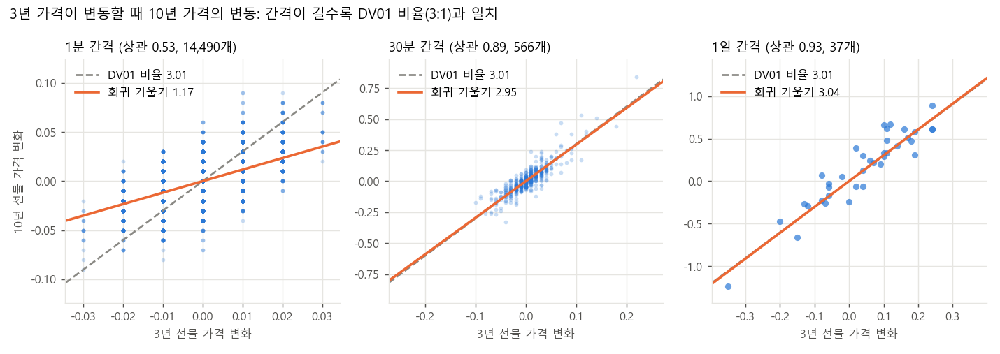
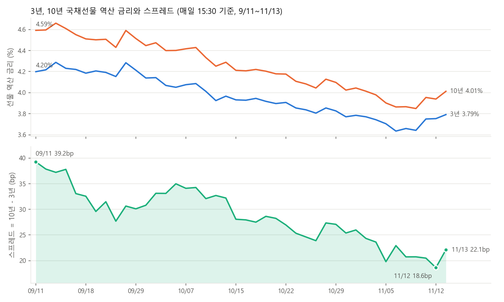
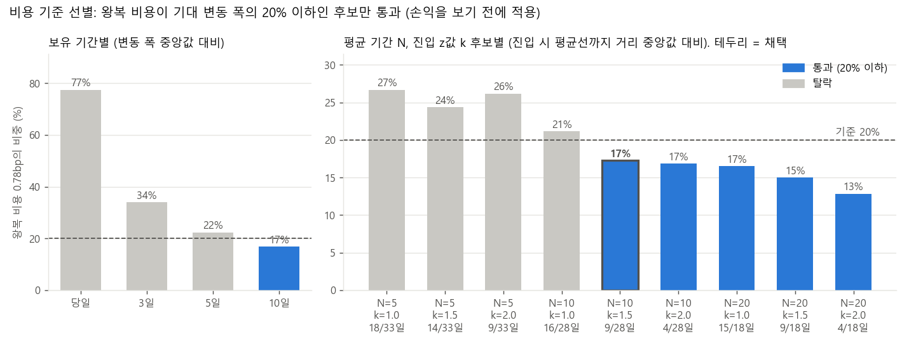
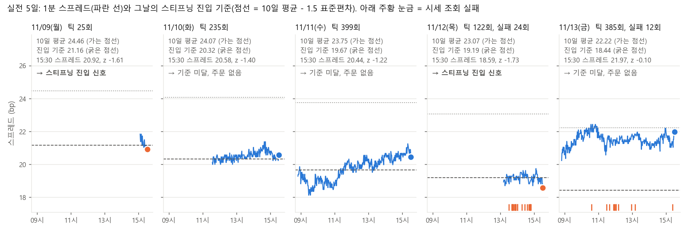
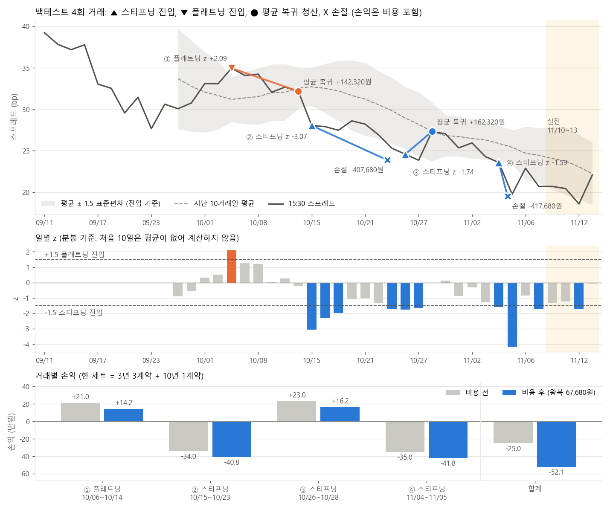
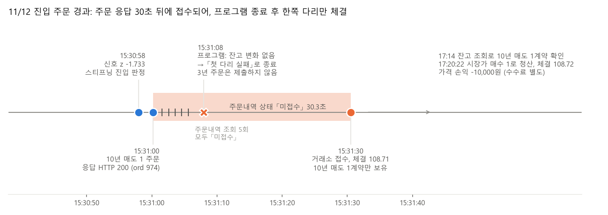
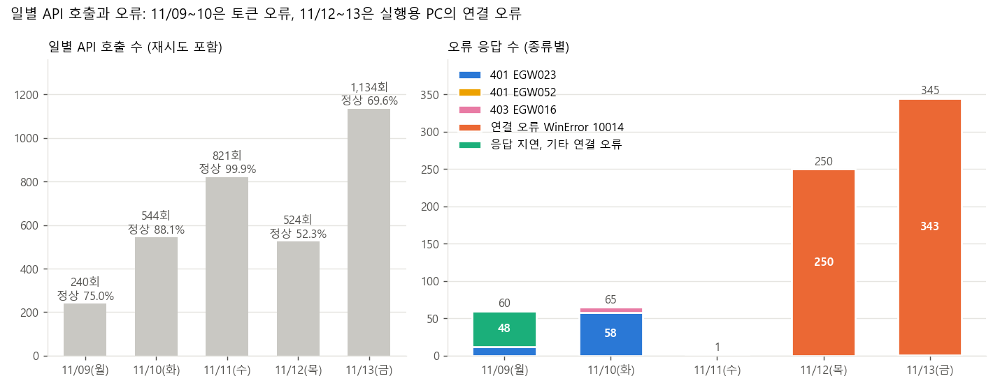

# 4주차 복수상품, 스프레드 전략: 국채선물 3년, 10년 커브 스프레드

**제출일: 2026/11/13(금) 23:59**

| 항목 | 내용 |
| --- | --- |
| 대상 | KRX 3년 국채선물 2026년 12월물 `A656C000`, 10년 국채선물 2026년 12월물 `A676C000` |
| 전략 | 10년 금리와 3년 금리의 차이(커브 기울기)가 지난 10거래일 평균에서 표준편차의 1.5배 이상 벗어나면, 평균으로 회귀한다고 판단하고 DV01 중립(3년 3계약 : 10년 1계약)으로 진입한다 |
| 실행 환경 | NH선물 **모의계좌 실제 주문**(11/09 수동 왕복, 11/10부터 자동 실행) + 1분봉 **백테스트**(시뮬레이션). 두 결과를 5절에 구분해 기술했다 |
| 거래 단위 | 한 세트 = 3년 3계약 + 10년 1계약. 1계약 승수 1,000,000, 호가 0.01 = 10,000원. 1bp 금리 변화 시 3년 1계약 약 28,800원, 10년 1계약 약 86,600원. 한 세트 왕복 비용 67,680원 = 스프레드 0.78bp (11/09 실측: 호가 1틱씩 40,000원 + 수수료 27,680원) |
| 실행 기간 | 11/09(월) 15:05\~15:30 시험 실행(주문 없음), 11/10(화)\~11/13(금) 4거래일 실전 실행 (평일 08:50 자동 시작) |
| 결과 | 실전 4일 중 11/12 하루만 진입 신호(z = -1.733)가 발생했다. 첫 다리인 10년 매도 1계약이 주문 30초 뒤에 접수되어 프로그램 종료 후 체결되었고, 3년 주문은 제출되지 않았다. 잔존한 10년 1계약은 17:20에 청산했다(가격 손익 -10,000원). 11/10, 11/11, 11/13은 진입 기준(-1.5) 미달로 주문 없음. 11/13 종료 시 잔고 0 |
| 백테스트 | 9/11\~11/09, 4회 거래, 2승 2패, 비용 포함 -520,720원 |

### 요약

1. **장중 평균회귀는 비용 때문에 제외했다.** 하루 스프레드 변동 폭 중앙값은 1.01bp이고 한 세트 왕복 비용은 0.78bp다. 비용이 기대 변동 폭의 20% 이하인 조건은 10거래일 보유에서만 충족되었다(2절).
2. **백테스트는 4회 거래, 비용 포함 -520,720원이다.** 손실 2건은 스프레드가 39.7bp에서 21.5bp로 축소되는 구간에서 스티프닝으로 진입한 거래다. 규칙은 손익을 확인하기 전에 확정했고 결과를 본 뒤에도 변경하지 않았다(5절, 6절 3번).
3. **실전 진입 신호는 11/12에 1회 발생했고, 두 다리 중 10년만 체결되었다.** 모의 서버는 주문을 30초 뒤에 접수했고, 프로그램은 8초 뒤에 실패로 판단하고 종료했다. 3년 주문이 제출되지 않아 10년 매도 1계약이 약 1시간 49분 동안 단독으로 남았다(5절, 6절 6번).
4. **이 사례를 반영해 코드를 3곳 수정했다.** 15:30:30 이후에는 주문하지 않고, 체결 확인을 60초로 늘렸으며, 미체결 잔량이 있으면 실패로 처리하지 않고 중단한다(3절, 7절).
5. **API와 실행 환경에서 관찰한 현상 8건을 기록했고 5건을 제보했다.** 이번 주에 토큰 `expires_in` 고정, 장 마감 후 국내 주문 체결, 주문 접수 지연 3건을 제보했다(7절).
6. **해외선물 모의투자 수익률 대회(11/13)는 10팀 중 10위(-$1,144.24)였다.** 가격 손익은 -$0.24였고 손실 전액이 수수료였다. 종료 50분 전부터 수동으로 5회 주문해 수수료가 3배가 되었다. 거래 내역과 피드백은 부록에 정리했다.

### 필수 기능과 구현 위치

과제의 필수 기능이 코드 어디에 있고, 실행했다는 근거가 어느 파일에 남아 있는지 정리했다. 줄 번호는 이 제출본 기준이다.

| 필수 기능 | 이번 주에 한 것 | 코드 | 실행 근거 |
| --- | --- | --- | --- |
| 두 종목 시세 조회 | 3년, 10년 현재가와 호가, 1분봉 38일치 | [fetch_bars.py](fetch_bars.py#L26) `fetch`, [live.py](live.py#L54) `quote` | `results/bars_*_1m_*.json`, `results/api_log/*.jsonl` |
| 스프레드 계산 | 두 선물 가격을 각각 금리로 환산한 뒤 (10년 금리 - 3년 금리)를 bp로 계산 | [explore.py](explore.py#L17) `price`, [`implied_yield`](explore.py#L23), [`bars`](explore.py#L34) | `results/spread_1m.csv`, `results/explore_summary.json` |
| 신호 판정 | 백테스트와 실전이 같은 함수를 사용 | [strategy.py](strategy.py#L16) `zscore`, [`entry_side`](strategy.py#L23), [`exit_reason`](strategy.py#L30) | `results/backtest_summary.json`, `results/live_*.jsonl`의 `신호` 기록 |
| 두 다리 주문 | 10년을 먼저 주문하고 체결을 확인한 뒤 3년을 주문. 진입 중 3년이 실패하면 10년을 반대 주문으로 청산 | [live.py](live.py#L118) `move_to`, [`send`](live.py#L80) | `results/manual_roundtrip_20261109_143920.json`, `results/live_20261112.jsonl`의 `주문` 기록 |
| 위험 관리 | 4bp 손절(1분마다 확인), 10거래일 시간 청산, 시작할 때 잔고와 기록이 다르면 주문하지 않고 중단, 모의계좌가 아니면 주문 차단 | [strategy.py](strategy.py#L9) 9\~10행, [live.py](live.py#L139) `main` / `week02/nh.py` 실계좌 차단 | 3절 |
| 실행 기록 | 1분 단위 시세와 판정, 주문을 파일로 기록하고, API 요청과 응답 원본은 계좌번호와 계좌명, IP를 가려 저장 | [live.py](live.py#L26) `journal` | `results/live_YYYYMMDD.jsonl`, `results/api_log/*.jsonl` |
| 결과 분석 | 스프레드 수준, 계약 비율, 비용 기준 선별, 백테스트, 실전 5일, 11/12 주문 경과, API 오류를 차트 7장으로 작성 | [plot_analysis.py](plot_analysis.py) | 2절, 5절, 6절, 7절 차트 (`results/fig_*.png`) |

## 1. 과제 개요

같은 시장에서 거래되는 두 국채선물을 조합해 금리 커브의 기울기를 거래했다. 한쪽 다리만 보유하면 금리 방향에 대한 투자이지만, 두 다리의 금리 민감도(DV01)를 일치시켜 매수, 매도하면 금리 전체가 동시에 상승, 하락하는 위험은 상쇄되고 두 금리의 차이만 손익에 반영된다.

목표는 다음 세 가지다.

1. 두 종목의 1분봉으로 스프레드의 변동 폭과 평균 회귀 속도를 확인하고, 3주차와 같은 비용 기준으로 규칙을 선별한다. 규칙은 손익을 확인하기 전에 확정하고, 결과를 본 뒤 바꾸지 않는다.
2. 두 다리 주문(한쪽 체결 실패 시 처리 포함)을 구현하고, 모의계좌 수동 왕복으로 체결과 비용을 실측한다.
3. 백테스트와 실전 프로그램이 같은 신호 함수([strategy.py](strategy.py))를 쓰게 하고, 실전은 작업 스케줄러로 평일 08:50에 자동 실행한다.

진행 순서는 다음과 같다.

1. 11/09 두 종목의 1분봉(9/11\~11/09)을 수집해 스프레드의 변동 폭과 평균으로 회귀하는 속도를 확인했다.
2. 모의계좌에서 3:1 한 세트를 진입했다가 즉시 청산해 수수료와 체결가를 실측했다.
3. 3주차와 같은 비용 기준으로 후보 규칙을 선별했고, 손익을 확인하기 전에 규칙을 확정했다(평균 기간 10일, 진입 z 1.5, 손절 4bp).
4. 확정한 규칙으로 백테스트를 수행하고, 같은 날 15:30에 주문 없는 시험 실행을 진행했다.
5. 11/10부터 11/13까지 실행용 PC(24시간 켜 두는 PC)의 작업 스케줄러로 평일 08:50에 자동 실행했다.
6. 11/12 진입 주문에서 한쪽 다리만 체결된 원인을 로그로 확인하고, 주문 처리 코드를 수정했다(6절 6번, 7절).

### 대상 상품

| 항목 | 3년 국채선물 | 10년 국채선물 | 출처 |
| --- | --- | --- | --- |
| 종목코드 | `A656C000` | `A676C000` | 모의 `price` 응답 (11/08 조회) |
| 월물 | 2026년 12월물 | 2026년 12월물 | 같은 응답 |
| 승수 | 1,000,000 | 1,000,000 | `price` 응답 `mltplr` |
| 호가 단위 | 0.01 (10,000원) | 0.01 (10,000원) | 11/09 `price-bid` 응답의 매수 1호가와 매도 1호가 차이 |
| 11/06 종가 | 103.85 | 109.37 | `price` 응답 |
| 11/06 거래량 | 195,463계약 | 96,772계약 | `price` 응답 |
| 운영 구간 | 09:00\~15:30, 신호와 주문은 15:30에 종료 | | 모의 서버 국내 운영 시간 09:00\~15:45(과제 공지)와 분봉 구성 기준 |

5년 국채선물(`A666C000`)도 조회되지만 11/06 거래량이 0이므로 제외했다.

분봉은 08:45부터 15:34까지 연속되고, 이후에는 15:45 봉 하나만 존재한다. 15:35\~15:45를 종가 단일가 구간으로 판단하고 신호와 주문은 15:30에 종료한다[추정].

## 2. 전략 설명

10년 금리에서 3년 금리를 차감한 값을 스프레드라고 정의한다. 스프레드가 확대되면 커브가 가팔라진 것(스티프닝)이고, 축소되면 평평해진 것(플래트닝)이다. 스프레드가 최근 평균보다 표준편차의 1.5배 이상 낮으면 스티프닝, 1.5배 이상 높으면 플래트닝으로 진입하고, 평균으로 회귀하면 청산한다.

| 예상 | 3년 | 10년 | 이익이 나는 경우 |
| --- | --- | --- | --- |
| 스티프닝 | 매수 3계약 | 매도 1계약 | 10년 금리의 상승 폭이 3년보다 크거나 하락 폭이 3년보다 작다 |
| 플래트닝 | 매도 3계약 | 매수 1계약 | 10년 금리의 하락 폭이 3년보다 크거나 상승 폭이 3년보다 작다 |

### 선물 가격을 금리로 환산한 이유

국채선물 가격은 표면금리 5%, 6개월 이표, 만기 3년(또는 10년)인 가상 국채의 가격으로 결정된다. 두 선물의 가격 차이(109.37 - 103.85)는 만기가 다른 채권의 가격 차이이므로 커브 기울기를 나타내지 않는다. 그래서 각 선물 가격을 이 가상 국채의 수익률로 역산한 뒤 차이를 산출했다([explore.py](explore.py#L17) `price`, `implied_yield`). 가상 국채의 조건은 KRX 상품 명세를 기준으로 했고, 원문과는 아직 대조하지 않았다.

### 계약 비율: DV01 중립

금리가 1bp 변동할 때 선물 1계약의 가격 변화(DV01)를 같은 가상 국채로 계산했다. 11/09 14:27 가격 기준이다.

| 항목 | 3년 | 10년 |
| --- | --- | --- |
| 가격 | 103.73 | 109.12 |
| 역산 금리 | 3.675% | 3.890% |
| DV01 (1계약) | 28,792원 | 86,602원 |

비율이 3.008이므로 3년 3계약 : 10년 1계약으로 결정했다. 실제 가격 변동도 이 비율과 일치하는지 1분봉으로 확인했다. 3년 가격이 0.01 변동할 때 10년 가격의 변동 폭(회귀 기울기)는 다음과 같다.

| 간격 | 기울기 | 상관계수 |
| --- | --- | --- |
| 1분 | 1.17 | 0.53 |
| 30분 | 2.95 | 0.89 |
| 1일 | 3.04 | 0.93 |



점 하나는 해당 간격 동안의 두 선물 가격 변화다. 회색 점선은 DV01 비율(3.01), 주황 실선은 회귀 기울기다. 30분과 1일 간격에서는 두 선의 차이가 0.06 이하다. 1분 간격에서 기울기가 낮은 것은 두 종목의 체결 시점이 동일한 분 내에서도 다르기 때문이다[추정].

30분 간격 값에는 전일 마감부터 다음 날 개장까지의 변화가 포함되어 있다. 장중 변화만 사용하면 기울기 2.58, 상관계수 0.85다(529개).

### 스프레드의 변동 (9/11\~11/09, 38거래일)

| 항목 | 값 |
| --- | --- |
| 수준 | 9/11 39.74bp → 11/09 21.49bp (최저 19.52, 최고 41.29) |
| 장중 고가와 저가 차이 (중앙값) | 2.6bp |
| 개장부터 마감까지 변화 폭 (중앙값) | 1.01bp |
| 1일, 3일, 5일, 10일 변화 폭 (중앙값) | 1.26, 2.3, 3.5, 4.63bp |
| 평균으로 절반 회귀하는 기간 (일별 종가 AR(1)) | 5.9일 |

같은 기간 3년 금리는 4.20%에서 3.68%로, 10년 금리는 4.60%에서 3.89%로 하락했다. 10년 금리가 더 큰 폭으로 하락해 스프레드가 18bp 축소되었다(금리 하락과 함께 커브가 평평해진 불 플래트닝).



위 표는 규칙을 확정한 11/09 14:27까지의 값이고, 차트는 실전 기간을 포함해 11/13까지 그렸다. 차트의 값은 매일 15:30 이전 마지막 분봉 기준이어서 표의 9/11 값(15:34 마지막 봉 39.74bp)과 다르다. 스프레드는 11/12에 18.6bp까지 축소되었다가 11/13에 22.1bp로 확대되었다.

장중 5분 간격으로 계산하면 절반 회귀 기간이 약 20분으로 산출된다. 3년 선물의 호가 1틱이 금리로 약 0.35bp이므로, 체결가가 매수호가와 매도호가에서 번갈아 형성되는 것만으로도 평균회귀로 관측될 수 있다. 장중 평균회귀는 이 때문에 신뢰하지 않았다.

### 후보 비교 (3주차와 같은 비용 기준, 손익을 보기 전에 적용)

**왕복 비용이 진입할 때 평균선까지 거리 중앙값의 20% 이하인가**를 우선 확인한다. 비용이 기대 변동 폭에 비해 크면 신호가 적중해도 이익이 발생하지 않는다.

왕복 비용은 11/09 수동 왕복에서 실측한 67,680원이다(5절). 3:1 한 세트에서 스프레드 1bp는 10년 1계약의 DV01(86,602원)에 해당하므로 비용은 0.78bp다.

보유 기간별로 우선 확인했다.

| 보유 기간 | 변동 폭 중앙값 | 비용 비중 | 판정 |
| --- | --- | --- | --- |
| 당일 (개장부터 마감) | 1.01bp | 78% | 탈락 |
| 3일 | 2.3bp | 34% | 탈락 |
| 5일 | 3.5bp | 22% | 탈락 |
| 10일 | 4.63bp | 17% | 통과 |

장중 전략은 이 단계에서 제외하고 며칠 보유하는 규칙으로 결정했다. 이어서 평균 기간(N)과 진입 z값(k) 후보마다 진입할 때 평균선까지 거리를 계산했다. 신호일은 |z| ≥ k인 날의 수다.

| N | k | 신호일 / 계산 가능일 | 진입 거리 중앙값 | 비용 비중 | 판정 |
| --- | --- | --- | --- | --- | --- |
| 5 | 1.0 | 18 / 33 | 2.93bp | 27% | 탈락 |
| 5 | 1.5 | 14 / 33 | 3.21bp | 24% | 탈락 |
| 5 | 2.0 | 9 / 33 | 2.99bp | 26% | 탈락 |
| 10 | 1.0 | 16 / 28 | 3.70bp | 21% | 탈락 |
| **10** | **1.5** | **9 / 28** | **4.52bp** | **17%** | **통과, 채택** |
| 10 | 2.0 | 4 / 28 | 4.64bp | 17% | 통과 |
| 20 | 1.0 | 15 / 18 | 4.73bp | 16% | 통과 |
| 20 | 1.5 | 9 / 18 | 5.21bp | 15% | 통과 |
| 20 | 2.0 | 4 / 18 | 6.08bp | 13% | 통과 |



위 두 표를 막대로 나타냈다. 점선(20%)보다 낮은 파란 막대가 기준을 통과한 후보이고, 테두리가 있는 막대가 채택한 규칙이다. 막대 아래의 일수는 신호일 / 계산 가능일이다.

### N = 10, k = 1.5를 채택한 근거

- 평균 기간을 절반 회귀 기간(5.9일)의 약 2배로 설정했다.
- N = 20보다 백테스트할 수 있는 날이 10일 많다. N = 20은 18일 중 15일이 |z| ≥ 1이었는데, 회귀 기회가 많아서가 아니라 스프레드가 지속적으로 축소되어 평균 아래에 머물렀기 때문이다.
- 손절 폭 4bp는 장중 고가와 저가 차이의 중앙값(2.6bp)보다 1.4bp 넓게 설정했다.

이 값들은 [strategy.py](strategy.py)에 11/09 14시대에 기록했고, 백테스트 손익을 확인한 뒤에도 변경하지 않았다.

## 3. 매매 로직

### 규칙

| 구분 | 규칙 | 근거 |
| --- | --- | --- |
| 스프레드 | 10년 선물의 역산 금리 - 3년 선물의 역산 금리 (bp) | 2절 선물 가격을 금리로 환산한 이유 |
| z | (오늘 15:30 스프레드 - 지난 10거래일 평균) / 지난 10거래일 표준편차. 오늘 값은 평균에 포함하지 않는다 | 2절 후보 비교 (N = 10) |
| 진입 | 15:30에 z ≤ -1.5 이면 스티프닝(3년 매수 3, 10년 매도 1), z ≥ +1.5 이면 플래트닝(3년 매도 3, 10년 매수 1). 포지션이 없고 그날 청산하지 않았을 때만 ([strategy.py](strategy.py#L23) `entry_side`) | 2절 후보 비교 (k = 1.5). 15:35부터 종가 단일가라 연속매매 안에서 주문을 마친다 |
| 손절 | 장중 1분마다 확인. 진입 후 스프레드가 불리한 방향으로 4bp 이상 변동하면 청산. 손절한 날은 재진입하지 않는다 ([strategy.py](strategy.py#L30) `exit_reason`) | 장중 고가와 저가 차이 중앙값 2.6bp보다 넓게. 한 세트 기준 약 346,000원(4 × 86,602원) |
| 평균 복귀 | 15:30에 스티프닝은 z ≥ 0, 플래트닝은 z ≤ 0이면 청산 | 평균회귀 전략의 목표가 평균이므로 별도 익절 가격을 두지 않았다 |
| 시간 청산 | 진입 후 10거래일이 지나면 15:30에 청산 | 2절 후보 비교에서 비용 기준을 통과한 보유 기간(10일)과 같다 |
| 수량 | 한 세트(3년 3계약 + 10년 1계약). 보유 중에는 추가 진입하지 않는다 | 2절 DV01 중립 |

### 두 다리 주문 처리

이번 주 과제의 핵심인 두 다리 주문은 [live.py](live.py#L118) `move_to`와 [`send`](live.py#L80)에서 처리한다. 2번과 6번은 11/12 주문 결과를 반영해 수정한 내용이다(6절 6번).

1. **10년을 먼저 주문한다.** 11/06 거래량이 3년의 절반이므로 체결이 더 불확실한 쪽을 우선 확정한다.
2. 주문내역에서 체결을 확인한 뒤 3년을 주문한다. 체결 확인은 1초 간격으로 최대 60회 조회한다(11/12까지는 5회). 60회 이후에도 주문내역에 미체결 잔량이 있으면 주문 실패로 처리하지 않고, `중단`을 기록한 뒤 프로그램을 종료한다. 주문 응답이 없으면 재주문하지 않고, 3초 뒤 잔고 변화로 체결 여부를 판단한다.
3. **진입 중** 3년 주문이 실패하면 이미 체결된 10년을 반대 주문으로 청산한다. 한쪽만 보유하면 금리 방향 위험이 그대로 잔존하기 때문이다.
4. **청산 중** 3년 주문이 실패하면 2초 간격으로 2회 재시도한다. 그래도 실패하면 프로그램을 중단하고 잔고를 기록한다. 청산 중에는 10년을 반대 주문하면 포지션이 새로 생성되므로 반대 주문하지 않는다.
5. 프로그램이 재시작될 때 브로커 잔고가 `live_state.json`의 기록(한 세트 또는 0)과 다르면 주문하지 않고 중단한다. 두 다리 사이에서 프로그램이 비정상 종료되었을 때 잘못된 수량으로 주문하지 않기 위해서다.
6. 15:30:30 이후에는 주문하지 않고 `주문 생략(마감 후)`을 기록한다(11/13부터). 15:30:30은 임의로 정한 값이다.

### 실행 흐름

```
08:50  작업 스케줄러가 run_live.bat 실행 (월~금)
       git pull로 최신 코드를 받은 뒤 live.py --yes 시작
       지난 거래일 중 15:30까지 분봉이 없는 날을 재수집해 10일 평균과 표준편차 준비
       브로커 잔고와 results/live_state.json 대조 (다르면 주문하지 않고 중단)
매 분 (09:00~15:29)
  1. 두 종목 현재가와 호가 조회 → 스프레드 계산
  2. 포지션이 있으면 손절 확인 → 손절이면 두 다리 청산
  3. 모든 틱을 results/live_YYYYMMDD.jsonl에 기록
15:30  z 계산 → 평균 복귀, 시간 청산, 진입 판정 → 필요하면 두 다리 주문 (15:30:30 이후에는 주문 생략) → 종료
종료 후  results/ 폴더를 커밋하고 push (11/12부터)
```

[run_live.bat](run_live.bat)은 `live.py`가 오류로 종료되면 1분 간격으로 최대 5회 재실행한다.

## 4. API 활용

| 용도 | API | 사용 위치 |
| --- | --- | --- |
| 접근토큰 | `POST /auth-service/v1/token` | 한 번 발급해 재사용하고, 토큰 오류(`EGW018`, `EGW023`, `EGW052`)를 받으면 재발급 |
| 현재가 | `/trade/v1/domestic/price` | 종목 정보(승수, 거래량), 실전 1분 틱의 현재가와 호가 |
| 호가 | `/trade/v1/domestic/price-bid` | 수동 왕복에서 주문 직전 매수 1호가, 매도 1호가 |
| 분봉 | `/trade/v1/domestic/chart-minute` | 두 종목 1분봉 9/11\~11/09 (하루씩 조회), 실전 시작 시 지난 거래일 재수집 |
| 예수금 | `/trade/v1/domestic/deposit` | 수동 왕복 전후 수수료 차이로 수수료 실측 |
| 잔고 | `/trade/v1/domestic/open-interest` | 종목별 순포지션. 실전 시작 시 기록과 대조 |
| 주문 | `/trade/v1/domestic/order` | 시장가 신규 주문 (체결조건 FAS) |
| 주문내역 | `/trade/v1/domestic/order-history` | 체결 여부와 체결가 확인 |

공통 처리는 2주차 [nh.py](../week02/nh.py)를 그대로 사용한다. 이번 주에 이 파일을 네 군데 수정했다(7절 우리 코드의 개선 사항).

- **호출 간격**: 종류별 최소 간격을 둔다. 시세 0.1초, 계좌 0.1초, 주문 0.2초, 인증 0.34초(운영안내 17p의 초당 한도 10, 10, 5, 3회 기준).
- **재시도**: 시세와 계좌 조회는 응답 지연, 연결 오류, 5xx, 호출량 초과(`EGW020`, `EGW036`, HTTP 429) 시 0.5, 1, 2초 간격으로 최대 3회 재시도한다.
- **주문은 재전송하지 않는다**: 주문 응답을 못 받으면 체결되었을 수 있으므로 재전송하지 않고, 주문내역과 잔고를 먼저 조회한다(운영안내 22p).
- **실계좌 주문 차단**: `NH_ENV=paper`가 아니면 주문 API를 호출하지 않는다.
- **응답 로그**: 모든 요청과 응답을 `results/api_log/`에 남긴다. 계좌번호, 계좌명, IP는 `***`로 가린다. 11/11까지는 `YYYYMMDD.jsonl`, 11/12부터는 PC 이름을 붙인 `YYYYMMDD_PC이름.jsonl`이다.
- **키 분리**: 국내와 해외 권한이 APP Key마다 별도로 부여되어, 저장소 루트 `.env`에 국내 키(`NH_DOMESTIC_*`)와 해외 키(`NH_OVERSEAS_*`)를 구분해 두었다. 11/08 해외 권한만 있는 키로 국내 시세를 조회하면 `403 EGW016`("호출 권한이 없는 API")이 반환되었다.

`chart-minute`의 12월물 분봉은 9/10부터 유효하다. 9/10 이전은 하루 0\~4봉이고, 만기된 9월물(`A6569000`, `A6769000`)은 빈 응답이 반환되었다. 그래서 백테스트 기간이 38거래일로 짧다.

## 5. 실행 결과

### 일별 요약

| 날짜 | 실행 구간 | 15:30 스프레드 | 지난 10일 평균, 표준편차 | z | 판정 | 주문 | 종료 시 잔고 |
| --- | --- | --- | --- | --- | --- | --- | --- |
| 11/09(월) | 15:05\~15:30 시험 실행 (`--dry`, 주문 없음) | 20.92bp (10년 109.32, 3년 103.78) | 24.459bp, 2.201bp | -1.607 | 스티프닝 진입 신호 | 기록만 (10년 매도 1 → 3년 매수 3) | 두 종목 0 |
| 11/10(화) | 11:34\~15:30 (08:50 자동 시작 실패 후 재실행) | 20.582bp (10년 109.47, 3년 103.82) | 24.07bp, 2.501bp | -1.395 | 진입 기준(-1.5) 미달 | 없음 | 두 종목 0 |
| 11/11(수) | 08:50\~15:30 (스케줄러 자동 실행) | 20.443bp (10년 108.55, 3년 103.51) | 23.754bp, 2.721bp | -1.217 | 진입 기준(-1.5) 미달 | 없음 | 두 종목 0 |
| 11/12(목) | 13:11\~15:31 (08:50 자동 실행 누락 후 수동 실행) | 18.585bp (10년 108.71, 3년 103.51) | 23.067bp, 2.586bp | -1.733 | 스티프닝 진입 신호 | 10년 매도 1 (주문번호 974). 3년 매수 3은 제출되지 않음 | 프로그램 종료 시 조회 0, 15:31:30 체결로 10년 매도 1. 17:20 청산 후 0 |
| 11/13(금) | 08:50\~15:30 (스케줄러 자동 실행, 13:11 재시작) | 21.969bp (10년 108.09, 3년 103.40) | 22.222bp, 2.524bp | -0.100 | 진입 기준(-1.5) 미달 | 없음 | 두 종목 0 |

기록: `results/live_YYYYMMDD.jsonl`, `results/live_console.log`.



파란 선은 1분마다 기록한 스프레드, 굵은 점선은 그날의 스티프닝 진입 기준(지난 10일 평균 - 1.5 × 표준편차), 가는 점선은 지난 10일 평균이다. 15:30 시점의 점이 굵은 점선보다 낮으면 진입 신호다(주황 점). 11/09(시험 실행)와 11/12에 신호가 발생했다. 플래트닝 진입 기준(평균 + 1.5 × 표준편차)은 5일 모두 26.0bp 이상으로 스프레드와 3.5bp 이상 차이가 있어 표시하지 않았다. 11/12와 11/13 아래의 주황 눈금은 시세 조회가 실패한 시각이다(7절 8번).

**실전 손익 (모의계좌, 11/10\~11/13)**

| 날짜 | 주문 | 체결가 | 가격 손익 | 비고 |
| --- | --- | --- | --- | --- |
| 11/12 15:31:30 | 10년 매도 1 | 108.71 | | 진입 첫 다리. 프로그램 종료 후 체결 |
| 11/12 17:20:22 | 10년 매수 1 | 108.72 | -10,000원 | 잔존분 청산 (세진 지시) |

수수료는 11/09 실측 비율(거래대금의 0.00329%)을 적용하면 두 주문 합계 약 7,150원이다[추정]. 3:1 한 세트가 모두 체결된 거래는 없었다. 원본: `results/live_20261112.jsonl`, [results/close_A676C000_20261112_172021.json](results/close_A676C000_20261112_172021.json).

**11/09 시험 실행 (주문 없음)**

`python live.py --dry`로 실전과 같은 흐름을 주문만 제외하고 실행했다.

| 항목 | 결과 |
| --- | --- |
| 로드한 과거 일수 | 37일 (9/11\~11/06) |
| 1분 틱 | 25회 (15:05\~15:29), 시세 조회 실패로 생략된 틱 0회 |
| 기록된 주문 | 10년 매도 1 → 3년 매수 3 (실제 주문 없음) |

실행 중 `401 EGW023`("유효하지 않은 토큰")이 7회 반환되었으나 토큰을 재발급해 같은 틱 내에서 시세를 수신했다(7절). 기록: `results/live_20261109.jsonl`.

백테스트는 11/09를 14:27 봉으로 계산해 z = -1.35(진입 없음)였고, 시험 실행은 15:30 현재가로 계산해 z = -1.607이었다. 같은 날이라도 신호 시각의 가격에 따라 진입 여부가 달라진다.

**11/10 실행 경과**

| 시각 | 내용 |
| --- | --- |
| 08:50 | 자동 시작. 11/09 분봉 조회가 `403 EGW016`("호출 권한이 없는 API입니다", 국내 시세조회 권한 필요)으로 두 종목 모두 실패 |
| 08:50\~08:54 | 1분 간격 재시작 5회가 모두 동일한 오류(`AttributeError: 'DataFrame' object has no attribute 'ref_dt'`)로 종료. 첫 실행이 빈 분봉 파일을 저장했고, 재시작할 때마다 API를 재호출하기 전에 이 파일을 읽는 단계에서 중단되었다 (7절) |
| 11:28 | `domestic/price` 1회가 동일한 `403 EGW016` |
| 11:34 | 재실행해 정상 시작. 과거 38일(9/11\~11/09) 로드, 브로커 잔고와 기록 모두 0 |
| 11:34\~15:29 | 1분 틱 235회, 틱 간격 최대 66초, 시세 조회 실패로 생략된 틱 0회. 스프레드 범위 20.00\~21.38bp |
| 15:30 | z = -1.395, 진입 없이 종료 |

11:28과 11:34 사이에 실행용 PC의 키 설정이 변경되었는지는 기록되지 않았다[확인 필요]. 포지션이 없던 날이라 09:00\~11:34에 시세를 수신하지 못한 것이 손절에는 영향을 주지 않았다.

**11/11 실행 경과**

| 시각 | 내용 |
| --- | --- |
| 08:50 | 자동 시작. 과거 39일(9/11\~11/10) 로드, 브로커 잔고와 기록 모두 0 |
| 08:50\~15:29 | 1분 틱 399회, 틱 간격 최대 62초, 시세 조회 실패로 생략된 틱 0회. 스프레드 범위 18.13\~21.26bp |
| 11:34 | `domestic/price` 1회가 `401 EGW052`("토큰 재발급이 필요합니다"). 토큰을 재발급해 0.45초 후 같은 틱 내에서 정상 수신 (7절 1번) |
| 15:30 | z = -1.217, 진입 없이 종료 |

이날 `live.py`의 API 호출 807회 중 806회가 정상 응답했다. 첫날(11/10)과 달리 재시작 없이 시작부터 종료까지 한 번에 실행되었다.

**11/12 실행 경과**

| 시각 | 내용 |
| --- | --- |
| 08:50 | 자동 실행 누락. 02:29에 Windows 업데이트가 실행용 PC를 재시작했고, 작업 스케줄러 작업이 로그인 상태에서만 실행되도록 설정되어 있었다 |
| 13:11 | 수동 실행(세진 지시). 과거 40일(9/11\~11/11) 로드, 브로커 잔고와 기록 모두 0 |
| 13:11\~15:29 | 1분 틱 122회, 스프레드 범위 18.59\~19.75bp. 13:30\~14:47에 시세 조회 실패 24회(재시도 3회 후 실패), 틱 간격 최대 176초 |
| 15:30:58 | z = -1.733, 스티프닝 진입 판정 |
| 15:31:00 | 10년 시장가 매도 1 주문, 응답 HTTP 200 (주문번호 974) |
| 15:31:00\~15:31:05 | 주문내역 5회 조회, 모두 상태 "미접수" |
| 15:31:08 | 잔고 변화가 없어 `첫 다리 실패`로 기록하고 종료. 3년 주문은 제출하지 않음 |
| 15:31:30 | 주문번호 974가 거래소에 접수되어 108.71에 체결 (프로그램 종료 후) |
| 17:14 | 잔고 조회에서 10년 매도 1계약 확인 |
| 17:20 | 시장가 매수 1로 청산, 체결가 108.72. 청산 후 잔고 두 종목 0 (6회 조회 동일) |

주문 경과와 원인은 6절 6번에 정리했다.

**11/13 실행 경과**

| 시각 | 내용 |
| --- | --- |
| 08:50 | 자동 시작. 과거 41일(9/11\~11/12) 로드, 브로커 잔고와 기록 모두 0 |
| 08:50\~15:29 | 1분 틱 385회, 스프레드 범위 20.23\~22.44bp. 10:36\~15:23에 시세 조회 실패 12회, 틱 간격 최대 186초 |
| 13:11:42 | `domestic/price`가 `401 EGW052`("토큰 재발급이 필요합니다"). 토큰 재발급 요청이 연결 오류(`WinError 10014`)로 실패해 프로그램 종료 (7절 1번, 8번) |
| 13:12:44 | 재시작 1회차도 동일한 연결 오류로 종료 |
| 13:13:48 | 재시작 2회차에 정상 시작. 브로커 잔고와 기록 모두 0 |
| 15:30:08 | z = -0.100, 진입 없이 종료 |

### 백테스트 (시뮬레이션, 9/11\~11/09)



위 그림은 매일 15:30 스프레드(검은 선)와 진입 기준 범위(회색 영역), 거래 4회의 진입과 청산 시점이다. 가운데 그림은 일별 z이고, 점선(±1.5)을 넘은 날이 색 막대다. 아래 그림은 거래별 손익이다. 스프레드가 회색 영역 아래로 벗어난 날이 10/15 이후에 집중되어 있고, 손절 2회(②, ④)는 모두 이 구간의 스티프닝 진입이었다. 노란 영역은 실전 기간(11/10\~11/13)이다. z는 저장된 분봉으로 재계산한 값이어서 15:30 현재가로 계산한 실전 z와 소수 둘째 자리에서 차이가 있다(11/09는 14:27 이후 봉을 포함해 -1.71).

| 항목 | 가정 |
| --- | --- |
| 데이터 | 두 종목이 같은 분에 체결된 1분봉만 사용 (9/11\~11/09 14:27, 14,528봉) |
| 체결가 | 신호를 낸 봉의 종가 |
| 비용 | 거래마다 왕복 67,680원 (11/09 실측) |
| 신호 시각 | 매일 15:30 이전 마지막 봉 |
| 손절 | 진입 다음 날부터 15:30 이전 1분봉마다 확인 |
| 계산 가능일 | 최초 10일은 평균이 없어 z를 계산하지 않는다 (38일 중 28일) |

| # | 방향 | 진입 z | 진입 | 청산 | 사유 | 스프레드 변화 | 비용 전 | 비용 후 |
| --- | --- | --- | --- | --- | --- | --- | --- | --- |
| 1 | 플래트닝 | +2.09 | 10/06 15:30, 34.96bp | 10/14 15:30, 32.18bp | 평균 복귀 | +2.78bp | +210,000원 | +142,320원 |
| 2 | 스티프닝 | -3.07 | 10/15 15:30, 28.03bp | 10/23 10:40, 23.89bp | 손절 | -4.15bp | -340,000원 | -407,680원 |
| 3 | 스티프닝 | -1.74 | 10/26 15:30, 24.58bp | 10/28 15:30, 27.31bp | 평균 복귀 | +2.73bp | +230,000원 | +162,320원 |
| 4 | 스티프닝 | -1.59 | 11/04 15:30, 23.58bp | 11/05 14:58, 19.52bp | 손절 | -4.06bp | -350,000원 | -417,680원 |
| **합계** | | | | | **2승 2패** | | **-250,000원** | **-520,720원** |

스프레드 변화는 이익 방향을 +로 표기했다. 기록: `results/backtest_summary.json`, `results/backtest_trades.csv`.

**위험 지표 (백테스트, 비용 포함)**

| 거래 | 거래당 평균 | 평균 이익 | 평균 손실 | 손익비 | 최대 낙폭 | 최대 손실 1회 |
| --- | --- | --- | --- | --- | --- | --- |
| 4 | -130,180원 | +152,320원 | -412,680원 | 0.37 | -663,040원 | -417,680원 |

- 손익비 = 이익 거래 합계 ÷ 손실 거래 합계(절댓값).
- 최대 낙폭은 1번 거래 뒤 누적 +142,320원에서 4번 거래 뒤 -520,720원까지 하락한 구간이다.
- 손익분기 승률은 412,680 ÷ (152,320 + 412,680) = 73%이고, 백테스트 승률은 50%였다. 평균 손실이 평균 이익의 2.7배인 것은 손절(4bp)이 평균 복귀 시 이익 폭(약 2.8bp)보다 크기 때문이다.
- 거래가 4회라 위 지표로 전략의 성과를 판단하지 않는다.

### 수동 왕복 점검 (모의계좌, 11/09 14:39)

자동 실행 전에 [manual_roundtrip.py](manual_roundtrip.py)로 3:1 한 세트를 진입했다가 즉시 청산해 주문, 체결, 잔고, 수수료를 확인했다. 방향은 비용 측정에 영향을 주지 않으므로 스티프닝으로 설정했다.

| 순서 | 주문 | 직전 매수/매도 호가 | 체결가 | 주문에서 체결까지 |
| --- | --- | --- | --- | --- |
| 1 | 10년 매도 1 | 109.18 / 109.19 | 109.18 | 0.24초 |
| 2 | 3년 매수 3 | 103.74 / 103.75 | 103.75 | 0.24초 |
| 3 | 10년 매수 1 | 109.18 / 109.19 | 109.19 | 0.25초 |
| 4 | 3년 매도 3 | 103.74 / 103.75 | 103.74 | 0.22초 |

| 항목 | 결과 |
| --- | --- |
| 체결 | 4건 모두 시장가 FAS 전량 체결. 매수는 매도 1호가, 매도는 매수 1호가로 체결되어 호가 대비 슬리피지 0 |
| 호가를 넘는 비용 | 4계약 × 1틱 = 40,000원 |
| 수수료 | 27,680원 = 거래대금의 0.00329% (편도) |
| 왕복 비용 | 67,680원 = 스프레드 0.78bp |
| 청산 후 잔고 | 두 종목 모두 0 |

이 비용은 위 자동매매 결과에 포함하지 않았다. 원본: [results/manual_roundtrip_20261109_143920.json](results/manual_roundtrip_20261109_143920.json). 주문번호 1246\~1249.

## 6. 결과 분석

**1. DV01 비율은 실제 변동과 일치했다.**
가상 국채로 계산한 3.01과 30분, 1일 간격 가격 회귀 기울기(2.95, 3.04)의 차이가 0.06 이하였다. 이 기간에 두 금리는 1:1에 가깝게 변동했으므로, 3:1로 조합하면 두 금리가 동일한 폭으로 변동할 때 생기는 손익은 상쇄된다.

**2. 장중 평균회귀는 비용 때문에 성립하지 않는다.**
하루 동안 스프레드 변동 폭의 중앙값은 1.01bp이고 왕복 비용은 0.78bp다. 비용의 59%(40,000원)는 호가를 넘는 비용이므로 시장가 대신 지정가로 주문하면 절감할 수 있지만, 체결되지 않을 위험이 생긴다. 이번 주에는 시장가를 유지했다.

**3. 백테스트 손실은 추세 구간에서 발생했다.**
백테스트 기간에 스프레드가 39.7bp에서 21.5bp로 지속적으로 축소되었다. 손실 2건은 모두 스프레드가 평균보다 낮을 때 스티프닝으로 진입했다가 추가로 축소되어 손절한 경우다. 평균회귀 규칙은 추세가 이어지는 구간에서 추세 반대쪽에 진입한다.

**4. 11/10과 11/11에는 스프레드가 낮게 유지되면서 z가 0에 가까워져 진입하지 않았다.**
11/09 시험 실행에서는 z가 -1.607이었지만 11/10에는 -1.395, 11/11에는 -1.217이었다. 15:30 스프레드는 세 날 모두 20.4\~20.9bp로 유사했다.

| 날짜 | 10일 구간에서 제외된 날 | 포함된 날 | 평균 | 표준편차 |
| --- | --- | --- | --- | --- |
| 11/09 → 11/10 | 10/26 (24.58bp) | 11/09 (20.69bp) | 24.46 → 24.07bp | 2.20 → 2.50bp |
| 11/10 → 11/11 | 10/27 (23.85bp) | 11/10 (20.70bp) | 24.07 → 23.75bp | 2.50 → 2.72bp |

높은 날이 빠지고 낮은 날이 들어오면서 평균이 하락했고, 평균에서 먼 값이 들어와 표준편차가 확대되었다. 스프레드가 낮은 수준에 머무는 동안 10일 평균도 함께 하락하므로, 진입하려면 스프레드가 더 하락해야 한다. 11/12와 11/13의 15:30 스프레드가 11/11과 같은 20.44bp라고 가정하고 계산하면 z는 -1.02, -0.95다. 11/12에 진입하려면 15:30 스프레드가 약 19.2bp 이하여야 한다(10/29\~11/11 평균 23.07bp, 표준편차 2.59bp 기준. 11/11 값은 15:30 신호 시점 값으로 대신했다). 평균에 포함되는 값은 15:30 이전 마지막 분봉이고, z 계산에 쓰는 오늘 값은 15:30 현재가다.

위 계산은 11/11에 작성했다. 11/12의 실제 진입 기준은 19.19bp(평균 23.067bp, 표준편차 2.586bp)였고, 15:30 스프레드가 18.585bp로 기준보다 0.6bp 낮아 z = -1.733으로 진입 신호가 발생했다. 5절 실전 5일 차트의 굵은 점선이 날마다 낮아지는 것이 이 과정이다(21.16 → 20.32 → 19.67 → 19.19 → 18.44bp).

**5. 거래 4회로는 전략의 우열을 판단할 수 없다.**
12월물 분봉이 9/10부터만 있어서 백테스트 기간을 확장할 수 없었다. 만기된 9월물은 조회되지 않았다. 실전 4일 동안 한 세트가 모두 체결된 거래는 없었다.

**6. 11/12 진입 주문은 첫 다리만 체결되었다.**



10년 매도 주문은 15:31:00에 HTTP 200으로 응답되었으나, 주문내역 상태가 30.3초 동안 "미접수"였다. 프로그램은 주문내역을 5회 조회한 뒤 잔고 변화가 없다는 이유로 15:31:08에 주문 실패로 처리하고 종료했다. 주문은 15:31:30에 접수되어 체결되었고, 3년 주문이 제출되지 않은 상태에서 10년 매도 1계약만 보유하게 되었다. 이 상태는 두 금리의 차이가 아니라 10년 금리의 방향에 노출된 포지션이다(1bp당 약 86,600원).

원인은 두 가지로 판단된다.

- **체결 확인 대기 시간이 부족했다.** 11/09 수동 왕복 4건은 주문부터 체결까지 0.22\~0.25초였고, 프로그램은 이를 기준으로 5회(약 5초)만 조회했다. 진입 중 3년이 실패하면 10년을 반대 주문으로 청산하는 처리(3절 3번)는 구현했지만, 첫 다리가 실패로 처리된 뒤에 체결되는 경우는 고려하지 않았다.
- **신호 판정이 15:30:58로 늦었다.** 틱 주기가 60초이므로 15:30 이후 첫 틱은 15:30:00\~15:30:59 사이에 발생한다. 이날은 13:11에 수동 실행했고 시세 조회 재시도로 주기가 지연되어, 마감 직전 틱이 매 분 52\~58초에 발생했다.

운영진은 11/13 답변에서 주문 응답이 정상이면 접수된 것이므로 "미접수"를 실패로 처리하지 말고, 주문내역에서 접수, 체결, 거부가 확인될 때까지 대기하라고 안내했다(7절 7번). 이에 따라 체결 확인을 60초로 연장하고, 그 이후에도 미체결 잔량이 있으면 다음 다리를 주문하지 않고 중단하도록 수정했다(3절 두 다리 주문 처리 2번, 6번).

잔존한 10년 매도 1계약은 15:31:30부터 17:20까지 1시간 49분 동안 보유했다. 장 마감 이후여서 가격 변동은 0.01(1틱)이었고 손실은 10,000원이었다.

**7. 11/12 신호가 정상 체결되었다고 가정하면 11/13 15:30 기준 평가손익은 +230,000원이다(가정 계산).**
11/12 15:31 호가로 한 세트(10년 매도 108.71, 3년 매수 103.52)가 체결되었다고 가정했다. 11/13 15:30 호가(10년 매도호가 108.09, 3년 매수호가 103.39)로 평가하면 10년 +620,000원, 3년 -390,000원이다. 11/13의 z는 -0.100으로 평균 복귀 청산 조건(z ≥ 0)에 미달했으므로 규칙상 보유를 유지했을 것이다. 실제로 체결된 거래가 아니므로 5절 실전 손익에는 포함하지 않았다. 수수료는 제외한 값이다.

### 한계

- **표본이 작다.** 백테스트는 38거래일 4회 거래이고 실전은 4일이다. 승률, 손익비로 전략을 평가할 수 없다.
- **백테스트 체결 가정이 실전과 다르다.** 백테스트는 신호 봉 종가에 두 다리가 동시에 체결된다고 가정했다. 실전에서는 두 다리를 순서대로 주문하고, 11/12처럼 한쪽만 체결될 수 있다.
- **가상 국채 조건을 원문과 대조하지 않았다.** 표면금리 5%, 6개월 이표 조건은 KRX 상품 명세 원문으로 확인하지 않았다. 다만 이 조건으로 계산한 DV01 비율(3.01)은 실제 가격 회귀 기울기(2.95, 3.04)와 일치했다.
- **백테스트 기간 전체가 스프레드 축소 구간이다.** 스프레드가 확대되거나 횡보하는 구간에서의 성과는 확인하지 못했다.
- **수수료는 모의계좌 실측값이다.** 실계좌 요율과 같은지 확인하지 않았다.
- **15:30:30 주문 마감 시각은 임의 값이다.** 모의 서버는 장 종료 후에도 주문을 받아 마지막 시세로 체결하므로(7절 6번), 모의 결과로는 실제 시장의 주문 가능 시각을 확인할 수 없다.
- **모의 서버의 체결은 실제 시장과 다르다.** 장 종료 후 체결과 접수 지연(7절 6번, 7번)은 모의 환경에서 관찰한 현상이다.

## 7. 오류 제보와 개선 사항

### 발견한 현상

| 번호 | 엔드포인트 | 현상 | 일시 | 근거 | 상태 |
| --- | --- | --- | --- | --- | --- |
| 1 | `domestic/*` | 정상 발급된 토큰으로 호출해도 `401 EGW023`("유효하지 않은 토큰입니다")이 반환된다. 토큰을 재발급하면 즉시 정상 응답한다. 11/08 16:55 1회, 11/09 14:16\~15:30 12회(`chart-minute` 4, `price` 7, `open-interest` 1), 11/10 11:35\~15:23 58회(모두 `price`, 실행용 PC). 11/10에는 58회 모두 재발급 후 같은 틱 내에서 시세를 수신했다. 11/11에는 08:50\~15:30 807회 호출 중 0회, 11/12와 11/13에도 0회. 단, 11/11 11:34와 11/13 13:11에 다른 코드인 `401 EGW052`("토큰 재발급이 필요합니다")가 1회씩 반환되었다(아래 EGW052 설명) | 2026-11-08\~11-13 | `../week02/results/api_log/20261108.jsonl`, `results/api_log/20261109.jsonl`, `results/api_log/20261110.jsonl`, `results/api_log/20261111.jsonl` | 원인 확인 중 |
| 2 | `domestic/chart-minute` | 장중 응답 지연. 11/09 14:10\~14:31에 157회 호출 중 48회가 10초 내에 응답하지 않았다. 응답한 105회의 응답 시간 중앙값은 0.42초, 5초 초과 20회, 최댓값은 65.4초. 같은 형식의 요청 4건(11/10, 11/11 08:50)은 0.13\~0.17초에 응답했다. 이와 별도로 1회는 응답 수신 중 SSL 오류(`SSLV3_ALERT_BAD_RECORD_MAC`)로 연결이 종료되었다(이 오류는 API 로그에 기록되지 않았다) | 2026-11-09 | `results/api_log/20261109.jsonl` | 제보 완료 (11/11, 답변 대기) |
| 3 | `domestic/chart-minute` | 거래량이 더 많은 3년 선물의 1분봉에 빈 분이 더 많다. 9/11\~11/06 37일 중 하루 411봉을 모두 채운 날이 3년 5일, 10년 20일. 하루 봉 수 중앙값 3년 385, 10년 411 | 2026-11-09 조회본 | `results/bars_A656C000_1m_20260911_20261109.json` | 오류 아님 |
| 4 | `overseas/order` | 장 운영 시간 외(일요일 17:15)에 시장가 주문을 제출하면 `400 5016`("[거래소주문전송중 오류발생] 모듈 처리중 오류가 발생하였습니다")이 반환된다. 거부 사유가 장 운영 시간이라는 것을 메시지로 알 수 없다. 대기 주문은 잔존하지 않았다. 같은 요청을 장중인 11/09 14:03에 제출하자 정상 체결됐다 | 2026-11-08 17:15 | `../week03/results/api_log/20261108.jsonl`, `../week03/results/api_log/20261109.jsonl` | 제보 완료 (11/11). 11/12 답변: 장 시간 외 거절이 맞음, 주문 전에 거래 시간을 확인하고 5016이 오면 같은 주문을 반복 전송하지 말 것 |
| 5 | `auth-service/v1/token` | 유효한 토큰이 있는 상태에서 재발급을 요청하면 기존 토큰이 반환되고 `expires_at`도 처음 발급 시각 기준으로 유지되지만, `expires_in`은 매번 `86400`(24시간)으로 반환된다. `expires_in`을 남은 시간으로 해석하면 만료 시각을 실제보다 늦게 계산한다. team-07의 `expires_in` 타입 제보(10/25)와는 다른 내용이다 | 2026-11-11 17:30 | `results/token_test_20261111_173210_sejeans.json`, `results/token_test_20261111_212948_DESKTOP-PSARHNS.json` | 제보 완료 (11/12, 답변 대기) |
| 6 | `domestic/order` | 장 운영 시간(09:00\~15:45) 이후인 17:20에 제출한 시장가 주문이 거부되지 않고 체결된다. 주문 직전 조회한 매도호가는 108.70이었으나 체결가는 108.72였다. 해외 주문은 장 운영 시간 외에 `400 5016`으로 거부된다(4번) | 2026-11-12 17:20 | `results/close_A676C000_20261112_172021.json`, `../week02/results/api_log/20261112_DESKTOP-PSARHNS.jsonl` | 제보 완료 (11/12). 11/13 답변: 모의 환경은 24시간 주문과 체결이 가능하고, 장 종료 후에는 마지막 시세 기준으로 체결됨 |
| 7 | `domestic/order`, `domestic/order-history` | 주문 응답(HTTP 200, 응답 시간 0.109초) 후 거래소 접수까지 30.3초가 소요되었다. 그동안 주문내역 5회 조회의 상태가 모두 "미접수"였다. 11/09 장중 수동 주문 4건은 주문부터 체결까지 0.22\~0.25초였다. 1회만 관찰했고 재현 조건은 확인하지 못했다 | 2026-11-12 15:31 | `results/api_log/20261112_DESKTOP-PSARHNS.jsonl` | 제보 완료 (11/12). 11/13 답변: 모의 서버가 불안정할 때 접수가 지연될 수 있음. 주문 응답이 정상이면 "미접수"를 실패로 처리하지 말고 접수, 체결, 거부가 확인될 때까지 대기할 것 |
| 8 | `domestic/price` 외 | 실행용 PC에서 API 연결 단계의 오류 `URLError(OSError WinError 10014)`가 11/12 250회, 11/13 343회 기록되었다. 재시도 3회가 모두 실패한 `시세 실패`는 11/12 24회, 11/13 12회다. 같은 PC에서 github.com 연결도 10회 중 4회가량 실패했으므로 API 서버가 아니라 실행용 PC의 네트워크 문제로 판단된다[추정] | 2026-11-12\~11-13 | `results/api_log/20261112_DESKTOP-PSARHNS.jsonl`, `results/api_log/20261113_DESKTOP-PSARHNS.jsonl` | 오류 아님 (실행 환경 문제) |

2번, 4번, 5번, 6번, 7번은 [오류제보_초안.md](오류제보_초안.md)에 제보 양식으로 정리해 Discord에 제보했다(2번과 4번 11/11, 5번\~7번 11/12). 이미 올라온 제보(다른 팀 것 포함)와 중복되지 않는 것을 확인했다.



`results/api_log/`에 기록된 호출을 날짜별로 집계했다(재시도 포함, 분봉 수집과 시험 호출 포함). 11/09의 초록 부분은 분봉 조회 응답 지연(2번), 11/09\~11/10의 파란 부분은 EGW023(1번), 11/12\~11/13의 주황 부분은 실행용 PC의 연결 오류(8번)다. 11/11은 821회 중 820회가 정상 응답했다.

**1번 원인 확인.** 처음에는 같은 키로 다른 곳에서 토큰을 발급해 기존 토큰이 무효가 된 것으로 추정했다. 11/10 11:28\~11:34에 실행용 PC에서 프로그램을 재실행할 때 같은 키로 프로그램 두 개가 동시에 실행됐을 수 있고, 프로그램 하나만 실행한 11/11에는 EGW023이 발생하지 않았기 때문이다. 이를 확인하기 위해 11/11 장 마감 후 [token_test.py](token_test.py)로 같은 키에서 토큰을 연속 2회 발급했다.

| PC | 실행 | 두 번째 발급 결과 | `expires_at` | 조회 |
| --- | --- | --- | --- | --- |
| 작업용 | 11/11 17:32 | 첫 번째와 동일한 토큰 | 2026-11-12 17:30:41 | 모두 HTTP 200 |
| 실행용 | 11/11 21:29 | 첫 번째와 동일한 토큰 | 2026-11-12 11:34:43 | 모두 HTTP 200 |

- 같은 PC에서 재발급해 기존 토큰이 무효가 되는 일은 없었다.
- 같은 키라도 PC마다 별도 토큰이 발급된다. 실행용 PC 토큰은 작업용 PC가 17:30에 토큰을 발급한 뒤에도 정상 응답했으므로, 다른 PC의 발급이 기존 토큰을 무효로 만든다는 추정은 이 시험에서 확인되지 않았다.
- 11/08\~11/10 EGW023의 원인은 아직 설명하지 못했다. 다음 발생 시 같은 키를 쓰는 다른 프로그램이 있었는지 함께 기록한다.

**11/11 11:34 EGW052는 토큰의 24시간 만료로 판단된다.** 우리 코드([nh.py](../week02/nh.py#L97))는 `expires_in`으로 만료 시각을 계산하므로, 기존 토큰이 반환되면 만료 시각을 실제보다 늦게 계산한다(5번). 실행용 PC는 11/10 11:33에 재실행되며 국내 키 토큰을 처음 발급받았다(11:28 호출은 국내 권한이 없는 키로 실패). 11/11 08:50 재발급은 같은 토큰을 반환했을 것이고, 이 토큰이 24시간 뒤인 11/11 11:33\~11:34에 만료되어 11:34:43 호출이 EGW052를 받았다. 실행용 PC 시험에서 확인한 토큰의 만료 시각이 2026-11-12 11:34:43, 즉 발급 시각이 EGW052 직후 재발급한 11/11 11:34:43이라는 점이 이 판단과 일치한다. 재시도 로직이 즉시 재발급하므로 손실은 없었다. 11/12 11:34 전후에도 이 토큰이 만료되어 EGW052가 1회 발생할 것으로 예상했다.

**11/13 13:11 EGW052도 24시간 만료와 일치했다.** 11/12는 프로그램이 13:11에 시작되어 11:34에는 호출이 없었고, 이때 토큰이 새로 발급되었다. 24시간 뒤인 11/13 13:11:42에 EGW052가 반환되었다. 두 번의 EGW052가 모두 토큰 발급 24시간 뒤에 발생했으므로 5번(`expires_in` 고정)이 원인이라는 판단을 유지한다. 11/13에는 재발급 요청이 연결 오류(8번)로 실패했고, 토큰 발급 호출에는 재시도가 없어 프로그램이 종료되었다. 배치 파일의 재시작 2회차에 복구되어 13:11:42\~13:13:48 약 2분간 시세를 기록하지 못했다. 포지션이 없어 손절에는 영향이 없었다.

**8번 확인.** 오류는 API 응답이 아니라 PC에서 서버로 연결하는 단계(`socket.connect`)에서 발생했다. 같은 시간대에 실행용 PC의 `git` 명령도 `Failed to connect to github.com:443`으로 10회 중 4회가량 실패했다. 실행 중인 네트워크 필터 프로그램을 원인으로 의심하지만 확인하지 못했다[추정]. 11/10과 11/11에는 같은 PC에서 이 오류가 0회였다.

**3번 확인.** 1분봉 거래량 합계를 다음 날 `price` 응답의 전일 거래량(`pd_trd_qty`)과 대조했다. 3년 11/10 124,104계약, 10년 11/06 96,772계약과 11/10 73,076계약이 모두 일치했다. 1분봉이 하루 거래량을 누락 없이 포함하므로 빈 분은 체결이 없던 분이다. 근거: `results/bars_A656C000_1m_20261110_20261110.json`, `results/bars_A676C000_1m_20261110_20261110.json`, `results/bars_A676C000_1m_20260911_20261109.json`, `price` 응답(`results/api_log/20261109.jsonl` 15:05, `results/api_log/20261111.jsonl` 08:50).

### 우리 코드의 개선 사항

| 문제 | 영향 | 조치 |
| --- | --- | --- |
| `EGW023`을 토큰 오류로 처리하지 않음 | 11/09 시험 실행이었다면 15:09에 중단되었을 것이다 | 토큰 재발급 대상 오류코드에 `EGW023` 추가 ([nh.py](../week02/nh.py#L27)) |
| SSL 오류를 재시도하지 않음 | 11/09 분봉 수집 중 프로그램 종료 | 재시도 대상을 타임아웃, URLError에서 `OSError` 전체로 확대 ([nh.py](../week02/nh.py#L116)). 주문 중에 발생하면 기존대로 재주문하지 않음 |
| 분봉 수집이 하루라도 실패하면 전체 중단 | 응답 지연이 잦은 장중에 수집을 완료할 수 없음 | 실패한 날은 생략하고 마지막에 재수집한다(최대 3회) ([fetch_bars.py](fetch_bars.py#L26)) |
| 국내와 해외 키를 같은 이름으로 읽음 | 키를 교체할 때마다 한쪽 권한이 사라짐 | `.env`에 `NH_DOMESTIC_*`, `NH_OVERSEAS_*`를 별도로 두고 클래스마다 읽는 이름을 지정 ([nh.py](../week02/nh.py#L60)) |
| 분봉을 하루도 수집하지 못해도 빈 파일을 저장 | 11/10 08:50 첫 실행이 `403`으로 실패한 뒤, 재시작 5회가 모두 API를 재호출하기 전에 빈 파일을 읽는 단계에서 종료. 실전이 11:34에야 시작됨 | 수집된 날이 없으면 파일을 저장하지 않고 오류로 종료. 다음 재시작에서 재조회한다 ([fetch_bars.py](fetch_bars.py#L45)) |
| 배치 파일의 재시작 대기에 `timeout` 사용 | 입력이 없는 환경에서 `timeout`이 대기 없이 즉시 종료됨 (11/09 시험) | `ping -n 61 127.0.0.1`로 약 60초 대기 |
| 두 PC가 같은 API 로그 파일에 기록 | 작업용 PC에서 조회한 기록이 실행용 PC 파일에 덧붙어 `git pull --ff-only`가 실패하면, 실행용 PC가 이전 코드로 실행됨 | 로그 파일 이름에 PC 이름을 붙임 ([nh.py](../week02/nh.py#L19)). 11/12부터 적용 |
| 실행 결과를 수동으로 커밋 | 결과가 저장소에 반영되기까지 지연 | [run_live.bat](run_live.bat)이 종료 후 `results/`를 커밋하고 push. 11/12부터 적용 |
| 토큰 만료 시각을 `expires_in`으로 계산 | 기존 토큰이 반환되면 만료 직후 호출 1회가 EGW052 (11/11 11:34, 11/13 13:11) | `expires_at`으로 계산하도록 수정 예정 (미반영) |
| 체결 확인을 5회(약 5초)만 조회하고 실패로 처리 | 11/12 첫 다리가 프로그램 종료 후 체결되어 10년 매도 1계약만 1시간 49분 보유 (6절 6번) | 체결 확인을 1초 간격 60회로 연장. 이후에도 미체결 잔량이 있으면 다음 다리를 주문하지 않고 `중단` 기록 후 종료 ([live.py](live.py#L22) `FILL_TRIES`, [`open_qty`](live.py#L67)). 11/13부터 적용 |
| 15:30 이후 첫 틱이 늦으면 마감 직전에 주문 | 11/12 15:31:00에 주문 | 15:30:30 이후에는 주문하지 않고 `주문 생략(마감 후)` 기록 ([live.py](live.py#L23) `ORDER_DEADLINE`). 15:30:30은 임의 값이며, 틱 시각을 매 분 0초에 맞추는 수정은 미반영 |
| 주문 취소를 구현하지 않음 | 미체결 주문이 남으면 수동으로 처리해야 함 | `domestic/cancel`은 호출한 적이 없어 요청 형식을 확인한 뒤 구현 예정 (미반영) |
| 토큰 발급 호출에 재시도가 없음 | 11/13 13:11 재발급 중 연결 오류로 프로그램 종료, 약 2분간 시세 미기록 | 토큰 발급도 시세 조회와 같은 재시도 대상에 포함 예정 (미반영). 배치 파일 재시작으로 복구됨 |
| 작업 스케줄러 작업이 로그인 상태에서만 실행 | 11/12 Windows 업데이트 재시작 후 08:50 자동 실행 누락, 13:11 수동 실행 | 로그온 여부에 관계없이 실행하도록 설정 변경 필요 (관리자 권한 필요) |
| 배치 파일의 `git` 출력을 추적 중인 로그 파일에 기록 | 11/12 종료 후 자동 push가 중단됨 (`git`이 열려 있는 파일을 교체하지 못함) | `git` 출력을 추적하지 않는 `results/git_push.log`에 기록 ([run_live.bat](run_live.bat)). 11/13부터 적용 |

### 다음 주에 반영할 것

| 항목 | 이유 |
| --- | --- |
| 신호 계산 시각을 15:30:00으로 고정하거나 15:20으로 변경 | 11/12처럼 신호가 늦게 계산되면 15:30:30 이후로 넘어가 주문이 생략된다 (6절 6번) |
| 미체결 주문 취소(`domestic/cancel`) 형식 확인 후 `중단` 뒤 처리 자동화 | 현재는 `중단` 뒤 처리가 수동이다 |
| 종료 후 일정 시간 뒤 잔고 재확인 | 11/12에는 종료 22초 뒤에 체결되어 잔고가 1시간 43분 동안 확인되지 않았다 |
| 토큰 만료를 `expires_at`으로 계산, 토큰 발급 재시도 | 24시간마다 EGW052가 1회 발생하고, 11/13에는 프로그램이 종료되었다 |
| 시세 조회가 연속 실패하면 기록에 표시하고 손절 확인 누락 시간을 집계 | 11/12, 11/13에 틱 간격이 최대 186초였다. 포지션 보유 중이면 손절 확인이 늦어진다 |

## 8. 소스코드

| 파일 | 내용 |
| --- | --- |
| [fetch_bars.py](fetch_bars.py) | 두 종목 1분봉을 하루씩 수집해 저장, 저장본을 DataFrame으로 읽기 |
| [explore.py](explore.py) | 선물 가격 → 역산 금리 → 스프레드, DV01, 회귀 기울기, 절반 회귀 기간 (`selfcheck` 포함) |
| [strategy.py](strategy.py) | 전략 규칙과 상수. 백테스트와 실전이 공통으로 사용 (`selfcheck` 포함) |
| [backtest.py](backtest.py) | 1분봉 백테스트 |
| [manual_roundtrip.py](manual_roundtrip.py) | 3:1 한 세트 수동 왕복과 비용 실측. 주문마다 y 입력 |
| [live.py](live.py) | 실전(모의) 실행. `--dry`는 주문 없이 신호만, `--yes`는 확인 입력 없이 주문 |
| [run_live.bat](run_live.bat) | 작업 스케줄러 실행용. 오류로 종료되면 1분 간격 최대 5회 재실행, 종료 후 결과 push |
| [token_test.py](token_test.py) | 7절 1번, 5번 확인용. 같은 키로 토큰을 2회 발급해 동일 여부와 만료 시각을 기록. 시세만 조회 |
| [plot_analysis.py](plot_analysis.py) | README 차트 7장 (`results/fig_*.png`). 저장된 분봉, 실전 기록, API 로그만 사용하고 API를 호출하지 않는다 |

### 실행 방법

```bash
pip install pandas numpy scipy matplotlib
# 저장소 루트의 .env에 국내 권한이 있는 모의 키를 NH_DOMESTIC_APP_KEY, NH_DOMESTIC_APP_SECRET으로 입력한다 (NH_ENV=paper)

cd week04
python fetch_bars.py 2026-09-11 2026-11-09     # 1분봉 수집
python explore.py results/bars_A656C000_1m_20260911_20261109.json results/bars_A676C000_1m_20260911_20261109.json
python backtest.py results/bars_A656C000_1m_20260911_20261109.json results/bars_A676C000_1m_20260911_20261109.json
python manual_roundtrip.py                    # 장중 수동 왕복 (주문 전 y 입력)
python live.py --dry                          # 주문 없이 신호만
python token_test.py                          # 토큰 재발급 확인 (live.py가 실행 중이 아닐 때)
python plot_analysis.py                       # results/fig_*.png 7장
```

작업 스케줄러 등록: `schtasks /Create /TN "NH_spread" /TR "<경로>\week04\run_live.bat" /SC WEEKLY /D MON,TUE,WED,THU,FRI /ST 08:50`

외부 코드: 없음. 국채선물 가격 산식과 DV01, z 점수는 아래 출처의 정의를 직접 구현했고, 운영진 [nh-futures-open-api](https://github.com/PetterChanHyuk/nh-futures-open-api) 코드는 사용하지 않았다. 사용 패키지: pandas, numpy, scipy, matplotlib.

## 부록. 해외선물 모의투자 수익률 대회 (11/13 Mid Review, 15:00\~18:00)

Mid Review 현장에서 진행된 해외 모의계좌 수익률 대회의 거래 내역과 결과다. 4주차 스프레드 전략은 국내 상품이어서 대회에 사용할 수 없었고, 3주차 해외 전략(미국 10년 국채선물 ZN 시계열 모멘텀)을 대회용으로 수정해 참가했다. 대회 프로그램과 발표 자료는 저장소에 포함하지 않았다. 아래 값은 API 요청과 응답 원본(`../week03/results/api_log/20261113_DESKTOP-PSARHNS.jsonl`)에서 확인했다.

### 대회 조건과 계획

| 항목 | 내용 |
| --- | --- |
| 조건 | 해외 모의계좌 원금 $100,000, 15:00 평가금액 대비 18:00까지의 수익금으로 순위 결정. 3, 4주차에 만든 해외 전략 사용, 손절 필수 (운영진 공지) |
| 대상 | CME 미국 10년 국채선물 2026년 12월물 `ZNZ26`. 1틱 1/64포인트 = $15.625, 수수료 편도 $8/계약 (11/02 실측) |
| 방향 | 직전 일봉 조정 종가가 252거래일 전 종가보다 낮으면 매도, 높으면 매수 (3주차 실전 규칙) |
| 수량, 손절, 청산 | 15:00에 24계약 진입(주문 가능 수량 48계약의 절반), 진입가보다 10틱 불리하면 손절, 17:55 시간 청산, 진입은 하루 1회 |
| 사전 시뮬레이션 | 8/24\~10/30 중 49일. 15:00\~17:55 변화 폭 중앙값 4틱, 손절 10틱 기준 하루 평균 -$262 (비용 포함), 이익인 날 45% |
| 리허설 (11/11) | 매도 24계약 106.03125 → 17:55 청산 106.109375, 5틱 손실. 순손익 -$2,259.12 (수수료 $384 포함) |

### 거래 내역 (11/13)

| 순서 | 시각 | 주문 | 체결가 | 근거 | 가격 손익 |
| --- | --- | --- | --- | --- | --- |
| 1 | 15:00:03 | 매도 24 (주문 1209) | 105.34375 | 프로그램 규칙. 11/12 조정 종가 105.453125가 252거래일 전(2025-11-21) 종가 113.921875보다 낮아 매도 신호 | |
| 2 | 17:10:17 | 매수 24 (주문 1368) | 105.328125 | 수동 청산(`STOP` 파일). 계획한 17:55 시간 청산보다 45분 이르다 | +1틱, +$375 |
| 3 | 17:12:50 | 매도 24 (주문 1370) | 105.3125 | 수동 재실행(시작 시각을 17:12로 지정). 방향, 수량, 손절은 1번과 같다 | |
| 4 | 17:19:37 | 매수 24 (주문 1378) | 105.328125 | 수동 청산 | -1틱, -$375 |
| 5 | 17:19:37 | 매수 48 | 거부 | `400 7035` "주문가능금액이 부족합니다" | |
| 6 | 17:19:45 | 매수 47 (주문 1379) | 105.328125 | 수동 주문. 종료 40분을 남기고 방향을 매수로 전환하고 수량을 주문 가능한 최대로 늘렸다 | 18:00 기준 평가손익 약 0 (아래 설명) |

1번 주문은 주문 직전 매수 1호가(105.34375)에, 2번은 매도 1호가(105.328125)에 전량 체결되었다. 1번 포지션을 보유한 2시간 10분 동안 추정 손익은 -$1,125\~+$1,125(±3틱) 범위였고 손절(10틱)은 발생하지 않았다.

2\~6번은 프로그램 규칙이 아니라 수동 주문이다. 종료 50분 전까지 1번 포지션의 손익이 수수료를 넘지 못하자, 순위를 올리기 위해 남은 시간에 위험을 키운 마지막 시도였다. 신호나 시뮬레이션에 근거한 판단이 아니라 방향에 건 도박이었다.

### 전략 변경 경과

| 구간 | 포지션 | 내용 |
| --- | --- | --- |
| 15:00\~17:10 | 매도 24 | 계획대로 실행. 프로그램이 5초마다 손절을 확인하고 1분마다 상태를 기록 |
| 17:10\~17:12 | 없음 | 수동 청산 후 2분 33초 동안 포지션 없음 |
| 17:12\~17:19 | 매도 24 | 같은 규칙으로 재진입. 청산가보다 1틱 낮은 가격에 매도했고, 7분 뒤 1틱 높은 가격에 환매 |
| 17:19\~ | 매수 47 | 신호(매도)와 반대 방향으로 전환. 증거금 $96,938로 원금의 97%를 사용. 1틱 손익 $734. 프로그램을 통하지 않은 주문이어서 자동 손절이 적용되지 않았다 |

매수 47계약은 17:35에 2틱 불리한 105.296875에서 평가손실 -$1,468.75였다. 대회 집계는 18:00에 종료되었고, 이 포지션은 18:00까지 보유한 상태로 평가되었다. API 로그는 17:35까지 있다.

### 최종 순위 (18:00, 대회 화면 기준)

| 순위 | 팀 | 수익률 | 수익금 |
| --- | --- | --- | --- |
| 1 | 8팀 | +0.14% | +$142.00 |
| 2 | 9팀 | +0.13% | +$128.00 |
| 3 | 3팀 | 0.00% | $0.00 |
| 4 | 7팀 | -0.02% | -$23.63 |
| 5 | 10팀 | -0.19% | -$190.00 |
| 6 | 5팀 | -0.23% | -$231.50 |
| 7 | 2팀 | -0.32% | -$321.24 |
| 8 | 6팀 | -0.43% | -$428.00 |
| 9 | 1팀 | -0.88% | -$883.50 |
| **10** | **4팀 (우리 팀)** | **-1.14%** | **-$1,144.24** |

10팀 평균은 -0.30%였고 이익을 낸 팀은 2팀이었다. 우리 팀은 종료 10분 전 8위에서 10위로 내려갔다.

### 손익 구성

| 항목 | 금액 |
| --- | --- |
| 실현손익 (1\~4번, 가격 기준) | -$0.24 (+$375와 -$375) |
| 수수료 | $1,144 = 24계약 × 4회 × $8 + 47계약 × 1회 × $8 |
| 합계 | -$1,144.24 |

17:19:47 예수금 조회의 수수료 $1,144와 실현손익 -$0.24를 합한 값이 대회 화면의 최종 수익금 -$1,144.24와 같다. 18:00 집계 시점에 매수 47계약의 평가손익이 0에 가까웠다는 뜻이다[추정]. 가격이 진입가(105.328125) 부근으로 돌아온 상태에서 집계가 종료되어, 마지막 시도는 이익도 추가 손실도 없이 진입 수수료 $376만 남겼다. 집계 이후의 청산 수수료($376)는 대회 결과에 포함되지 않는다.

### 피드백

**1. 손실 전액이 수수료였다.**
가격 손익은 합계 -$0.24였고 수수료가 $1,144였다. 계획대로 1회 왕복했다면 수수료는 $384였다. 수동으로 청산과 재진입을 반복하면서 수수료가 3배가 되었다.

**2. 신호의 기간과 보유 시간이 맞지 않았다.**
12개월 시계열 모멘텀은 수 주에서 수개월 보유를 전제로 한 신호다. 3시간 보유에 적용할 근거가 없었다. 사전 시뮬레이션에서도 1계약 왕복 비용(약 2틱)이 변화 폭 중앙값(4틱)의 51%였고 하루 평균 손익이 음수였다. 3주차에 정한 비용 기준(20% 이하)을 적용하면 거래하지 않는 것이 맞는 구간이었다.

**3. 이날 대회 시간에는 비용을 넘는 가격 변동이 없었다.**
1번 포지션의 최대 유리 폭은 3틱($1,125)이었고 24계약 왕복 비용은 약 $759(수수료 $384 + 호가 1틱 $375)였다. 한국 15:00\~18:00은 미국 동부 01:00\~04:00으로 ZN 거래가 적은 시간대다.

**4. 수동 개입이 사전에 정한 규칙 세 가지와 달랐다.**
진입은 하루 1회, 17:55 시간 청산, 손절 필수였다. 실제로는 3회 진입했고, 마지막 매수 47계약은 신호와 반대 방향이며 자동 손절이 없었다. 47계약이 10틱 불리하게 움직이면 손실은 $7,344다. 17:35에는 평가손실이 -$1,468.75까지 확대되었고, 18:00에 가격이 진입가 부근으로 돌아온 것은 결과가 좋았던 것이지 판단이 맞았던 것이 아니다. 순위가 낮을 때 위험을 키우는 선택은 대회에서는 잃을 것이 적지만, 실제 계좌에서는 손실을 키우는 전형적인 행동이다.

**5. 거래 횟수가 적은 쪽이 순위에 유리했다.**
10팀 중 8팀이 손실이었고 1위의 수익금은 $142였다. 수익금 0인 팀이 3위였다. 1번 거래만 하고 17:10에 종료했다면 약 -$9(+$375, 수수료 $384)로 4위에 해당한다.

**6. 프로그램 실행은 계획대로 동작했다.**
15:00 진입부터 17:10까지 중단 없이 실행되었다. 조회 오류 2회는 5초 뒤 재시도로 복구되었고, 24계약은 매번 주문 직전 호가에 전량 체결되었다. 이날 API 기록 3,389건 중 319건은 실행용 PC의 연결 오류였다(7절 8번과 같은 `WinError 10014` 312건 포함).

### 다음에 반영할 것

| 항목 | 이유 |
| --- | --- |
| 보유 시간에 맞는 장중 신호 사용 | 12개월 신호로는 3시간 구간의 방향을 판단할 근거가 없다 |
| 비용 기준에 미달하면 거래하지 않거나 최소 수량으로 거래 | 변동 폭이 비용보다 작은 구간에서는 거래할수록 수수료만 누적된다 |
| 수동 개입 금지, 불가피하면 사유와 시각을 기록 | 규칙과 다른 주문 5건은 근거 없이 위험을 키운 시도였고, 수수료 $760가 추가되었다 |
| 수동 주문에도 손절 적용 | 매수 47계약은 손절 없이 보유했다 |
| 종료 시각에 포지션을 청산하는 처리 | 매수 47계약을 18:00까지 보유한 상태로 집계가 종료되었다. 종료 후 잔고 조회와 청산 기록을 남긴다 |

## 출처

- 한국거래소, 국채선물 상품 명세 (표면금리 5%, 6개월 이표 가상 국채, 현금결제) (2절)
- NH선물 REST API 개발자센터 <https://apidev.futures.co.kr/>. API 명세 (4절)
- NH선물 Pioneer 1기 운영안내 자료. 호출 한도 17p, 주문 응답을 받지 못했을 때의 처리 22p (4절)
- 수수료율 0.00329%는 외부 자료가 아니라 11/09 수동 왕복 주문의 예수금 변화로 실측했다 (5절)

[전체 일정으로](../README.md)
