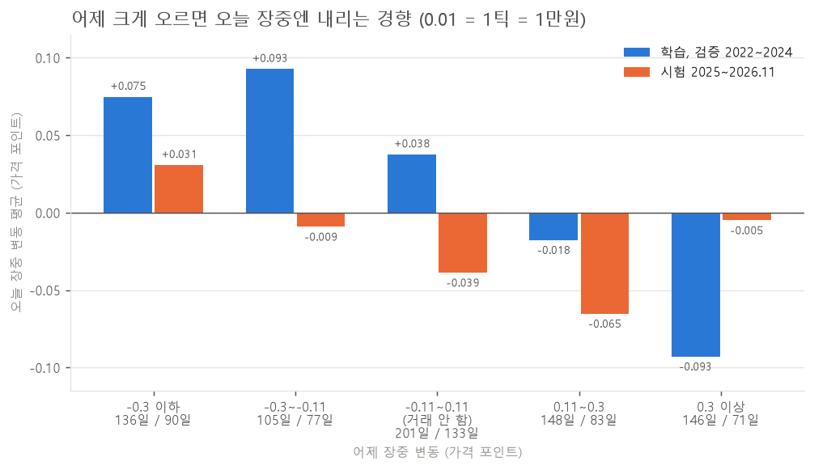
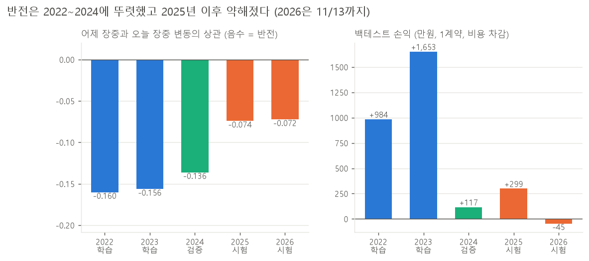
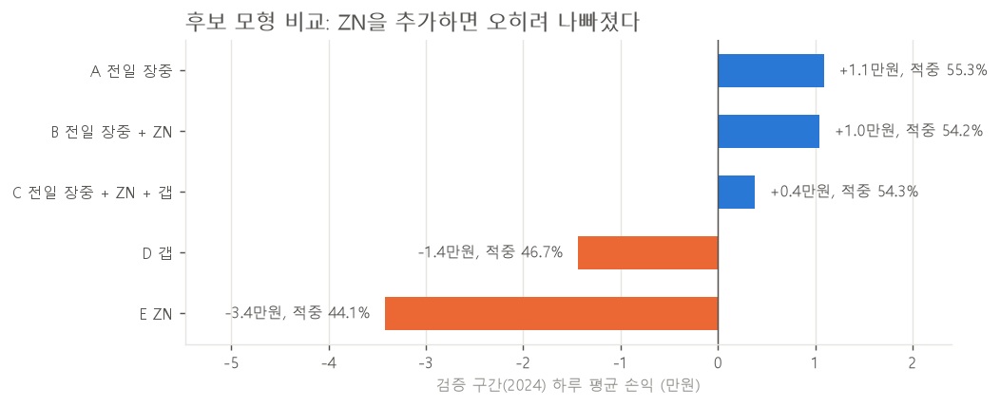
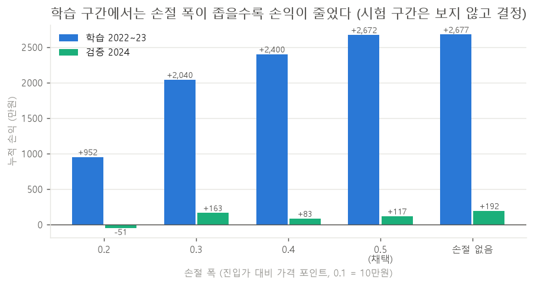
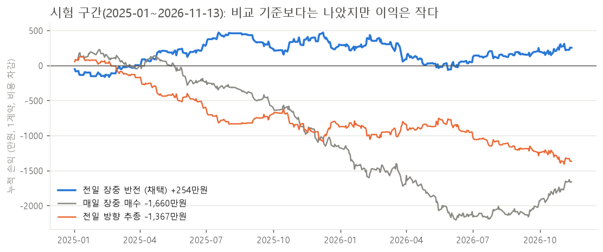
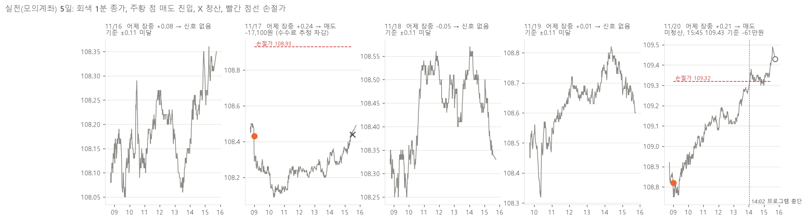

# 5주차 데이터 기반 전략: 미국 금리 선행 가설 검증과 10년 국채선물 전일 장중 반전

**제출일: 2026/11/20(금) 23:59**

| 항목 | 내용 |
| --- | --- |
| 대상 | KRX 10년 국채선물 2026년 12월물 `A676C000`(주문), CME 미국 10년 국채선물 `ZNZ26`(분석) |
| 처음 세운 가설 | 미국 금리의 밤사이 변동이 다음 날 한국 국채선물의 장중 변동을 예측한다 → **기각** |
| 채택한 신호 | 데이터에서 발견한 **전일 장중 반전**. 어제 장중에 0.11 이상 움직였으면 오늘 09:00에 반대 방향으로 1계약 진입, 15:30 청산 |
| 백테스트 (시험 구간) | 2025-01\~2026-11-13, 327회, **+253.8만원**. 통계적으로 유의하지 않다(t = 0.45) |
| 실전 (모의계좌) | 11/16\~11/20 실행(11/17부터 작업 스케줄러 자동 실행). 신호 2회(11/17 -16,920원, 11/20 미청산 -613,460원) |

## 1. 과제 개요

시세 데이터를 수집, 분석해 신호를 만들고, 그 신호가 쓸 만한지 검증하는 과제다. 팀 관심 분야인 금리 예측과 연결해 **미국 금리 변동으로 다음 날 한국 국채선물 방향을 예측할 수 있는지** 확인했다.

결과를 보고 규칙을 선택하는 일을 막으려고 기간을 셋으로 나누고, 규칙은 학습과 검증 구간만으로 정했다. 시험 구간은 규칙을 확정한 뒤(11/16, [strategy.py](strategy.py)) 한 번만 계산했다.

| 구간 | 기간 | 용도 |
| --- | --- | --- |
| 학습 | 2022\~2023 (492일) | 계수 추정 |
| 검증 | 2024 (244일) | 후보 모형 선택, 손절 폭 결정 |
| 시험 | 2025-01\~2026-11-13 (454일) | 최종 확인 1회 |

## 2. 전략 설명

### 데이터

| 데이터 | API | 기간 |
| --- | --- | --- |
| 한국 10년 국채선물(KTB10) 연결 일봉 | `domestic/chart-daily` | 2021-12-27\~2026-11-16 (1,192일) |
| 미국 10년 국채선물(ZN) 연결 일봉 | `overseas/chart-daily` | 1998\~2026-11-16 |
| KTB10, ZN 1분봉 | `domestic/chart-minute`, `overseas/chart-minute` | 2026-09\~11 |

API가 한 번에 주는 봉 수가 제한되어 여러 번 나눠 받고, 같은 시각의 봉은 하나만 남겼다([fetch_data.py](fetch_data.py)). 월물이 바뀌는 날의 가격 차이는 시장 변동이 아니므로 분석에서 제외했다.

### 가설 검증: 미국 금리는 시가에만 반영된다


ZN이 1포인트 오른 다음 날 KTB10은 평균 0.56포인트 높게 시작했다(왼쪽, R² 0.57). 하지만 09:00 이후 장중 변동과는 관계가 없었다(오른쪽, R² 0.008). 미국 정보는 한국 장이 열리는 순간 가격에 이미 반영된다.


장중 1분봉으로 봐도 두 시장은 같은 봉에서만 함께 움직였다. ZN이 먼저 움직이고 KTB10이 따라가는 시차는 없었다. 그래서 처음 세운 가설은 기각했다.

### 데이터에서 발견한 신호: 전일 장중 반전

가설을 검증하는 과정에서, 어제 장중에 오른 날은 오늘 장중에 내리는 경향을 발견했다. 2022\~2024 회귀 계수는 **-0.155**(t = -4.25)다. 어제 장중 1포인트 상승했으면 오늘 장중 평균 0.155포인트 하락한다는 뜻이다.





반전은 2022\~2024 세 해 모두 비슷한 크기로 나타났다. 시험 구간인 2025년 이후에는 상관이 절반 수준으로 약해졌다(6절).

### 후보 모형 비교



학습 구간으로 계수를 추정하고 검증 구간(2024)에서 비교했다. ZN이나 시가 갭을 설명변수로 추가하면 오히려 성과가 나빠져, **가장 단순한 A(전일 장중만 사용)**를 채택했다.

## 3. 매매 로직

| 항목 | 규칙 | 근거 |
| --- | --- | --- |
| 신호 | 어제 장중 변동 = 어제 종가 - 어제 시가 | 2절 |
| 방향 | 어제 상승이면 매도, 하락이면 매수 | 계수 -0.155 |
| 진입 기준 | \|어제 장중 변동\| ≥ 0.11 | 예상 이익(0.155 × 변동)이 왕복 비용 17,100원보다 큰 날만 거래 |
| 진입 / 청산 | 09:00 시장가 / 15:30 시장가, 1계약 | 모의계좌 운영 시작, 15:35 종가 단일가 전 청산 |
| 손절 | 진입가 대비 0.5 불리 (50만원) | 아래 차트 |



반전 신호는 장중에 불리하게 움직였다가 마감 무렵 회복하는 날이 많아, 손절 폭이 좁으면 회복 전에 손절된다. 0.5는 학습 구간 손익이 손절 없음보다 5만원 적을 뿐이고(+2,672만 vs +2,677만원), 하루 손실을 50만원으로 제한한다.

**실행 흐름** ([live.py](live.py), 작업 스케줄러가 평일 08:50 [run_live.bat](run_live.bat) 실행)

```
08:50  어제 일봉으로 방향 계산. 계좌 잔고와 기록 파일(live_state.json)이 다르면 주문하지 않고 종료
09:00  시장가 진입 → 체결 확인
매 분   현재가 조회 → 손절가 도달 시 청산
15:30  시장가 청산 → 계좌 조회 창 표시 (screenshots/ 캡처용)
```

## 4. API 활용

| API | 용도 |
| --- | --- |
| `domestic/chart-daily`, `overseas/chart-daily` | 분석용 연결 일봉, 실전 신호용 전일 일봉 |
| `domestic/chart-minute`, `overseas/chart-minute` | 장중 시차 분석, 실전 차트 |
| `domestic/price` | 실전 1분 시세, 손절 판정 |
| `domestic/order`, `order-history`, `open-interest`, `deposit` | 주문, 체결 확인, 잔고 대조, 예수금 조회 |

API 클라이언트는 2주차 [nh.py](../week02/nh.py)와 3주차 [nh_os.py](../week03/nh_os.py)를 그대로 사용했다(토큰 재사용, 호출 간격, 재시도, 실계좌 주문 차단). 요청과 응답 원본은 모두 `results/api_log/`에 남는다.

## 5. 실행 결과

### 백테스트 (일봉, 시가 진입과 종가 청산, 1계약, 비용 차감)

| 구간 | 거래 | 적중률 | 손익 | 최대 낙폭 |
| --- | --- | --- | --- | --- |
| 학습 2022\~2023 | 396 | 57.1% | +2,671.8만원 | -401.9만원 |
| 검증 2024 | 159 | 54.7% | +117.1만원 | -316.0만원 |
| **시험 2025\~2026.11** | **327** | **51.7%** | **+253.8만원** | **-535.2만원** |




시험 구간에는 국채선물 가격이 장중에 내리는 날이 많아, 매일 매수하거나 어제 방향을 따라가면 1,300만원 넘게 손실이었다. 반전 규칙은 매수와 매도 신호가 비슷한 횟수로 발생해(170회, 157회) 이 하락의 영향을 적게 받았지만, 이익 자체는 작았다.

실전과 같은 시각(09:00 진입, 15:30 청산)으로 1분봉이 있는 34일을 재계산하면 +40.9만원으로, 일봉 기준(+63.9만원)과 날짜별 손익 방향이 31일 일치했다.

### 실전 (모의계좌)



| 날짜 | 어제 장중 | 신호 | 진입 | 청산 | 손익 (수수료 포함) |
| --- | --- | --- | --- | --- | --- |
| 11/16 | +0.08 | 없음 | | | 0원 |
| 11/17 | +0.24 | 매도 | 09:00, 108.43 | 15:30, 108.44 | -16,920원 |
| 11/18 | -0.05 | 없음 | | | 0원 |
| 11/19 | +0.01 | 없음 | | | 0원 |
| 11/20 | +0.21 | 매도 | 09:00, 108.82 | **미청산** | -613,460원 (정산가 109.43 기준, 미확정) |

- **11/17**: 오전에 평가이익이 최대 34만원까지 났지만 오후에 가격이 회복해 1틱 손실로 청산했다. 주문 2건 모두 직전 호가에 즉시 체결됐다.
- **11/20**: 14:02에 실행 프로그램이 종료되어 손절과 15:30 청산이 실행되지 않았다. 오류 기록이 없어 실행 창이 외부에서 닫힌 것으로 추정한다. 프로그램이 동작했다면 14:03 전후 손절가(109.32)에서 약 50만원 손실로 청산했을 것이다. 남은 1계약은 11/23(월) 08:50 자동 실행에서 청산한다(`live.py`가 전일 보유분을 먼저 정리).

## 6. 결과 분석

1. **미국 금리 정보는 한국 장이 열릴 때 이미 가격에 들어 있다.** 시가 갭은 57% 설명하지만 장중 변동은 설명하지 못한다. 미국 금리를 보고 장중에 거래할 여지는 없었다.
2. **전일 장중 반전은 약해졌다.** 계수가 학습 구간 -0.155에서 시험 구간 -0.072로 절반이 되었고, 시험 구간 이익(+254만원)은 0과 통계적으로 구분되지 않는다(t = 0.45). 2026년만 보면 -45만원이다.
3. **기간을 나누지 않았다면 성과를 과대평가했을 것이다.** 2022\~2026 전체 이익(+3,043만원)의 88%가 학습 구간에서 발생했다.
4. **실전 5일로는 성과를 판단할 수 없다.** 11/17에는 진입부터 청산까지 사람 개입 없이 동작했다. 11/20에는 프로그램 자체가 꺼지는 경우를 감지하지 못하는 문제를 확인했다(7절).

최종 프로젝트에서는 반전이 생기는 원인(장 마감 무렵 주문 흐름, 투자자별 매매동향 `trend-investor`)을 조사한다.

## 7. 오류 제보와 개선 사항

| 번호 | API | 현상 | 상태 |
| --- | --- | --- | --- |
| 1 | `overseas/price` | 종목 2개를 요청하면 HTTP 200과 빈 본문이 반환된다 | **11/16 제보**. 답변: 1종목만 지원, 명세 확인 예정 |
| 2 | `overseas/deposit` | 선택 항목 `biz_dt`를 빈 문자열로 보내면 HTTP 400 `ETR018` | **11/16 제보**. 답변: 의도된 동작, 키를 빼고 보내야 함 |
| 3 | `domestic/deposit` | 손실이 난 다음 영업일에도 시작예탁금과 주문가능금액이 1억원으로 돌아간다 | 제보 초안 작성 ([오류제보_초안.md](오류제보_초안.md)) |
| 4 | `domestic/order-history` | 11/20 09:00에 체결된 주문이 같은 날 19:34 조회에서 0건으로 나온다(11/17 16:58 조회는 정상) | 미제보, 조회 가능 시간 확인 필요 |
| 5 | `domestic/chart-daily` | `fut_cidx_exp_mod`(만기 보정)를 1로 줘도 0과 응답이 같다 | 미제보 |

1, 2번은 [repro_errors.py](repro_errors.py)로 재현했다.

**개선 사항**
- `run_live.bat`은 프로그램이 오류로 종료되면 재실행하지만, 11/20처럼 실행 창 자체가 닫히면 재실행하지 못한다. 실행 기록이 몇 분 이상 끊기면 프로그램을 재실행하는 감시 작업을 검토한다. `live.py`는 시작할 때 계좌 잔고를 읽어 보유 포지션을 이어서 관리하므로 재실행만 하면 된다.
- 일봉 백테스트는 하루 안에서 손절가와 종가 중 무엇이 먼저였는지 알 수 없어, 손절가에 닿은 날은 모두 손절로 계산했다(보수적 가정).

## 8. 소스코드

| 파일 | 내용 |
| --- | --- |
| [fetch_data.py](fetch_data.py) | 일봉, 1분봉 수집과 중복 제거 |
| [analysis.py](analysis.py) | 가설 회귀, 장중 반전, 시차 상관, 후보 모형 비교 (시험 구간 사용 안 함) |
| [strategy.py](strategy.py) | 확정 규칙. 백테스트와 실전이 같은 함수 사용 |
| [backtest.py](backtest.py) | 일봉 백테스트, 손절 폭 비교, 1분봉 실전 시각 비교 |
| [live.py](live.py) | 모의계좌 실행 (`--dry` 주문 없이 신호만) |
| [run_live.bat](run_live.bat) | 작업 스케줄러 실행용 |
| [show_account.py](show_account.py) | 체결내역, 잔고, 예수금 조회 (주문 없음) |
| [plot_analysis.py](plot_analysis.py) | README 차트 9장 (`results/fig_*.png`) |

```bash
pip install pandas numpy scipy statsmodels matplotlib
# 저장소 루트 .env: NH_DOMESTIC_APP_KEY, NH_DOMESTIC_APP_SECRET, NH_OVERSEAS_APP_KEY, NH_OVERSEAS_APP_SECRET (NH_ENV=paper)
cd week05
python fetch_data.py daily                      # 연결 일봉
python fetch_data.py ktb 2026-11-16 2026-11-20  # KTB10 1분봉
python analysis.py
python backtest.py
python plot_analysis.py
python live.py --dry
```

**screenshots/**: 매일 장 마감 후 계좌 조회 화면(`account_YYYYMMDD.png`). 11/20 화면은 미청산 매도 1계약과 정산차금 -610,000원을 보여 준다. 진입 체결은 조회되지 않아(7절 4번) `results/live_20261120.jsonl`의 주문 응답으로 대신한다.

외부 코드: 없음. 회귀는 statsmodels OLS(HAC 표준오차), 검정은 scipy를 사용했다.

## 출처

- NH선물 REST API 개발자센터 <https://apidev.futures.co.kr/>: API 명세
- 한국거래소 국채선물 상품 명세: 최종거래일 결제월 셋째 화요일 (월물 교체일)
- 거래 비용(호가 1틱 + 수수료 0.00329%)은 4주차 11/09 수동 왕복 주문 실측값
- 모의 국내 운영 시간 09:00\~15:45: 5주차 과제 공지

[전체 일정으로](../README.md)
