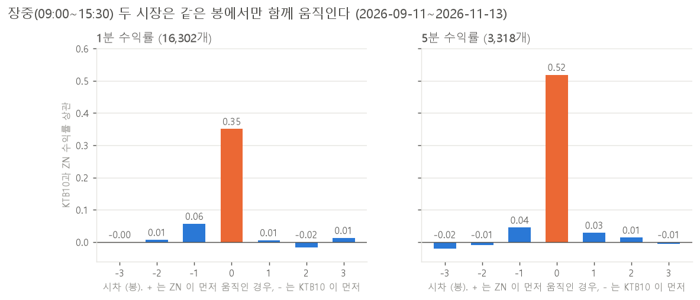
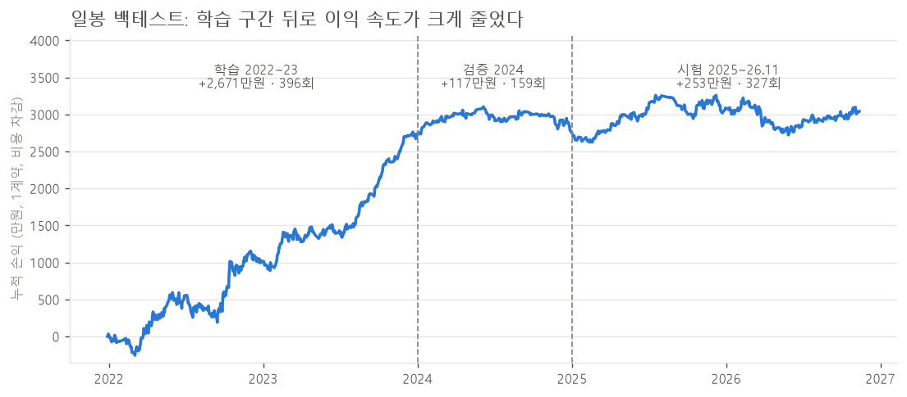

# 5주차 데이터 기반 전략: 미국 금리 선행 가설 검증과 10년 국채선물 전일 장중 반전

**제출일: 2026/11/20(금) 23:59**

## 요약

| 항목 | 내용 |
| --- | --- |
| 대상 | KRX 10년 국채선물 2026년 12월물 `A676C000`(신호와 주문), CME 미국 10년 국채선물 `ZNZ26`(분석) |
| 처음 세운 가설 | 미국 10년 금리의 밤사이 변동이 다음 날 한국 10년 국채선물의 장중 변동을 예측한다 → **기각** |
| 검증 결과 | 미국 변동은 다음 날 **시가 갭의 57%를 설명**했지만(R² 0.57), 개장 후 장중 변동은 설명하지 못했다(R² 0.008) |
| 채택한 신호 | 데이터에서 발견한 **전일 장중 반전**: 오늘 장중 변동 = -0.155 × 어제 장중 변동 (2022\~2024, t = -4.25). 어제 장중 변동이 ±0.11 이상이면 반대 방향으로 1계약, 09:00 진입, 15:30 청산, 손절 0.5 |
| 백테스트 (시험 구간) | 2025-01-02\~2026-11-13, 327회, 승률 51.7%, 비용 차감 +2,538,300원. 통계적으로 유의하지 않다(t = 0.45) |
| 실전 (모의계좌) | 작업 스케줄러로 11/17\~11/20 평일 08:50 자동 실행. 11/17 매도 1계약 -16,920원, 11/18 신호 없음 |

## 1. 과제 개요

과제는 시세 데이터를 수집, 가공, 분석해 신호를 만드는 것이다. 팀 관심 분야인 금리 예측과 연결해, 미국 금리 정보로 한국 국채선물 방향을 예측할 수 있는지를 검증했다. 한국 장이 닫힌 뒤 미국 장이 열리므로 미국의 밤사이 금리 변동은 다음 날 한국 시장에 반영된다. 검증할 내용은 이 반영이 시가에서 완료되는지, 장중까지 이어지는지다. 시가에서 완료된다면 모의계좌가 열리는 09:00 이후에는 거래할 정보가 남아 있지 않다.

1. 미국 10년 국채선물(ZN)과 한국 10년 국채선물(KTB10)의 일봉과 1분봉을 수집하고 품질을 점검한다.
2. 신호와 규칙은 **2022\~2024년 데이터로만** 정하고, 2025년 이후 데이터는 규칙을 확정한 뒤 한 번만 확인한다.
3. 확정한 규칙을 모의계좌에서 자동 실행한다.

| 구간 | 기간 | 용도 | 일수 |
| --- | --- | --- | --- |
| 학습 | 2022-01-01\~2023-12-31 | 계수 추정 | 492 |
| 검증 | 2024-01-01\~2024-12-31 | 후보 모형 선택 | 244 |
| 시험 | 2025-01-01\~2026-11-13 | 규칙 확정 후 1회 확인 | 454 |

기간 구분은 손익을 보기 전(11/16)에 정했고, 규칙은 같은 날 10:35에 [strategy.py](strategy.py)로 확정했다.

## 2. 전략 설명

### 데이터

| 데이터 | API | 기간 | 개수 |
| --- | --- | --- | --- |
| KTB10 연결 일봉 | `domestic/chart-daily` `cidx_yn=1` | 2021-12-27\~2026-11-16 | 1,192일 |
| ZN 연결 일봉 | `overseas/chart-daily` `cidx_yn=1` | 1998-09-28\~2026-11-16 | 7,024일 (2022-06\~2023-01 결측) |
| ZN 12월물 1분봉 | `overseas/chart-minute` | 2026-03-30\~11-16 | 85,637개 |
| KTB10 12월물 1분봉 | `domestic/chart-minute` | 2026-09-11\~11-13 | 42일 |

- 봉 수 제한 때문에 나눠 받아 이어 붙이고, 같은 시각의 봉은 나중에 받은 값으로 중복을 제거했다([fetch_data.py](fetch_data.py) `load_minute`).
- 품질 점검: 시가나 종가가 고가와 저가 범위 밖인 날 0일. 1분봉으로 재구성한 일봉은 42일 중 39일이 API 일봉과 일치했다. 불일치 3일은 연결 일봉이 9월물 만기일(9/15)까지 9월물 가격을 쓰기 때문이다.
- 월물 교체일의 밤사이 갭은 가격 변동이 아니므로 제외했다. ZN 마지막 봉이 4일보다 오래된 날(미국 휴일, 결측 구간)은 ZN 값을 쓰지 않았다.

### 가설 1 (채택): 미국 밤사이 변동이 KTB10 시가 갭을 설명한다
### 가설 2 (기각): 미국 정보가 장중 변동까지 예측한다

KTB10의 밤사이 갭과 장중 변동을 각각 직전 ZN 일간 변동으로 회귀했다(2022\~2024, 574일, HAC 표준오차).

| 종속변수 | ZN 계수 | t | R² |
| --- | --- | --- | --- |
| KTB10 밤사이 갭 (전일 종가 → 시가) | 0.557 | 17.59 | 0.568 |
| KTB10 장중 변동 (시가 → 종가) | -0.063 | -2.07 | 0.008 |


ZN이 1포인트 오른 다음 날 KTB10은 평균 0.56포인트 높게 시작했다. 장중 변동의 계수는 음수이고 R²는 0.008이어서, 미국 정보가 장중까지 이어진다는 가설과 반대다. 갭을 미국으로 설명되는 부분과 나머지로 구분해 회귀해도 두 계수 모두 5% 수준에서 유의하지 않았다.

1분봉으로도 확인했다(9/11\~11/13). 장중 KTB10과 ZN의 수익률 상관은 같은 봉에서만 높았고(1분 0.351, 5분 0.519), 한 봉 이상 시차를 두면 0.06 이하였다. ZN을 보고 다음 봉 KTB10을 거래할 여지는 확인되지 않았다.



### 데이터에서 발견한 신호: 전일 장중 반전

가설 2를 검증하면서 오늘 장중 변동과 어제 장중 변동의 상관이 음수라는 것을 발견했다. 2022년 -0.160, 2023년 -0.156, 2024년 -0.136이고, 변동성이 높은 날(-0.164)과 낮은 날(-0.174)에도 음수였다. 어제 장중에 1포인트 상승했다면 오늘 장중에는 평균 0.16포인트 하락했다. 원인은 이번 주에 조사하지 않았다.


**후보 모형 비교** (2022\~2023으로 추정, 2024에서 비교, 매일 1계약 시가 진입과 종가 청산, 비용 17,100원 차감)

| 모형 | 설명변수 | 검증 적중률 | 검증 하루 평균 |
| --- | --- | --- | --- |
| **A** | **전일 장중** | **55.3%** | **+10,892원** |
| B | 전일 장중, ZN | 54.2% | +10,442원 |
| C | 전일 장중, ZN, 갭 | 54.3% | +3,805원 |
| D | 갭 | 46.7% | -14,392원 |
| E | ZN | 44.1% | -34,219원 |

ZN을 추가하면 성과가 감소했다. 가장 단순한 A를 채택하고, 계수는 2022\~2024 전체로 재추정했다(**-0.155, t = -4.25**).

## 3. 매매 로직

| 항목 | 값 | 근거 |
| --- | --- | --- |
| 신호 | 어제 장중 변동 = 어제 종가 - 어제 시가 (12월물 일봉) | 2절 |
| 방향 | 어제 상승이면 매도, 하락이면 매수 | 계수 -0.155 |
| 진입 기준 | \|어제 장중 변동\| ≥ 0.11 | 예상 이익 0.155 × \|변동\|이 왕복 비용 0.0171 이상인 날만 거래 |
| 진입 / 청산 | 09:00 시장가 1계약 / 15:30 시장가 | 모의 국내 운영 시작 시각, 15:35부터 종가 단일가 |
| 손절 | 진입가 대비 0.50 불리 (50만원) | 아래 |
| 왕복 비용 | 17,100원 | 호가 넘기 1틱 10,000원 + 수수료 (4주차 11/09 실측) |

**손절 폭.** 학습, 검증 구간에서 0.2\~0.5를 비교했다. 반전 신호는 장중에 불리하게 움직였다가 종가 무렵 회복하는 날이 많아, 손절 폭이 좁을수록 손익이 감소했다. 0.5는 학습 손익이 손절 없음(+26,768,400원)과 5만원 차이이고, 장중 고가와 저가 차이의 중앙값(0.51)과 같다. 하루 최대 손실을 약 50만원으로 제한하는 용도다.

**실행 흐름** ([live.py](live.py))

1. 08:50 작업 스케줄러 `NH_reversal`이 [run_live.bat](run_live.bat)을 실행한다.
2. 전일 일봉으로 방향을 계산하고, 브로커 잔고와 `results/live_state.json`이 다르면 주문하지 않고 종료한다.
3. 09:00 시장가 진입 후 체결을 최대 60초 확인한다. 미체결 잔량이 남으면 중단한다.
4. 1분마다 현재가를 조회해 손절가에 도달하면 청산하고, 15:30에 시장가로 청산한다.
5. 시세, 신호, 주문, 체결을 `results/live_YYYYMMDD.jsonl`에 기록하고, [show_account.py](show_account.py)로 당일 체결내역, 잔고, 예수금을 조회한다.

오류로 종료되면 1분 간격으로 최대 5회 재실행한다. 재시작 시 보유가 있으면 손절과 청산만 처리하고, 09:15 이후에는 새로 진입하지 않는다.

## 4. API 활용

| API | 용도 |
| --- | --- |
| `domestic/chart-daily` | KTB10 연결 일봉(분석), 12월물 전일 일봉(실전 신호) |
| `domestic/chart-minute`, `overseas/chart-minute` | KTB10, ZN 1분봉 (ZN은 한 페이지 495봉, 174페이지) |
| `overseas/chart-daily` | ZN 연결 일봉 (`nxt_key`로 페이지 이동) |
| `domestic/price` | 실전 1분 시세, 손절 판정 |
| `domestic/order`, `order-history`, `open-interest`, `deposit` | 시장가 주문, 체결 확인, 잔고 대조, 예수금 조회 |

클라이언트는 2주차 [nh.py](../week02/nh.py)(토큰 재사용, 호출 간격, 재시도, 응답 로그, 실전 서버 주문 차단)와 3주차 [nh_os.py](../week03/nh_os.py)를 그대로 사용했다. 모든 요청과 응답 원본은 `results/api_log/`에 기록된다. 11/17 실전에서는 402회 중 401회가 첫 요청에 성공했고, 1회는 토큰 만료(7절 3번)로 재발급 후 0.4초 뒤 성공했다.

## 5. 실행 결과

### 백테스트 (일봉 시뮬레이션, 시가 진입과 종가 청산)

| 구간 | 거래 | 적중률 | 비용 차감 손익 | 거래당 | 연환산 샤프 | 최대 낙폭 |
| --- | --- | --- | --- | --- | --- | --- |
| 학습 2022\~2023 | 396 | 57.1% | +26,718,400원 | +67,470원 | 2.19 | -4,018,900원 |
| 검증 2024 | 159 | 54.7% | +1,171,100원 | +7,365원 | 0.38 | -3,160,300원 |
| **시험 2025\~2026.11** | **327** | **51.7%** | **+2,538,300원** | **+7,762원** | **0.33** | **-5,352,100원** |



- 비교 기준(시험 구간, 같은 비용): 매일 장중 매수 -16,603,400원, 전일 방향 추종 -13,671,699원.
- 1분봉이 있는 기간에 신호가 발생한 34일을 실전 시각(09:00 진입, 15:30 청산)으로 재계산하면 +408,600원이다. 일봉 기준(+638,600원)과 하루 손익 부호가 31일 일치했다(상관 0.928).

### 실전 (모의계좌)

| 날짜 | 전일 장중 변동 | 신호 | 진입 | 청산 | 가격 손익 | 수수료 | 합계 |
| --- | --- | --- | --- | --- | --- | --- | --- |
| 11/16 | +0.08 | 기준 미달 | | | | | 0원 |
| 11/17 | +0.24 | 매도 | 09:00:03, 108.43 | 15:30:01, 108.44 | -10,000원 | 6,920원 | -16,920원 |
| 11/18 | -0.05 | 기준 미달 | | | | | 0원 |
| 11/19 | (실행 후 기록) | | | | | | |
| 11/20 | (실행 후 기록) | | | | | | |

**11/17.** 시장가 주문 2건이 직전 호가에 즉시 체결되어 슬리피지가 없었다. 10:18에 108.09까지 하락해 평가이익이 최대 34만원이었으나 오후에 상승해 1틱 손실로 청산했다. 장중 이익 실현 규칙은 학습, 검증 구간에서 비교하지 않았으므로 추가하지 않았다. 손익과 수수료는 장 마감 후 예수금 조회 값과 일치한다(`results/account_*.json`, `screenshots/`).

**11/18.** 신호가 기준에 미달해 09:00:02에 주문 없이 종료했다. 종료 직후 계좌 조회가 오류(7절 6번)로 실패해 16:48에 수동으로 재조회하고 캡처했다.

## 6. 결과 분석

1. **미국 금리 정보는 한국 시장 개장 시점에 이미 가격에 반영되어 있다.** 시가 갭의 57%를 설명하지만 09:00 이후 장중 변동은 설명하지 못했다. 처음 세운 가설은 기각했다.
2. **전일 장중 반전은 학습 구간에서 뚜렷했지만 이후 약해졌다.** 계수는 -0.155에서 시험 구간 -0.072(t = -1.61)로 절반이 되었다. 시험 구간 이익(+254만원)은 0과 통계적으로 구분되지 않고(t = 0.45, 적중률 이항검정 p = 0.58), 2026년만 보면 -451,500원이다.
3. **기간을 나누지 않았다면 결과를 과대평가했을 것이다.** 2022\~2026 전체 누적 손익 약 +3,043만원 중 88%(2,672만원)가 학습 구간에서 발생했다.
4. **비교 기준보다는 나았다.** 시험 구간의 장중 하락 추세에서 매일 매수와 전일 추종은 각각 -1,660만원, -1,367만원이었고, 반전 규칙은 매수 170회, 매도 157회로 한쪽 방향 노출이 작았다.
5. **실전 4일로는 성과를 판단할 수 없다.** 전략 평가는 백테스트 시험 구간을 기준으로 한다. 실전에서는 자동 실행, 진입, 1분 점검, 청산, 잔고 대조가 사람 개입 없이 동작하는 것을 확인했다.

최종 프로젝트에서는 장중 반전의 원인(마감 무렵 주문 흐름, 투자자별 매매동향 `trend-investor`)을 조사하는 방향을 검토한다.

## 7. 오류 제보와 개선 사항

| 번호 | API | 현상 | 상태 |
| --- | --- | --- | --- |
| 1 | `domestic/chart-daily` | `fut_cidx_exp_mod`(연속선물 만기수정)를 1로 주어도 0과 응답이 동일하다(1,192일 종가 모두 일치) | 미제보, 모의 서버 미지원 여부 확인 필요 |
| 2 | `overseas/chart-minute` | 조회 시작일 `inq_strt_dt`=20261029가 적용되지 않고 2026-03-30부터 반환된다 | 미제보 |
| 3 | 공통(토큰) | 발급 10분 뒤 HTTP 401 `EGW052`(토큰 재발급 필요). 재발급 후 정상 | 미제보, 클라이언트가 자동 재발급해 주문 영향 없음 |
| 4 | `overseas/price` | 종목 2개를 요청하면 오류 코드 없이 HTTP 200과 빈 본문이 반환된다 | **11/16 Discord 제보**, 답변 대기 |
| 5 | `overseas/deposit` | 필수가 아닌 `biz_dt`를 빈 문자열로 보내면 HTTP 400 `ETR018` | **11/16 Discord 제보**, 답변 대기 |
| 6 | `domestic/order-history` | 11/18 09:00:03 HTTP 400 `EGW009`(계좌번호 오류). 같은 요청을 16:47에 재전송하자 정상 | 미제보 |
| 7 | `domestic/deposit` | 11/18 조회에서 전일 손익이 반영되지 않고 주문가능금액이 1억원으로 복귀 | 미제보, 모의계좌 일일 초기화 여부 확인 필요 |

4, 5번은 [repro_errors.py](repro_errors.py)로 재현했고 제보 본문은 [오류제보_초안.md](오류제보_초안.md)에 있다. 나머지는 재현 조건을 확인하지 못해 제보하지 않았다.

**개선 사항**
- `show_account.py`가 조회 실패 시 10초 간격으로 최대 3회 재조회하도록 수정했다(6번 대응). 계좌 조회 창이 화면에 표시되도록 작업 스케줄러를 "사용자가 로그온할 때만 실행"으로 변경해야 한다.
- 일봉 백테스트는 손절가 도달 순서를 알 수 없어 손절가보다 1틱 불리하게 청산한 것으로 보수적으로 계산했다. 1분봉 기간을 늘리면 실제 순서로 재계산할 수 있다.

## 8. 소스코드

| 파일 | 내용 |
| --- | --- |
| [fetch_data.py](fetch_data.py) | 일봉, 1분봉 수집과 중복 제거 |
| [analysis.py](analysis.py) | 품질 점검, 가설 회귀, 장중 반전, 시차 상관, 후보 모형 비교 (시험 구간 미사용) |
| [strategy.py](strategy.py) | 확정 규칙과 상수. 백테스트와 실전이 같은 함수 사용 |
| [backtest.py](backtest.py) | 일봉 백테스트, 손절 폭 비교(`--stops`), 실전 시각 1분봉 비교 |
| [live.py](live.py) | 모의계좌 실행. `--dry` 주문 없음, `--yes` 확인 입력 없음 |
| [run_live.bat](run_live.bat) | 작업 스케줄러용. 오류 시 최대 5회 재실행, 종료 후 계좌 조회 |
| [show_account.py](show_account.py) | 당일 체결내역, 잔고, 예수금 조회 (`screenshots/` 캡처용, 주문 없음) |
| [plot_analysis.py](plot_analysis.py) | README 차트 (`results/fig_*.png`) |
| [repro_errors.py](repro_errors.py) | 7절 4, 5번 재현 (주문 없음) |

```bash
pip install pandas numpy scipy statsmodels matplotlib
# 저장소 루트 .env: NH_DOMESTIC_APP_KEY, NH_DOMESTIC_APP_SECRET, NH_OVERSEAS_APP_KEY, NH_OVERSEAS_APP_SECRET (NH_ENV=paper)

cd week05
python fetch_data.py daily                      # KTB10, ZN 연결 일봉
python fetch_data.py zn 2026-10-29              # ZN 1분봉 (36MB, 저장소에는 11/13 샘플만)
python fetch_data.py ktb 2026-11-13 2026-11-13  # KTB10 1분봉 (9/11~11/12는 week04/results 사용)
python analysis.py
python backtest.py --stops                      # 손절 폭 비교 (학습, 검증만)
python backtest.py
python plot_analysis.py
python live.py --dry                            # 주문 없이 신호만
```

작업 스케줄러 등록: `schtasks /Create /TN "NH_reversal" /TR "<경로>\week05\run_live.bat" /SC WEEKLY /D MON,TUE,WED,THU,FRI /ST 08:50`

**screenshots/**: 장 마감 후 `show_account.py` 조회 화면. 당일 주문내역 API는 지난 날짜를 조회할 수 없어 그날 캡처했다.
- `account_20261117.png`: 주문 33(매도 108.43), 897(매수 108.44) 체결, 잔고 없음, 수수료 6,920원
- `account_20261118.png`: 주문 0건, 잔고 없음, 주문가능금액 100,000,000원

외부 코드: 없음. 회귀는 statsmodels OLS(HAC 표준오차, 시차 5), 이항검정은 scipy를 사용했다. 운영진 [nh-futures-open-api](https://github.com/PetterChanHyuk/nh-futures-open-api) 코드는 사용하지 않았다.

## 출처

- NH선물 REST API 개발자센터 <https://apidev.futures.co.kr/>: `domestic/chart-daily` 명세의 `cidx_yn`, `fut_cidx_exp_mod`, `req_qty`
- 한국거래소 국채선물 상품 명세: 최종거래일 결제월 셋째 화요일 (월물 교체일)
- 비용(호가 넘기 1틱, 수수료 0.00329%)은 4주차 11/09 수동 왕복 주문 실측값
- 모의 국내 운영 시간 09:00\~15:45: 5주차 과제 공지

[전체 일정으로](../README.md)
