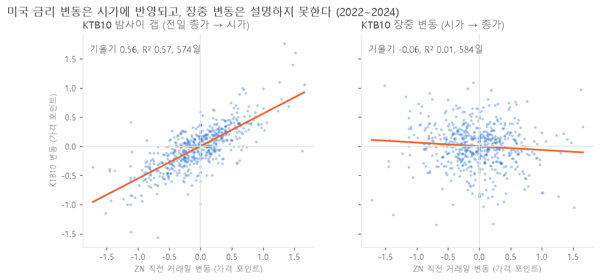

# 5주차 데이터 기반 전략: 미국 금리 선행 가설 검증과 10년 국채선물 전일 장중 반전

**제출일: 2026/11/20(금) 23:59**

| 항목 | 내용 |
| --- | --- |
| 대상 | KRX 10년 국채선물 2026년 12월물 `A676C000` (신호와 주문). 미국 10년 국채선물 CME `ZNZ26`과 연결 일봉(분석) |
| 처음 세운 가설 | 미국 10년 금리의 밤사이 변동이 다음 날 한국 10년 국채선물의 장중 움직임을 예측한다 |
| 검증 결과 | 미국 변동은 다음 날 **시가 갭의 57%를 설명**하지만(R² 0.57), 개장 후 장중 변동은 예측하지 못했다(R² 0.008). 장중 1분, 5분 수익률에서도 어느 쪽도 먼저 움직이지 않았다 |
| 채택한 신호 | 데이터에서 발견한 **전일 장중 변동의 반전**. 오늘 장중 변동 = -0.155 × 어제 장중 변동 (2022\~2024, t = -4.25). 어제 장중 변동이 ±0.11 이상이면 반대 방향으로 09:00에 1계약 진입, 15:30 청산, 손절 0.5 |
| 실행 환경 | NH선물 **모의계좌 실제 주문**(11/16 작업 스케줄러 등록, 11/17\~11/20 평일 08:50 자동 실행). 백테스트는 일봉과 1분봉 시뮬레이션. 두 결과를 5절에 구분해 기술했다 |
| 백테스트 (시험 구간) | 2025-01-02\~2026-11-13, 327회, 승률 51.7%, 비용 차감 +2,538,300원. 학습 구간(2022\~2023) 대비 거래당 이익이 67,470원에서 7,762원으로 감소했고 통계적으로 유의하지 않다(t = 0.45) |
| 실전 결과 | 11/17: 매도 1계약, 진입 108.43(09:00:03) 청산 108.44(15:30:01), 가격 손익 -10,000원, 수수료 6,920원, 합계 -16,920원(예수금 조회). 주문 2건 모두 즉시 체결, 오류로 인한 중단 없음. 11/18\~11/20은 실행 후 기록 |

### 필수 기능과 구현 위치

| 과제 요구 | 이번 주에 한 것 | 코드 | 근거 파일 |
| --- | --- | --- | --- |
| 데이터 수집 | 국내 연결 일봉 1,192일, ZN 연결 일봉 7,024일, ZN 1분봉 85,637개, KTB10 1분봉 42일. 봉 수 제한 때문에 나눠 받아 이어 붙이고 시각 기준으로 중복 제거 | [fetch_data.py](fetch_data.py) `ktb_daily`, `ktb_minute`, `load_minute` | `results/daily_*.json`, `results/bars_*.json` |
| 데이터 가공 | 날짜별 표: 밤사이 갭, 장중 변동, 전일 장중 변동, 직전 ZN 변동. 월물 교체일과 ZN 결측 구간 표시 | [analysis.py](analysis.py) `build` | `results/daily_dataset.csv` |
| 데이터 품질 점검 | 시가와 종가가 고가, 저가 범위 밖인 날, 1분봉으로 재구성한 일봉과의 차이 | [analysis.py](analysis.py) `data_quality` | `results/analysis_summary.json` `quality` |
| 신호 검증 | 가설 회귀, 연도별, 변동성 국면별 확인, 시차 상관, 학습/검증/시험 분리 | [analysis.py](analysis.py), [backtest.py](backtest.py) | `results/analysis_summary.json`, `results/backtest_summary.json` |
| 신호와 주문 | 백테스트와 실전이 같은 함수 사용 | [strategy.py](strategy.py) `side`, `stopped`, [live.py](live.py) | `results/live_*.jsonl` |

## 1. 과제 개요

과제의 요구는 시세 데이터를 수집, 가공, 분석하고 그 결과로 신호를 만드는 것이다. 이번 주에는 팀 관심 분야인 금리 예측과 연결해, 미국 금리 정보로 한국 국채선물 방향을 예측할 수 있는지를 데이터로 검증했다.

한국 국채 금리는 미국 국채 금리를 따라 움직인다는 설명을 자주 접한다. 한국 장이 닫힌 뒤 미국 장이 열리므로, 미국에서 밤사이 일어난 금리 변동이 다음 날 한국 시장에 반영된다는 가설을 세울 수 있다. 검증할 내용은 이 반영이 개장 시가에서 완료되는지, 장중까지 이어지는지다. 시가에서 완료된다면 모의계좌가 열리는 09:00 이후에는 거래할 수 있는 정보가 남아 있지 않다.

목표는 다음 세 가지다.

1. 미국 10년 국채선물(ZN)과 한국 10년 국채선물(KTB10)의 일봉과 1분봉을 수집하고 품질을 점검한다.
2. 가설을 회귀로 검증하고, 채택할 신호와 규칙은 **2022\~2024년 데이터로만** 정한다. 2025년 이후 데이터는 규칙을 확정한 다음 한 번만 확인한다.
3. 확정한 규칙을 모의계좌에서 자동 실행한다.

### 진행 순서 (11/16)

| 시각 | 한 일 |
| --- | --- |
| 10:24 | 국내 일봉 API 조회. 연결 일봉이 2021-12-27부터 제공되는 것을 확인 |
| 10:25\~10:27 | KTB10 연결 일봉, ZN 연결 일봉, ZN 1분봉, KTB10 1분봉(11/13) 수집 |
| 10:2x | 기간 구분 확정: 학습 2022\~2023, 검증 2024, 시험 2025-01-01\~2026-11-13 |
| 10:2x\~10:33 | 학습, 검증 구간에서 가설 1, 2 검증. 가설 2 기각, 전일 장중 반전 발견. 후보 모형 5개를 검증 구간에서 비교 |
| 10:35 | 규칙 확정([strategy.py](strategy.py)): 계수 -0.155, 진입 기준 0.11, 손절 0.5. 손절 폭은 학습, 검증 구간만으로 비교 |
| 10:35 | 시험 구간 백테스트 1회 실행 |
| 10:37\~10:40 | [live.py](live.py) 주문 없는 시험 실행: 신호 계산, 진입, 1분 점검, 시간 청산, 손절 경로 |

### 대상 상품

| 항목 | KTB10 | ZN | 출처 |
| --- | --- | --- | --- |
| 종목 | 10년 국채선물 2026년 12월물 `A676C000` | 미국 10년 국채선물 2026년 12월물 `ZNZ26` | 4주차, 3주차 `price` 응답 |
| 승수, 호가 단위 | 1,000,000, 0.01 = 10,000원 | 액면 $100,000, 1/64 = $15.625 | 4주차, 3주차 README |
| 거래 시간 (한국 시간) | 08:45\~15:45 (모의 09:00\~15:45) | 08:00\~다음 날 07:00 (11/02부터 미국 표준시 기준) | 과제 공지, 3주차 `market-operations` |
| 이번 주 역할 | 신호와 주문 | 분석(가설 검증)에만 사용 | |

## 2. 전략 설명

### 데이터

| 데이터 | API | 기간 | 개수 | 비고 |
| --- | --- | --- | --- | --- |
| KTB10 연결 일봉 | `domestic/chart-daily` `cidx_yn=1` | 2021-12-27\~2026-11-16 | 1,192일 | 한 번 요청(최대 9,999건)으로 전부 수신 |
| ZN 연결 일봉 | `overseas/chart-daily` `cidx_yn=1` | 1998-09-28\~2026-11-16 | 7,024일 | 2022-06\~2023-01 결측(3주차 7절 5번, 운영진 답변 완료) |
| ZN 12월물 1분봉 | `overseas/chart-minute` | 2026-03-30\~11-16 10:26 | 85,637개 | 한 페이지 495개, 174회 호출 |
| KTB10 12월물 1분봉 | `domestic/chart-minute` | 2026-09-11\~11-13 | 42일 | 4주차 수집분 + 11/13 재수집. 하루 한 번씩 요청 |

1분봉은 4주차와 3주차에 받아 둔 파일과 이번 주 파일을 이어 붙였다. 같은 시각의 봉이 여러 파일에 있으면 나중에 받은 값을 남겼다([fetch_data.py](fetch_data.py) `load_minute`). 받은 시점에 진행 중이던 마지막 봉이 다음 수집의 완성본으로 대체된다.

**품질 점검** ([analysis.py](analysis.py) `data_quality`)

| 점검 | 결과 |
| --- | --- |
| KTB10 연결 일봉에서 시가나 종가가 고가와 저가 범위 밖인 날 | 0일 |
| 이웃한 두 일봉 사이 최대 간격 | 8일 (설, 추석 연휴) |
| 1분봉으로 재구성한 일봉과 API 일봉의 비교 (42일) | 39일은 시가, 고가, 저가, 종가 모두 일치. 불일치 3일(9/11, 9/14, 9/15)은 연결 일봉이 9월물 만기일(9/15)까지 9월물 가격을 쓰기 때문이다 |
| 1분봉 시각 | 날마다 첫 봉 08:45. ZN과 KTB10의 같은 봉 상관이 가장 높아(아래 표) 두 시세의 시각이 모두 한국 시간이라는 것을 확인 |

월물 교체일의 밤사이 갭은 가격 변동이 아니므로 제외했다. KTB10은 결제월 셋째 화요일 다음 거래일, ZN은 3주차와 같은 방법(교체 시기 창 안에서 갭이 가장 큰 날)으로 찾았다. 장중 변동(시가에서 종가)은 같은 월물 안의 변동이라 교체의 영향을 받지 않는다.

**시각 맞추기.** ZN 일봉의 날짜 d는 한국 시간 d일 08:00\~d+1일 07:00 거래분이다. KTB10 t일 개장(08:45) 전에 종료된 가장 최근 ZN 봉은 t일보다 앞선 마지막 ZN 날짜의 봉이다. 이 ZN 봉에는 KTB10 전일 장중(08:45\~15:45)과 중복되는 시간이 포함되어 있으므로 밤사이 변동의 근사치다. ZN 마지막 봉이 4일보다 오래된 날(미국 휴일, 2022년 결측 구간)은 ZN 값을 쓰지 않았다(학습, 검증 구간에서 152일).

### 기간 구분 (손익을 보기 전에 정함)

| 구간 | 기간 | 용도 | 일수 |
| --- | --- | --- | --- |
| 학습 | 2022-01-01\~2023-12-31 | 계수 추정 | 492 |
| 검증 | 2024-01-01\~2024-12-31 | 후보 모형 선택 | 244 |
| 시험 | 2025-01-01\~2026-11-13 | 규칙 확정 후 1회 확인 | 454 |

### 가설 1: 미국 밤사이 변동이 KTB10 시가 갭을 설명한다 (채택)

KTB10 밤사이 갭(전일 종가에서 시가)을 직전 ZN 일간 변동으로 회귀했다(2022\~2024, 574일, HAC 표준오차).

| 종속변수 | ZN 계수 | t | R² |
| --- | --- | --- | --- |
| KTB10 밤사이 갭 | 0.557 | 17.59 | 0.568 |
| KTB10 장중 변동 | -0.063 | -2.07 | 0.008 |



ZN이 1포인트 오른 다음 날 KTB10은 평균 0.56포인트 높게 시작했고, 갭 분산의 57%가 미국 변동으로 설명되었다. 한국 국채선물은 미국 금리 변동을 시가에 반영한다.

### 가설 2: 개장 후에도 미국 정보가 남아 장중 변동을 예측한다 (기각)

갭을 미국으로 설명되는 부분(0.557 × ZN 변동)과 나머지로 구분해 장중 변동을 회귀했다.

| 설명변수 | 계수 | t |
| --- | --- | --- |
| 갭 중 미국으로 설명되는 부분 | -0.107 | -1.93 |
| 갭 중 나머지 | -0.007 | -0.08 |
| R² | 0.007 | |

두 계수 모두 5% 수준에서 유의하지 않다. 미국 쪽 정보가 장중까지 이어진다면 첫 번째 계수가 양수여야 한다. 실제 계수는 음수였다. 연도별 부호도 일정하지 않았다(2024년에는 양수).

1분봉으로도 확인했다. 장중(09:00\~15:30) KTB10과 ZN의 1분, 5분 수익률을 시차를 두고 상관을 구했다(9/11\~11/13).

| 시차 | -3 | -2 | -1 | 0 | +1 | +2 | +3 |
| --- | --- | --- | --- | --- | --- | --- | --- |
| 1분 (16,302개) | 0.000 | 0.007 | 0.057 | **0.351** | 0.006 | -0.016 | 0.013 |
| 5분 (3,318개) | -0.021 | -0.010 | 0.045 | **0.519** | 0.029 | 0.014 | -0.005 |

+는 ZN이 먼저 움직인 경우, -는 KTB10이 먼저 움직인 경우다. 상관은 같은 봉(0)에서만 높았다. ZN 변동을 보고 다음 봉 KTB10을 거래할 여지는 확인되지 않았다.


### 데이터에서 발견한 신호: 전일 장중 변동의 반전

가설 2를 검증하면서 장중 변동끼리의 상관을 함께 계산했다. 오늘 장중 변동과 어제 장중 변동의 상관이 음수였다.

| 구분 | 일수 | 상관 또는 계수 |
| --- | --- | --- |
| 2022\~2024 회귀 (상수항 포함) | 736 | 계수 -0.157, t = -4.05, R² 0.025 |
| 2022년 | 246 | 상관 -0.160 |
| 2023년 | 243 | 상관 -0.156 |
| 2024년 | 244 | 상관 -0.136 |
| 변동성 높은 날 (직전 20일 평균 장중 변동폭이 중앙값 이상) | 357 | 상관 -0.164 |
| 변동성 낮은 날 | 359 | 상관 -0.174 |

세 해와 두 변동성 국면에서 모두 음수였다. 어제 장중에 1포인트 상승했다면 오늘 장중에는 평균 0.16포인트 하락했다. 원인은 이번 주에 확인하지 않았다. 장 마감 무렵의 한쪽 방향 주문이 다음 날 일부 상쇄되는 현상일 수 있다[추정].


막대 아래 숫자는 학습과 검증 구간 일수 / 시험 구간 일수다. 학습과 검증 구간(파랑)에서는 어제 변동이 클수록 반대 방향 변동이 컸다. 시험 구간(주황)에서는 전체 평균이 -0.020으로 하락 쪽에 치우쳐 있고, 반전은 양 끝 구간에서만 남아 있다.

### 후보 모형 비교 (학습 2022\~2023으로 추정, 검증 2024에서 비교)

예측값의 부호대로 매일 1계약을 시가에 사거나 팔고 종가에 청산하며, 비용 0.0171(17,100원)을 차감했다. 상수항은 포함하지 않았다. 학습 구간의 장중 평균이 양수였지만, 이는 금리 방향에 대한 베팅이라 신호로 쓰지 않았다.

| 모형 | 설명변수 | 검증 상관 | 검증 적중률 | 검증 하루 평균 |
| --- | --- | --- | --- | --- |
| **A** | **전일 장중** | **0.136** | **55.3%** | **+10,892원** |
| B | 전일 장중, ZN | 0.061 | 54.2% | +10,442원 |
| C | 전일 장중, ZN, 갭 | 0.090 | 54.3% | +3,805원 |
| D | 갭 | -0.004 | 46.7% | -14,392원 |
| E | ZN | -0.069 | 44.1% | -34,219원 |

ZN을 추가하면 검증 성과가 하락했고, ZN과 갭만으로는 손실이었다. 가장 단순한 A를 채택했다. 최종 계수는 학습과 검증 구간 전체(2022\~2024)로 재추정했다: **-0.155 (t = -4.25)**.

## 3. 매매 로직

### 규칙 ([strategy.py](strategy.py), 11/16 10:35 확정)

| 항목 | 값 | 근거 |
| --- | --- | --- |
| 신호 | 어제 장중 변동 = 어제 종가 - 어제 시가 (12월물 일봉) | 2절 |
| 방향 | 어제 상승이면 매도, 하락이면 매수 | 계수 -0.155 |
| 진입 기준 | \|어제 장중 변동\| ≥ 0.11 | 예상 이익 0.155 × \|변동\|이 왕복 비용 0.0171 이상인 경우만 거래. 0.0171 / 0.155 = 0.110 |
| 진입 | 09:00 첫 시세에 시장가 1계약 | 모의 국내 운영 시작 시각 |
| 청산 | 15:30 시장가 | 15:35부터 종가 단일가(4주차와 같음) |
| 손절 | 진입가 대비 0.50 불리 (50만원) | 아래 표 |
| 왕복 비용 | 0.0171 = 17,100원 | 호가 넘기 1틱 10,000원 + 수수료 거래대금의 0.00329% × 2 (4주차 11/09 실측) |

**손절 폭 비교 (학습, 검증 구간만).** 일봉으로는 장중에 고가와 저가 중 어느 쪽이 먼저 발생했는지 알 수 없다. 그래서 손절가에 닿은 날은 모두 손절가보다 1틱 불리하게 청산한 것으로 계산했다(보수적 가정).

| 손절 폭 | 학습 손익 | 학습 손절 횟수 | 검증 손익 | 검증 손절 횟수 |
| --- | --- | --- | --- | --- |
| 없음 | +26,768,400원 | 0 | +1,921,100원 | 0 |
| 0.2 | +9,518,400원 | 216 | -508,900원 | 54 |
| 0.3 | +20,398,400원 | 152 | +1,631,100원 | 24 |
| 0.4 | +23,998,400원 | 110 | +831,100원 | 15 |
| **0.5** | **+26,718,400원** | **75** | **+1,171,100원** | **7** |

손절 폭이 좁을수록 손익이 감소했다. 반전 신호는 장중에 일시적으로 불리하게 움직였다가 종가 무렵에 회복하는 날이 많기 때문이다[추정]. 0.5는 손절 없음과 학습 손익 차이가 5만원(0.2%)이고, 장중 고가와 저가 차이의 중앙값(0.51)과 같은 폭이다. 1계약 하루 최대 손실을 약 50만원으로 제한하는 용도로 둔다.

### 실행 흐름 ([live.py](live.py))

| 시각 | 동작 |
| --- | --- |
| 08:50 | 작업 스케줄러 `NH_reversal`이 [run_live.bat](run_live.bat) 실행 → 저장소 `.venv`의 Python 3.12로 `live.py --yes` |
| 시작 직후 | `domestic/chart-daily`로 오늘보다 앞선 마지막 일봉을 받아 방향 계산. 브로커 잔고와 `results/live_state.json`을 대조해 다르면 주문하지 않고 종료 |
| 09:00 | 신호가 있으면 시장가 진입. 주문내역에서 체결을 최대 60초 확인하고, 미체결 잔량이 남으면 중단(4주차 11/12 늦은 접수 사례) |
| 09:00\~15:30 | 1분마다 현재가 조회, 손절가 도달 시 시장가 청산 |
| 15:30 | 시장가 청산. 15:44까지는 늦게 켜져도 청산 주문을 낸다 |
| 종료 | `results/live_YYYYMMDD.jsonl`에 시세, 신호, 주문, 체결을 기록. 콘솔 출력은 `results/live_console.log` |
| 종료 직후 | 새 콘솔 창에서 [show_account.py](show_account.py)로 당일 체결내역, 잔고, 예수금을 조회해 표시(11/18부터). 이 화면을 `screenshots/`에 캡처 |

재시작 처리: 오류로 종료되면 1분 간격으로 최대 5회 재실행한다. 재시작 시 `live_state.json`에 보유가 있으면 이어서 손절과 청산만 처리하고, 09:15 이후에는 새로 진입하지 않는다. 전일 보유가 남아 있으면 시작 직후 정리한다.

## 4. API 활용

| API | 용도 | 비고 |
| --- | --- | --- |
| `domestic/chart-daily` | KTB10 연결 일봉(분석), 12월물 전일 일봉(실전 신호) | `cidx_yn=1` 연결, `fut_cidx_exp_mod` 0과 1 모두 조회(7절 1번) |
| `domestic/chart-minute` | KTB10 1분봉 | 하루 단위 요청(`req_qty` 2,000 > 하루 411봉) |
| `overseas/chart-daily` | ZN 연결 일봉 | `nxt_key`로 페이지 이동 |
| `overseas/chart-minute` | ZN 1분봉 | 한 페이지 495봉, 174페이지 |
| `domestic/price` | 실전 1분 시세, 손절 판정 | |
| `domestic/order`, `order-history`, `open-interest` | 시장가 주문, 체결 확인, 잔고 대조 | 2주차 `nh.py` 클라이언트 재사용 |

클라이언트는 2주차 [nh.py](../week02/nh.py)(토큰 재사용, 호출 간격, 재시도, 응답 로그, 실전 서버 주문 차단)와 3주차 [nh_os.py](../week03/nh_os.py)(해외 경로)를 그대로 사용했다. 모든 호출은 `results/api_log/`에 요청과 응답 원본으로 기록된다.

11/16 수집 호출: 해외 분봉 174회, 해외 일봉 13회, 국내 일봉 11회, 국내 현재가 9회, 국내 분봉 1회. 국내 일봉 1회가 응답 없이 실패했고 재시도로 수신했다. 이날 로그(34MB)는 주로 ZN 1분봉 응답 원본이라 저장소에 올리지 않았다(`.gitignore`). 같은 내용은 `python fetch_data.py zn 2026-10-29`로 재수신할 수 있다.

11/17 실전 호출(`results/api_log/20261117_sejeans.jsonl`): 현재가 393회, 잔고 4회, 주문 2회, 주문내역 2회, 일봉 1회. 402회 중 401회가 첫 요청에 HTTP 200으로 응답했다. 나머지 1회는 09:00:02 현재가 조회에서 HTTP 401 `EGW052`(토큰 재발급이 필요합니다)가 반환되었고, 클라이언트가 토큰을 재발급해 0.4초 뒤 재조회에 성공했다(7절 3번). 응답 시간은 평균 0.14초, 최대 3.3초였다.

## 5. 실행 결과

### 백테스트 (시뮬레이션, 일봉, 시가 진입과 종가 청산)

| 구간 | 거래일 | 거래 | 매수/매도 | 적중률 | 비용 차감 손익 | 거래당 | 연환산 샤프 | 최대 낙폭 |
| --- | --- | --- | --- | --- | --- | --- | --- | --- |
| 학습 2022\~2023 | 492 | 396 | 187/209 | 57.1% | +26,718,400원 | +67,470원 | 2.19 | -4,018,900원 |
| 검증 2024 | 244 | 159 | 67/92 | 54.7% | +1,171,100원 | +7,365원 | 0.38 | -3,160,300원 |
| **시험 2025\~2026.11** | **454** | **327** | **170/157** | **51.7%** | **+2,538,300원** | **+7,762원** | **0.33** | **-5,352,100원** |
| 시험 중 2025년 | 242 | 162 | 88/74 | 50.6% | +2,989,800원 | +18,455원 | 0.79 | -3,145,900원 |
| 시험 중 2026년 | 212 | 165 | 82/83 | 52.7% | -451,500원 | -2,736원 | -0.12 | -4,997,600원 |


같은 비용으로 계산한 비교 기준 (시험 구간):

| 기준 | 거래 | 손익 | 적중률 |
| --- | --- | --- | --- |
| 매일 장중 매수 | 454 | -16,603,400원 | 45.6% |
| 전일 방향 추종 (같은 0.11 기준, 반대 방향) | 327 | -13,671,699원 | 45.0% |

시험 구간에는 KTB10 장중 평균이 -0.020으로 하락 쪽이었다. 매일 매수와 전일 방향 추종은 손실이었고, 반전 규칙은 소폭 이익이었다.

### 실전 시각과 일봉 백테스트의 차이 (1분봉, 9/11\~11/13)

일봉 백테스트는 08:45 시가에 진입하고 15:45 종가에 청산하지만, 실전은 09:00에 진입하고 15:30에 청산한다. 1분봉이 있는 기간에 같은 신호로 두 방식을 비교했다([backtest.py](backtest.py) `minute_check`).

| 항목 | 값 |
| --- | --- |
| 신호가 발생한 날 | 34일 |
| 실전 시각 기준 손익 | +408,600원 |
| 일봉 기준 손익 | +638,600원 |
| 하루 손익 부호가 같은 날 | 31 / 34일 |
| 하루 손익 상관 | 0.928 |

34일 중 31일은 하루 손익의 부호가 일치했다. 합계 차이(23만원)는 09:00 이전 15분과 15:30 이후 15분의 가격 변동에서 발생했다.

### 실전 (모의계좌)

신호, 진입가와 청산가, 체결 시각은 `results/live_*.jsonl`에서 옮겼다. 주문 응답에는 수수료 항목이 없으므로, 장 마감 후 [show_account.py](show_account.py)로 당일 체결내역과 예수금을 조회해 실제 수수료와 손익을 확인했다(`results/account_*.json`, 화면은 `screenshots/`).

| 날짜 | 전일 장중 변동 | 신호 | 진입 (체결 시각, 가격) | 청산 (체결 시각, 가격) | 가격 손익 | 수수료 | 합계 |
| --- | --- | --- | --- | --- | --- | --- | --- |
| 11/16 | +0.08 (11/13 시가 108.02, 종가 108.10) | 기준 미달, 주문 없음 | | | | | 0원 |
| 11/17 | +0.24 (11/16 시가 108.11, 종가 108.35) | 매도 (예상 장중 변동 -0.037) | 09:00:03.334, 108.43 | 15:30:01.783, 108.44 (시간 청산) | -10,000원 | 6,920원 | -16,920원 |
| 11/18 | (실행 후 기록) | | | | | | |
| 11/19 | (실행 후 기록) | | | | | | |
| 11/20 | (실행 후 기록) | | | | | | |

11/17 예수금 조회(16:56)의 선물 청산손익 -10,000원, 수수료 6,920원, 주문가능금액 99,983,080원(시작 1억원)이 위 표와 일치한다. 실제 수수료 6,920원은 거래대금(1억 843만원 + 1억 844만원)의 0.00319%로, 전략에서 가정한 0.00329%(왕복 7,100원)보다 약간 작았다. 실행 기록의 손익 추정치(`pnl_krw_after_fee_est` -17,100원)는 가정 수수료율로 계산한 값이다.

**11/17.** 08:50에 작업 스케줄러가 실행되었고, 잔고 0과 상태 파일이 일치해 09:00에 시장가 매도 1계약을 주문했다(주문번호 33). 주문 직전 호가는 매수 108.43, 매도 108.45였고 매수호가 108.43에 즉시 체결되었다. 이후 1분마다 현재가를 391회 조회했으며 손절가 108.93에는 도달하지 않았다. 가격은 10:18에 108.09까지 하락해 평가이익이 최대 34만원이었으나, 오후에 상승해 15:29에는 108.45가 되었다. 15:30에 시장가 매수로 청산했고(주문번호 897) 매도호가 108.44에 체결되었다. 청산 직전 브로커 잔고의 평가손익(-10,000원)이 위 가격 손익과 일치하고, 청산 후 잔고는 0이다. 진입과 청산 모두 직전 호가와 같은 가격에 체결되어 호가 대비 추가 슬리피지는 없었다(4주차 11/09 결과와 동일).

이 전략은 장중 이익을 확정하지 않고 15:30에 청산하므로, 11/17처럼 장중 평가이익이 컸던 날도 손실로 종료될 수 있다. 장중 이익 실현 규칙은 학습, 검증 구간에서 비교하지 않았으므로 이번 주에는 추가하지 않는다.

**11/16.** 신호가 기준(0.11) 미만이었다. 주문 없는 시험 실행에서 방향을 강제로 지정해 진입, 1분 점검, 시간 청산, 손절 경로가 동작하는 것을 확인했다(`results/live_20261116.jsonl`, `"dry": true`). 10:53에는 작업 스케줄러로 `run_live.bat`을 1회 실행해, 잔고 0 확인 후 주문 없이 종료 코드 0으로 끝나는 것을 확인했다(`results/live_console.log`).

## 6. 결과 분석

**1. 미국 금리 정보는 한국 시장 개장 시점에 이미 가격에 반영되어 있다.**
ZN 밤사이 변동은 KTB10 시가 갭의 57%를 설명했지만, 09:00 이후 장중 변동은 설명하지 못했다. 1분봉에서도 두 시장의 상관은 같은 봉에서만 높았다(1분 0.35, 5분 0.52). 모의계좌가 09:00에 열리므로 미국 정보만으로 거래할 수 있는 구간은 확인되지 않았다. 처음 세운 가설은 기각했다.

**2. 전일 장중 반전은 학습 구간에서 뚜렷했지만 이후 약해졌다.**
계수는 2022\~2024년 -0.155(t = -4.25)에서 시험 구간 -0.072(t = -1.61)로 절반이 되었다. 거래당 이익의 t 값은 학습 3.07, 검증 0.37, 시험 0.45이고 적중률의 이항검정 p 값은 시험 구간 0.58이다. 시험 구간 이익(+254만원)은 0과 통계적으로 구분되지 않는다.

**3. 기간을 나누지 않았다면 결과를 과대평가했을 것이다.**
2022\~2026 전체로 보면 이 전략의 누적 손익은 약 +3,000만원이다. 학습 구간만으로 계수를 정하고 이후 구간에서 확인하자, 이익의 88%(2,672만원 / 3,043만원)가 학습 구간에서 발생한 것이 확인되었다. 손절 폭도 학습, 검증 구간에서만 비교해 정했다.

**4. 비교 기준보다는 나았다.**
같은 비용으로 매일 매수는 -1,660만원, 반대 방향(전일 추종)은 -1,367만원이었다. 시험 구간 장중 하락 추세에서 반전 규칙은 매수 170회, 매도 157회를 거래해 한쪽 방향 노출이 작았다.

**5. 이번 주 실전 4일로는 우열을 판단할 수 없다.**
학습 구간 기준 하루 신호 발생 비율은 약 80%(396/492)이므로 4일 중 3일 정도 거래가 예상된다. 결과는 5절 표에 기록하되, 전략 평가는 백테스트 시험 구간을 기준으로 한다. 11/17 첫 거래는 가격 손익 -10,000원(1틱)에 수수료 6,920원이 더해져 -16,920원이었다. 대신 11/17 실전에서 자동 실행, 09:00 진입, 1분 점검, 15:30 청산, 잔고 대조가 사람 개입 없이 동작하는 것을 확인했다.

**최종 프로젝트와의 연결.** 이번 주에 미국 정보가 시가에 반영된다는 것을 확인했다. 시가 형성 이전(08:45 동시호가)에 반응할 수 없는 모의 환경에서는 이 정보를 거래에 쓰기 어렵다. 최종 프로젝트에서는 장중 반전의 원인(마감 무렵 주문 흐름, 투자자별 매매동향 `trend-investor`)을 조사하는 방향을 검토한다.

## 7. 오류 제보와 개선 사항

### 발견한 현상

| 번호 | API | 현상 | 근거 |
| --- | --- | --- | --- |
| 1 | `domestic/chart-daily` | `fut_cidx_exp_mod`(연속선물 만기수정)를 1로 주어도 0과 응답이 같았다. 1,192일 종가가 모두 일치한다. 연결 일봉은 9/15(9월물 최종거래일)까지 9월물, 9/16부터 12월물 가격이고, 9/15 하루 동안 두 월물 고가 차이가 0.61(103.98 대 103.37)이지만 보정되지 않았다 [확인 필요: 모의 서버 미지원 여부] | `results/daily_A676C000_cont_20261116_1025.json`, `..._cont_adj_...json` |
| 2 | `overseas/chart-minute` | 조회 시작일(`inq_strt_dt`)을 20261029로 주었는데, 페이지를 끝까지 넘기자 2026-03-30부터의 1분봉 85,637개(174페이지)가 왔다. 시작일 조건이 적용되지 않은 것으로 보인다 [확인 필요] | `results/api_log/20261116_sejeans.jsonl`(로컬), [fetch_data.py](fetch_data.py) `zn` |

| 3 | 공통(토큰) | 11/17 08:50에 발급한 토큰으로 일봉, 잔고를 정상 조회한 뒤, 10분 뒤인 09:00:02 현재가 조회에서 HTTP 401 `EGW052`(토큰 재발급이 필요합니다)가 반환되었다. 재발급한 토큰으로는 15:30까지 399회를 오류 없이 조회했다. 발급 직후 1회 401이 반환되는 현상은 4주차 11/08에도 `EGW023`으로 확인했다 [원인 미확인] | `results/api_log/20261117_sejeans.jsonl` |

1\~3번은 재현 조건을 확인하지 못해 아직 제보하지 않았다. 3번은 클라이언트가 `EGW018`, `EGW023`, `EGW052`를 받으면 토큰을 재발급하고 같은 요청을 재전송하도록 작성되어 있어 주문에는 영향이 없었다([nh.py](../week02/nh.py) `TOKEN_CODES`).

### 제출한 제보 (11/16, 운영진 답변 대기)

[repro_errors.py](repro_errors.py)로 조회만 반복해 재현하고, 요청과 응답 원본(`results/repro_log/20261116_sejeans.jsonl`)을 근거로 Discord에 제출했다. 제보 본문은 [오류제보_초안.md](오류제보_초안.md)에 있다.

| 번호 | API | 현상 | 재현 |
| --- | --- | --- | --- |
| 4 | `overseas/price` | 종목 2개(ZNZ26, ZFZ26)를 `Iccurs1`에 넣어 요청하면 오류 코드 없이 HTTP 200과 빈 본문이 반환된다. 1종목 요청은 정상 | 2종목 3/3회, 1종목 6/6회 |
| 5 | `overseas/deposit` | 명세상 필수가 아닌 `biz_dt`를 빈 문자열로 보내면 HTTP 400 `ETR018`이 반환된다. 키를 생략하면 당일 예수금이 정상 반환된다 | 3회씩 반복, 11/01에도 동일 |

ZN 연결 일봉의 2022-06\~2023-01 결측은 3주차에 제보했고 운영진 답변(모의 서버 데이터 문제)을 받았으므로 재차 제보하지 않았다.

### 우리 코드의 개선 사항

- 4주차는 두 다리 주문 중 한쪽만 체결되는 문제가 있었다. 이번 주는 한 종목 1계약이라 이 문제가 없다.
- 체결 확인은 4주차 수정본(60초 확인, 미체결 잔량이 남으면 중단)을 그대로 사용한다.
- 일봉 백테스트는 손절가 도달 순서를 알 수 없어 보수적으로 계산했다. 1분봉 기간을 늘리면 실제 순서로 재계산할 수 있다.

## 8. 소스코드

| 파일 | 내용 |
| --- | --- |
| [fetch_data.py](fetch_data.py) | 일봉, 1분봉 수집과 저장. 여러 파일을 이어 붙이고 중복을 제거해 읽기 |
| [analysis.py](analysis.py) | 데이터 품질 점검, 가설 1, 2 회귀, 전일 장중 반전, 시차 상관, 후보 모형 비교, 최종 계수. 시험 구간은 쓰지 않는다 |
| [strategy.py](strategy.py) | 확정 규칙과 상수. 백테스트와 실전이 공통으로 사용 (`selfcheck` 포함) |
| [backtest.py](backtest.py) | 일봉 백테스트(학습, 검증, 시험), 손절 폭 비교(`--stops`), 실전 시각 1분봉 비교 |
| [live.py](live.py) | 실전(모의) 실행. `--dry` 주문 없음, `--yes` 확인 입력 없음 |
| [run_live.bat](run_live.bat) | 작업 스케줄러용. 오류 시 최대 5회 재실행. 4주차와 달리 PC 한 대에서 실행하므로 `git pull`, `push` 단계를 제외. 종료 후 `show_account.py` 창을 연다 |
| [plot_analysis.py](plot_analysis.py) | README 차트 (`results/fig_*.png`). 저장된 파일만 사용 |
| [repro_errors.py](repro_errors.py) | 7절 4, 5번 제보 재현. 조회만 하고 주문하지 않음 |
| [show_account.py](show_account.py) | 당일 체결내역, 잔고, 예수금 조회와 출력(`screenshots/` 캡처용). 조회만 하고 주문하지 않음. 원본은 `results/account_*.json` |

### 실행 방법

```bash
pip install pandas numpy scipy statsmodels matplotlib
# 저장소 루트 .env: 국내 모의 키 NH_DOMESTIC_APP_KEY, NH_DOMESTIC_APP_SECRET / 해외 모의 키 NH_OVERSEAS_APP_KEY, NH_OVERSEAS_APP_SECRET (NH_ENV=paper)

cd week05
python fetch_data.py daily                      # KTB10, ZN 연결 일봉
python fetch_data.py zn 2026-10-29              # ZN 1분봉 (36MB, 저장소에는 11/13 하루 샘플 results/sample_ZNZ26_1m_20261113.csv)
python fetch_data.py ktb 2026-11-13 2026-11-13  # KTB10 1분봉 (9/11~11/12는 week04/results 파일 사용)
python analysis.py                              # results/analysis_summary.json, daily_dataset.csv
python backtest.py --stops                      # 손절 폭 비교 (학습, 검증만)
python backtest.py                              # results/backtest_summary.json, backtest_trades.csv
python plot_analysis.py                         # results/fig_*.png
python live.py --dry                            # 주문 없이 신호만
```

작업 스케줄러 등록: `schtasks /Create /TN "NH_reversal" /TR "<경로>\week05\run_live.bat" /SC WEEKLY /D MON,TUE,WED,THU,FRI /ST 08:50`

외부 코드: 없음. 회귀는 statsmodels OLS(HAC 표준오차, 시차 5), 이항검정은 scipy를 사용했다. 운영진 [nh-futures-open-api](https://github.com/PetterChanHyuk/nh-futures-open-api) 코드는 사용하지 않았다.

### screenshots/

모의계좌는 API로만 주문했으므로, 매일 장 마감 후 `python show_account.py`로 조회한 당일 체결내역, 잔고, 예수금 화면을 캡처했다. 당일 주문내역 API는 지난 날짜를 조회할 수 없어 그날 안에 캡처했다.

| 파일 | 내용 |
| --- | --- |
| `screenshots/account_20261117.png` | 11/17 16:57 조회 (`results/account_20261117_165752.json`). 주문 33(매도 108.43), 897(매수 108.44) 체결, 잔고 없음, 수수료 6,920원 |

## 출처

- NH선물 REST API 개발자센터 <https://apidev.futures.co.kr/>. `domestic/chart-daily` 명세의 `cidx_yn`, `fut_cidx_exp_mod`, `req_qty` 최대 9,999건 (4절, 7절)
- 한국거래소 국채선물 상품 명세: 최종거래일 결제월 셋째 화요일 (2절 월물 교체일)
- 비용(호가 넘기 1틱, 수수료 0.00329%)은 외부 자료가 아니라 4주차 11/09 수동 왕복 주문에서 실측했다 (3절)
- 모의 국내 운영 시간 09:00\~15:45: 5주차 과제 공지

[전체 일정으로](../README.md)
