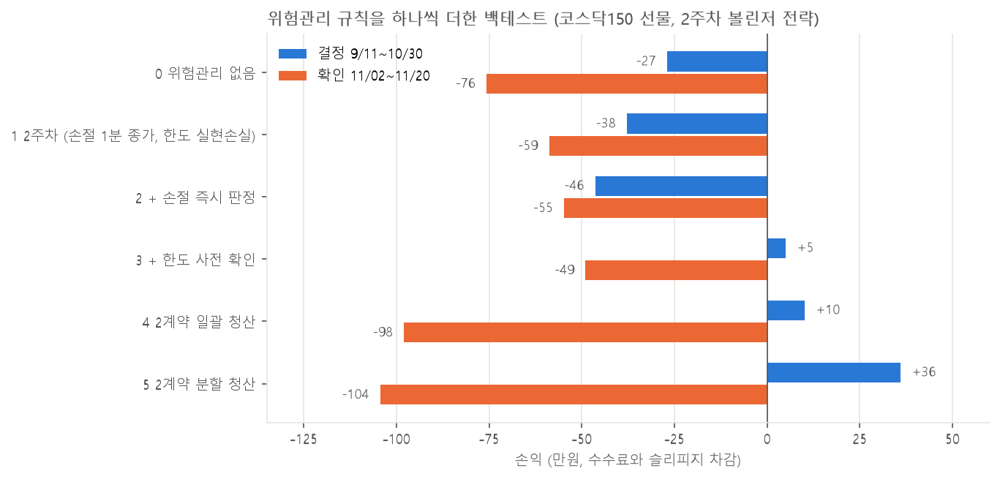
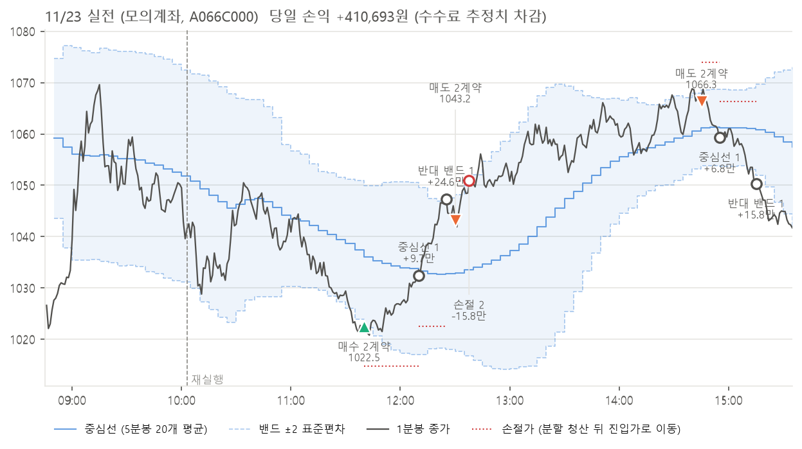
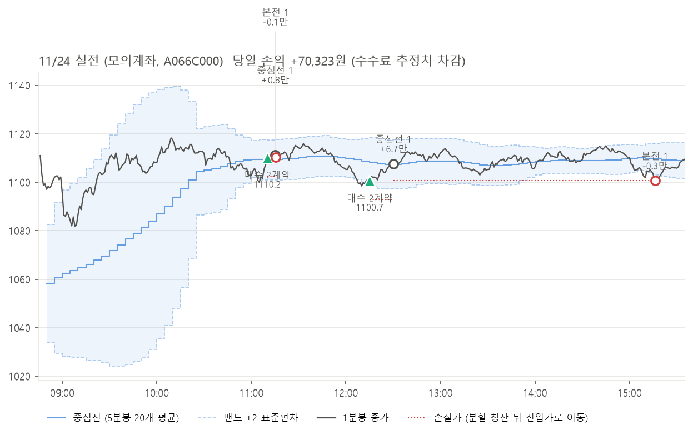
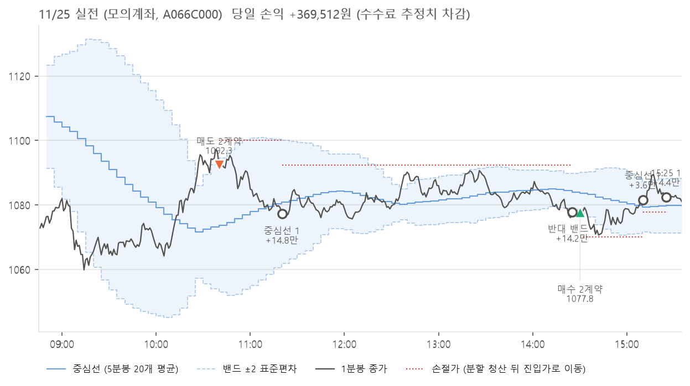
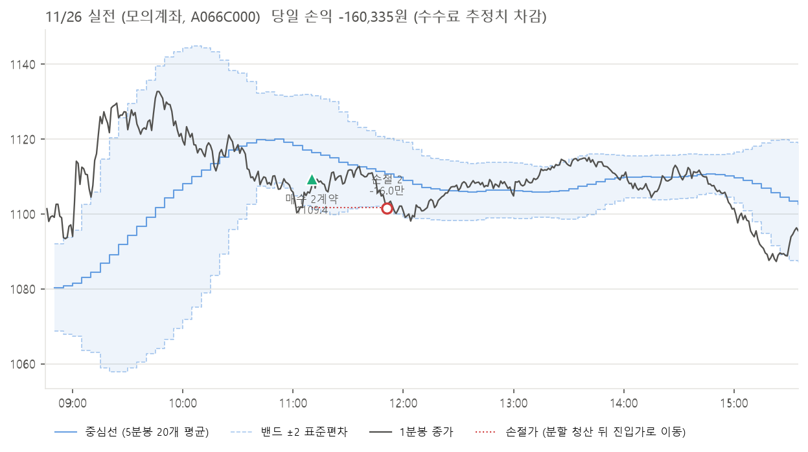
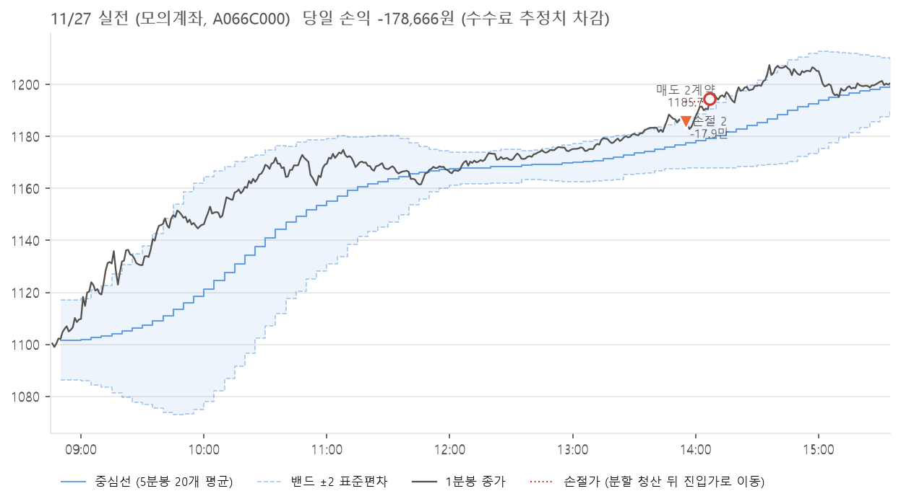

# 6주차 주문/위험관리 응용: 코스닥150 선물 볼린저 전략에 위험관리 규칙 추가

**제출일: 2026/11/27(금) 23:59**

| 항목 | 내용 |
| --- | --- |
| 대상 | KRX 코스닥150 선물 2026년 12월물 `A066C000` (승수 10,000, 1틱 0.1 = 1,000원) |
| 전략 | 2주차 5분봉 볼린저 평균회귀. 진입과 중심선 청산 규칙은 변경하지 않음 |
| 이번 주 추가한 것 | 손절 10초 확인, 다음 손절까지 포함한 일일 한도, 2계약 분할 청산, 주문 전 잔고 대조, 이상 감지 시 정리, 정지된 프로그램을 재실행하는 감시 프로그램 |
| 백테스트 | 실전 규칙 기준 결정 구간(9/11\~10/30) +36.0만원, 확인 구간(11/02\~11/20) -104.4만원. 확인 구간은 모든 규칙 조합에서 손실 |
| 실전 (모의계좌) | 11/23\~11/27 작업 스케줄러로 자동 실행. 5일간 거래 9회, 손절 3회, **+511,527원** (수수료 추정치 차감) |

## 1. 과제 개요

주문과 위험관리 기능을 응용하는 과제다. 새 전략을 만들지 않고 2주차 전략을 그대로 사용하면서, 2주차와 5주차 실전에서 발생한 위험관리 문제를 수정했다. 전략이 같으므로 2주차와의 성과 차이는 위험관리 규칙에서 발생한다.

| 이전 실전에서 발생한 문제 | 근거 | 이번 주 대응 |
| --- | --- | --- |
| 손절을 1분에 한 번 확인해, 손절 6회 중 5회가 손절선보다 2\~24틱 불리하게 체결 | [2주차 README](../week02/README.md) 6절 | 10초마다 현재가를 확인하고, 손절가에 닿으면 즉시 청산 |
| 일일 한도가 실현 손실만 확인해, 10/27 손실이 한도 154,000원을 31,946원 초과 | 2주차 6절 5번 | 다음 거래가 손절되어도 한도 안일 때만 진입 |
| 11/20 14:02에 실행 창이 닫혀 손절과 장 마감 청산이 실행되지 않음 | [5주차 README](../week05/README.md) 5절 | 감시 프로그램이 2분마다 확인하고, 정지되었으면 재실행 |

재실행 기능을 추가하면 같은 주문이 두 번 나갈 위험이 생긴다. 그래서 주문 전에 증권사 잔고와 프로그램 기록을 대조하고, 다르면 주문하지 않도록 했다.

진행 순서는 다음과 같다.

1. 위험관리 규칙을 하나씩 추가하며 같은 기간, 같은 체결 가정으로 백테스트했다(9/11\~11/20 분봉).
2. 11/22에 실전 규칙을 정했다.
3. 11/23\~11/27 모의계좌에서 자동 실행했다. 11/23 10:00에는 감시 프로그램이 작동하는지 확인하려고 자동매매 프로그램을 일부러 종료했다(5절).

## 2. 전략 설명

### 매매 신호 (2주차 그대로)

5분봉 종가가 볼린저 밴드(20개 평균 ± 2 표준편차) 밖으로 벗어났다가 밴드 안으로 복귀하면 반대 방향으로 진입하고, 중심선에 도달하면 청산한다. 당일 5분봉이 20개 쌓인 뒤(10:30 마감 봉부터) 진입한다. 숫자를 정한 근거는 [2주차 README](../week02/README.md) 3절에 있다.

### 위험관리 규칙

규칙은 [risk.py](risk.py) 한 파일에 있고, 백테스트([backtest06.py](backtest06.py))와 실전([trade06.py](trade06.py))이 같은 함수를 호출한다.

| 규칙 | 2주차 | 6주차 | 변경 이유 |
| --- | --- | --- | --- |
| 손절 폭 | 진입가에서 77틱 불리 | 동일 | 5분봉 ATR(14) 중앙값 38.36틱의 2배. 2주차 근거 유지 |
| 손절 확인 | 1분마다, 현재가가 손절가를 넘었을 때 | 10초마다, 현재가가 손절가에 닿았을 때 | 확인 간격 동안 가격이 움직인 만큼 손실이 커졌다 |
| 일일 손실 한도 | 실현 손실이 154,000원에 도달하면 진입 중지 | 실현 손익에서 다음 거래의 최대 손실을 빼도 한도 안일 때만 진입 | 한도 직전에 진입한 거래가 손절되면 한도를 초과했다 |
| 수량 | 1계약 | 2계약, 한도도 2배(308,000원) | 분할 청산을 하려면 2계약이 필요하다 |
| 청산 | 중심선에서 전량 | 중심선에서 1계약 청산. 남은 1계약은 손절가를 진입가로 옮기고 반대편 밴드 또는 15:25에 청산 | 중심선을 지나 계속 움직이는 경우 남은 1계약으로 이익을 추가하고, 손실은 진입가에서 제한한다 |
| 장 마감 | 15:25 전량 청산 | 동일 | |

다음 거래의 최대 손실은 계약 수 × (손절 77틱 + 진입과 청산 슬리피지 각 1틱 + 수수료 2,400원)으로 계산하며, 2계약이면 162,800원이다. 당일 실현 손익이 0원일 때 2계약 손절이 한 번 나면(약 -16만원) 다음 손절까지 더한 손실이 한도 308,000원을 넘으므로 그날은 더 진입하지 않는다.

### 주문과 장애 대응

| 상황 | 동작 |
| --- | --- |
| 주문 전 | 증권사 잔고(`open-interest`)가 프로그램 기록과 다르거나 앞 주문이 미체결이면 주문하지 않는다 |
| 주문 뒤 | 체결 내역(`order-history`)을 최대 60회 조회하고, 잔고에 반영되었는지 10초간 확인한다. 실패가 하루 2회면 이상으로 판단한다 |
| 시세 조회 실패 | 이전 가격으로 손절을 판정하지 않는다. 1분 연속 실패하면 알림, 3분 연속 실패하면 보유 포지션을 청산한다 |
| 이상 감지 (잔고 불일치, 주문 실패 반복, 시세 3분 실패) | 알림 → 보유 포지션 청산 → 그날 신규 진입 중지 |
| 프로그램 오류 종료 | [run_trade06.bat](run_trade06.bat)이 1분 뒤 재실행한다(최대 5회) |
| 프로그램 정지 (창이 닫히거나 응답 없음) | [watchdog06.py](watchdog06.py)가 2분마다 `heartbeat.json`을 확인하고, 90초 넘게 갱신되지 않았으면 정지된 프로세스를 종료하고 재실행한다 |
| 재실행 | `state06.json`, 당일 기록, 증권사 잔고를 읽어 보유 포지션과 당일 손익을 이어서 관리한다. 전날 보유가 기록과 다르면 주문하지 않고 종료한다 |
| 장 마감 | 15:34까지 청산을 재시도하고, 실패하면 알림. 감시 프로그램도 15:36 이후 보유가 남아 있으면 알림 |
| 중복 실행 | 윈도우 뮤텍스로 한 프로세스만 실행된다 |
| 수동 정지 | `week06/STOP` 파일을 만들면 보유 포지션을 청산하고 종료한다 |

알림은 `results/alerts.jsonl`에 기록하고 윈도우 화면 알림으로 표시한다([alert.py](alert.py)).

## 3. 매매 로직

**실행 흐름** (작업 스케줄러 `NH_trade06` 평일 08:50, `NH_watchdog06` 08:55부터 2분마다)

```
08:50  run_trade06.bat → trade06.py 시작. state06.json, 당일 기록, 증권사 잔고 대조
09:00~ 10초마다   heartbeat 기록 → 현재가 조회 → 손절 판정 (분할 청산 뒤에는 진입가)
       1분마다    잔고 대조. 5분봉 마감 분이면 신호 계산
                  → 15:25 청산 / 중심선 청산 / 반대편 밴드 청산 / 진입 (한도 사전 확인)
15:25  보유 전량 청산 후 종료 → 계좌 조회 창 표시 (screenshots/ 캡처용)
```

- 판정 순서: 10초 확인에서 손절, 1분 확인에서 15:25 청산 → 중심선 → 반대편 밴드 → 진입. 청산한 분에는 진입하지 않는다(백테스트와 동일).
- 판정 함수 `on_price`, `on_bar`는 주문 없이 시험할 수 있는 순수 함수다. `python trade06.py --check`로 손절, 분할 청산, 한도, 이상 감지 뒤 진입 중지 경우를 확인한다.
- 모든 판정과 주문은 `results/journal_YYYYMMDD.jsonl`에 기록한다.

## 4. API 활용

| API | 용도 |
| --- | --- |
| `domestic/price` | 10초마다 현재가, 손절 판정 |
| `domestic/chart-minute` | 5분봉 신호 계산, 백테스트용 1분봉과 5분봉 수집 |
| `domestic/open-interest` | 주문 전후와 1분마다 잔고 대조 |
| `domestic/order` | 시장가 주문 (FAS) |
| `domestic/order-history` | 체결 확인, 미체결 잔량 확인, 장 마감 뒤 체결내역 |
| `domestic/deposit` | 장 마감 뒤 예수금 |

API 클라이언트는 2주차 [nh.py](../week02/nh.py)를 그대로 사용했다(토큰 재사용, 종류별 호출 간격, 0.5, 1, 2초 간격 최대 3회 재시도, `NH_ENV=paper`가 아니면 실행하지 않음). 요청과 응답 원본은 모두 `results/api_log/`에 남는다.

## 5. 실행 결과

### 백테스트

| 항목 | 내용 |
| --- | --- |
| 데이터 | `A066C000` 1분봉, 5분봉. 2주차에 수집한 9/11\~10/30에 11/02\~11/20을 추가([data06.py](data06.py)). 10/15와 11/19는 1분봉이 382개, 361개만 수신됨(정상 411개) |
| 구간 | 결정 9/11\~10/30 (32일), 확인 11/02\~11/20 (15일) |
| 진입, 신호 청산 | 5분봉 마감 시각의 1분봉 종가에서 1틱 불리하게 체결 |
| 손절 | 2주차 방식: 1분봉 종가가 손절가를 넘으면 그 종가. 6주차 방식: 1분봉 고가 또는 저가가 손절가에 닿으면 손절가(봉 시가가 이미 넘었으면 시가). 모두 1틱 불리하게 체결 |
| 수수료 | 1계약 왕복 2,400원 (2주차 10/26 실측) |

같은 전략에 표의 순서대로 규칙을 하나씩 추가했다. 0번은 손절과 한도가 없고 15:25 청산만 있다.

| 시나리오 | 구간 | 거래 | 승률 | 손익 | 최대 낙폭 | 최악의 날 | 한도 초과일 |
| --- | --- | --- | --- | --- | --- | --- | --- |
| 0 위험관리 없음 | 결정 | 67 | 59.7% | -269,800 | -675,000 | -248,800 | 4 |
| | 확인 | 27 | 51.9% | -756,800 | -905,200 | -450,800 | 2 |
| 1 2주차 규칙 | 결정 | 78 | 56.4% | -378,200 | -854,800 | -178,800 | 8 |
| | 확인 | 33 | 42.4% | -588,200 | -757,000 | -176,800 | 3 |
| 2 + 손절 즉시 판정 | 결정 | 79 | 54.4% | -463,600 | -783,400 | -194,600 | 8 |
| | 확인 | 33 | 39.4% | -547,200 | -716,000 | -160,800 | 3 |
| 3 + 한도 사전 확인 | 결정 | 63 | 58.7% | +50,800 | -451,000 | -114,200 | 0 |
| | 확인 | 22 | 40.9% | -489,800 | -658,600 | -80,400 | 0 |
| 4 2계약 일괄 청산 | 결정 | 63 | 58.7% | +101,600 | -902,000 | -228,400 | 0 |
| | 확인 | 22 | 40.9% | -979,600 | -1,317,200 | -160,800 | 0 |
| **5 2계약 분할 청산 (실전)** | 결정 | 62 | 59.7% | **+360,400** | -1,060,800 | -278,400 | 0 |
| | 확인 | 22 | 40.9% | **-1,043,600** | -1,411,200 | -160,800 | 0 |

- 단위는 원이다. 거래 1회는 진입부터 마지막 청산까지이며, 분할 청산한 거래도 1회로 센다.
- 한도 초과일은 하루 손실이 계약당 154,000원을 넘은 날이다. 0번은 한도 규칙이 없지만 비교를 위해 같은 기준으로 세었다.
- 4번과 5번은 2계약이라 손익과 낙폭이 1계약 시나리오의 약 2배다. 계약당으로 나누면 5번은 결정 +18.0만원, 확인 -52.2만원이다.



11/22에 5번을 실전 규칙으로 정했다. 판단 근거는 다음과 같다.

- 이번 주 목표는 수익이 아니라 주문과 위험관리 기능이 실제 API에서 계획대로 동작하는지 확인하는 것이다. 5번은 2계약 주문, 1계약 부분 청산, 부분 청산 뒤 손절가 이동처럼 1계약 규칙에서는 실행되지 않는 주문 처리를 포함한다. 2주차에서도 수익보다 주문부터 기록까지 프로그램이 계획대로 동작하는지를 우선해 전략을 선택했다([2주차 README](../week02/README.md) 2절).
- 확인 구간 손실은 규칙 선택으로 피할 수 없었다. 위험관리가 없는 0번을 포함해 6개 시나리오가 모두 손실이었다.
- 확인 구간에서 5번의 손실이 가장 큰 것은 주로 계약 수가 2배이기 때문이다. 계약당으로 나누면 5번은 -52.2만원으로 3번(1계약, -49.0만원)과 3.2만원 차이이고, 최악의 날 손실도 계약당 -80,400원으로 3번과 같다. 하루 손실은 한도 사전 확인이 계약 수에 비례해 제한한다.
- 대신 손실 금액도 2배가 된다는 점을 받아들였다. 확인 구간 최대 낙폭은 -141.1만원으로, 모의계좌 원금 1억원의 1.4%다.

### 실전 (모의계좌)

| 날짜 | 거래 | 손절 | 당일 손익 (수수료 추정치 차감) | 위험관리 기록 |
| --- | --- | --- | --- | --- |
| 11/23 | 3 | 1 | **+410,693원** | 토큰 발급 실패 후 자동 재시작, 의도한 중단 시험 후 감시 프로그램이 재실행, 시세 조회 시간 초과 |
| 11/24 | 2 | 0 | **+70,323원** | 분할 청산 후 손절가를 진입가로 2회 이동, 시세 조회 실패 31회가 모두 재시도에서 성공 |
| 11/25 | 2 | 0 | **+369,512원** | 분할 청산 후 손절가를 진입가로 2회 이동, API 오류 0건 |
| 11/26 | 1 | 1 | **-160,335원** | 2계약 동시 손절(손절가 대비 1틱), 이후 손실 한도 사전 확인으로 진입 중지 상태, 현재가 조회 시간 초과 2건 모두 재시도에서 성공 |
| 11/27 | 1 | 1 | **-178,666원** | 손절가 대비 10틱 불리하게 체결, 이후 한도 사전 확인으로 진입 신호 1회 제외, 토큰 재발급 1회 |
| **합계** | **9** | **3** | **+511,527원** | |

#### 11/23



| 진입 | 방향 | 진입가 | 청산 | 청산가 | 사유 | 손익 |
| --- | --- | --- | --- | --- | --- | --- |
| 11:40 | 매수 2계약 | 1022.5 | 12:10, 1계약 | 1032.4 | 중심선 | +96,986원 |
| | | | 12:25, 1계약 | 1047.3 | 반대편 밴드 | +245,971원 |
| 12:30 | 매도 2계약 | 1043.2 | 12:37, 2계약 | 1050.9 | 손절 | -158,105원 |
| 14:45 | 매도 2계약 | 1066.3 | 14:55, 1계약 | 1059.3 | 중심선 | +67,916원 |
| | | | 15:15, 1계약 | 1050.3 | 반대편 밴드 | +157,925원 |
| **합계** | | | | | | **+410,693원** |

- 주문 8건이 모두 시장가로 즉시 체결됐고, 증권사 체결내역 화면([screenshots/account_20261123.png](screenshots/account_20261123.png))의 주문번호, 체결가, 시각이 기록과 일치한다. 장 마감 잔고는 0계약이다.
- 12:30 매도 진입 시점의 당일 손익은 +342,957원이었다. 다음 손절 최대 손실 162,800원을 빼도 한도(-308,000원) 안이어서 진입이 허용됐다. 12:37 손절 뒤 당일 손익은 +184,852원이었고, 같은 계산으로 14:45 진입도 허용됐다.
- 손익은 체결가와 2주차 실측 수수료율로 계산한 추정치다. 계좌의 선물 청산손익은 +273,000원, 수수료는 15,764원이다. 이 값에는 같은 날 09:00에 청산한 5주차 10년 국채선물 매도 1계약이 포함된다. 증권사는 전일 보유분을 11/20 정산가 109.43 기준으로 계산하므로(08:51 `open-interest` 평균가 109.43) 국채선물 청산손익은 (109.43 - 109.58) × 1,000,000 = -150,000원이다. 코스닥150 선물의 수수료 차감 전 손익 423,000원과 합하면 273,000원으로 계좌 값과 일치한다.

**11/23 위험관리 기록**

| 시각 | 발생한 일 | 처리 결과 | 근거 파일 |
| --- | --- | --- | --- |
| 08:50:02 | 토큰 발급이 HTTP 429로 실패해 `trade06.py`가 오류로 종료 | `run_trade06.bat`이 1분 뒤 재실행, 08:51:03 정상 시작 | `results/trade_console.log` |
| 09:13:30 | 현재가 조회가 `429 EGW020`(호출량 초과)으로 3회 연속 실패 | 세 번째 재시도(09:13:33)에 성공 | `results/api_log/` |
| 10:00:01 | **의도한 중단 시험.** [killtest06.py](killtest06.py)가 보유와 미체결이 없는 것을 확인한 뒤 실행 창(cmd와 python)을 강제 종료 | 감시 프로그램이 10:03:01에 heartbeat가 182초 끊긴 것을 감지하고 재실행. 10:03:02 시작 시 잔고 0계약, 기록 0계약 일치 | `killtest_20261123.jsonl`, `watchdog_20261123.jsonl`, `alerts.jsonl` |
| 12:37:40 | 현재가 1051.0이 손절가 1050.9를 넘음 | 같은 확인에서 시장가 매수 2계약 주문, 손절가와 같은 1050.9에 체결 | `results/api_log/`, journal |
| 13:28\~13:30 | 현재가 조회 응답 시간 초과(10초) 9회. 13:29:00 확인은 재시도 3회가 모두 실패 | 보유가 없던 시간이었다. 13:29:50 확인은 두 번째 재시도(13:30:01)에 성공했고 이후 정상 | `results/api_log/`, journal `price_fail` |
| 15:25:10 | 보유 0계약 확인 후 정상 종료 | 감시 프로그램은 종료 표시를 확인하고 재실행하지 않음 | `heartbeat.json`, `watchdog_20261123.jsonl` |

10:00 중단은 감시 프로그램을 시험하려고 일부러 만든 것이며 실제 장애가 아니다. 반면 08:50 토큰 발급 실패는 계획하지 않은 장애였다.

#### 11/24



| 진입 | 방향 | 진입가 | 청산 | 청산가 | 사유 | 손익 |
| --- | --- | --- | --- | --- | --- | --- |
| 11:10 | 매수 2계약 | 1110.2 | 11:15, 1계약 | 1111.2 | 중심선 | +7,823원 |
| | | | 11:15, 1계약 | 1110.3 | 본전 | -1,177원 |
| 12:15 | 매수 2계약 | 1100.7 | 12:30, 1계약 | 1107.6 | 중심선 | +66,835원 |
| | | | 15:16, 1계약 | 1100.6 | 본전 | -3,158원 |
| **합계** | | | | | | **+70,323원** |

- 15:25 증권사 계좌 조회에서 주문 6건과 잔고 0계약을 확인했다. 계좌 화면: [screenshots/account_20261124.png](screenshots/account_20261124.png)
- 표의 손익은 체결가와 2주차 실측 수수료율로 계산한 추정치다. 증권사 계좌의 선물 청산손익은 +79,000원, 수수료는 8,674원으로, 수수료 차감 후 손익은 **+70,326원**이다.

**11/24 실행 기록**

- 08:50:02 자동매매를 시작했다. 증권사 잔고와 프로그램 기록이 모두 0계약으로 일치했다.
- 11:15:10과 12:30:10에 중심선에서 1계약씩 분할 청산한 뒤, 남은 계약의 손절가를 각각 진입가인 1110.2와 1100.7로 옮겼다. 두 계약 모두 손절가(본전)에서 청산되었다.
- 10:09\~14:59에 10초 현재가 확인 31회가 첫 요청에서 실패했다(응답 시간 초과 24건, `429 EGW020` 13건). 13:16:10에는 잔고 조회도 429를 1회 반환했다. 모두 최대 3회 재시도 안에서 성공해, 재시도까지 모두 실패한 확인(`price_fail`)은 0회였다. 실패는 13:02\~13:34에 집중되었다.
- 12:50 이후의 실패는 1계약을 보유하고 손절가가 1100.7이던 시간에 발생했다. 가장 오래 걸린 확인은 13:32:40에 요청해 13:33:01에 성공했다(약 21초). 12:50\~13:35 1분봉 최저가는 1102.4로 손절가보다 17틱 높아, 지연 동안 놓친 손절은 없다. [API 로그](results/api_log/20261124_sejeans.jsonl)
- 15:25:10 보유 0계약, 대기 주문 0건으로 정상 종료했다. 감시 프로그램은 종료 상태를 확인했고 당일 재실행은 0회였다. [감시 로그](results/watchdog_20261124.jsonl)
- 15:50 장 마감 작업에서 1분봉과 5분봉을 저장하고 실전 차트와 README를 갱신했다. [장 마감 작업 로그](results/daily_console.log)

#### 11/25



| 진입 | 방향 | 진입가 | 청산 | 청산가 | 사유 | 손익 |
| --- | --- | --- | --- | --- | --- | --- |
| 10:40 | 매도 2계약 | 1092.3 | 11:20, 1계약 | 1077.3 | 중심선 | +147,873원 |
| | | | 14:25, 1계약 | 1077.9 | 반대편 밴드 | +141,873원 |
| 14:30 | 매수 2계약 | 1077.8 | 15:10, 1계약 | 1081.6 | 중심선 | +35,883원 |
| | | | 15:25, 1계약 | 1082.4 | 장 마감 | +43,883원 |
| **합계** | | | | | | **+369,512원** |

- 15:25 증권사 계좌 조회에서 주문 6건과 잔고 0계약을 확인했다. 주문번호와 체결가가 기록과 일치한다. 계좌 화면: [screenshots/account_20261125.png](screenshots/account_20261125.png)
- 표의 손익은 체결가와 2주차 실측 수수료율로 계산한 추정치다. 증권사 계좌의 선물 청산손익은 +378,000원, 수수료는 8,486원으로, 수수료 차감 후 손익은 **+369,514원**이다.

**11/25 실행 기록**

- 08:50:02 자동매매를 시작했다. 증권사 잔고와 프로그램 기록이 모두 0계약으로 일치했다.
- 11:20:10에 중심선에서 1계약을 분할 청산하고 남은 계약의 손절가를 진입가 1092.3으로 옮겼다. 남은 계약은 14:25:10에 반대편 밴드에서 청산되었다.
- 14:30:10에 반대 방향으로 진입했다. 15:10:10에 1계약을 분할 청산하고 손절가를 진입가 1077.8로 옮겼으며, 남은 계약은 15:25 장 마감 청산 규칙으로 청산되었다.
- 15:25:10 보유 0계약, 대기 주문 0건으로 정상 종료했다. API 응답 2,809건이 모두 HTTP 200이었고, 감시 프로그램의 재실행은 0회였다. [감시 로그](results/watchdog_20261125.jsonl)
- 15:50 장 마감 작업에서 1분봉과 5분봉을 저장하고 실전 차트와 README를 갱신했다. [장 마감 작업 로그](results/daily_console.log)

#### 11/26



| 진입 | 방향 | 진입가 | 청산 | 청산가 | 사유 | 손익 |
| --- | --- | --- | --- | --- | --- | --- |
| 11:10 | 매수 2계약 | 1109.4 | 11:51, 2계약 | 1101.6 | 손절 | -160,335원 |
| **합계** | | | | | | **-160,335원** |

- 15:25 증권사 계좌 조회에서 주문 2건과 잔고 0계약을 확인했다. 주문번호(675, 758)와 체결가가 기록과 일치한다. 계좌 화면: [screenshots/account_20261126.png](screenshots/account_20261126.png)
- 표의 손익은 체결가와 2주차 실측 수수료율로 계산한 추정치다. 증권사 계좌의 선물 청산손익은 -156,000원, 수수료는 4,333원으로, 수수료 차감 후 손익은 **-160,333원**이다. [계좌 원본 응답](results/account_20261126_152511.json)

**11/26 실행 기록**

- 08:50:03 자동매매를 시작했다. 증권사 잔고와 프로그램 기록이 모두 0계약으로 일치했다.
- 11:10:10에 매수 2계약으로 진입했고 손절가는 1101.7이었다. 분할 청산 조건(중심선)에 도달하기 전에 가격이 하락했다.
- 10초 현재가 확인에서 11:51:00까지는 1101.8로 손절가보다 높았고, 11:51:10에 1101.5를 확인해 즉시 2계약을 시장가로 청산했다. 체결가 1101.6은 손절가보다 1틱 낮다. 처음으로 분할 청산 없이 2계약을 한 번에 손절한 거래다.
- 실제 손실 -160,335원은 사전에 계산한 2계약 최대 손실 162,800원 안이었다. 이 손절 뒤에는 당일 손익에서 다음 거래의 최대 손실을 빼면 -323,135원으로 한도 308,000원을 초과하므로, 그날 신규 진입이 중지되는 상태가 되었다. 11:51 이후 5분봉 진입 신호는 15:25 1회뿐이었고, 이는 장 마감 청산 시각이라 진입 대상이 아니었다.
- API 요청 2,791건 중 2,789건이 HTTP 200이었다. 09:00:20과 13:11:20의 현재가 조회 2건이 응답 시간 초과였으나 모두 1회 재시도에서 성공했다. [API 로그](results/api_log/20261126_sejeans.jsonl)
- 15:25:10 보유 0계약, 대기 주문 0건으로 정상 종료했다. 감시 프로그램의 재실행은 0회였다. [감시 로그](results/watchdog_20261126.jsonl)
- 15:50 장 마감 작업에서 1분봉과 5분봉을 저장하고 실전 차트와 README를 갱신했다. 계좌 화면은 15:57에 캡처해 장 마감 작업을 재실행했다. [장 마감 작업 로그](results/daily_console.log)

#### 11/27



| 진입 | 방향 | 진입가 | 청산 | 청산가 | 사유 | 손익 |
| --- | --- | --- | --- | --- | --- | --- |
| 13:55 | 매도 2계약 | 1185.7 | 14:06, 2계약 | 1194.4 | 손절 | -178,666원 |
| **합계** | | | | | | **-178,666원** |

- 15:25 증권사 계좌 조회에서 주문 2건(713, 728)과 잔고 0계약을 확인했다. 체결가와 시각이 기록과 일치한다. 계좌 화면은 캡처하지 못해 같은 시각의 [계좌 원본 응답](results/account_20261127_152513.json)으로 대신한다.
- 표의 손익은 체결가와 2주차 실측 수수료율로 계산한 추정치다. 증권사 계좌의 선물 청산손익은 -174,000원, 수수료는 4,665원으로, 수수료 차감 후 손익은 **-178,665원**이다.

**11/27 실행 기록**

- 08:50:02 자동매매를 시작했다. 증권사 잔고와 프로그램 기록이 모두 0계약으로 일치했다.
- 09:00:00 첫 현재가 조회가 `401 EGW052`(토큰 재발급 필요)를 반환했다. `nh.py`가 토큰을 다시 발급받아 0.4초 뒤 재시도에서 성공했다.
- 13:55:10에 매도 2계약으로 진입했고 손절가는 1193.4였다. 이후 가격이 계속 올랐다.
- 10초 현재가 확인에서 14:06:40은 1193.3으로 손절가보다 1틱 낮았고, 14:06:50에 1194.3을 확인해 즉시 2계약을 시장가로 청산했다. 체결가 1194.4는 손절가보다 10틱 불리하다. 10초 사이에 가격이 10틱 움직였기 때문이다.
- 실제 손실 -178,666원은 사전에 계산한 2계약 최대 손실 162,800원을 15,866원 초과했다. 최대 손실 계산은 손절 슬리피지를 1틱으로 가정했기 때문이다. 일일 한도 308,000원 안에서는 끝났다.
- 14:20:10 매도 진입 신호가 나왔지만 당일 손익 -178,666원에서 다음 거래 최대 손실 162,800원을 빼면 한도를 넘어 진입하지 않았다. 이후 5분봉 고가는 14:35에 1207.7까지 올라, 이 신호로 진입했다면 손절가(진입가 + 77틱)에 닿았을 가능성이 높다(5분봉으로 계산한 추정).
- API 요청 2,792건 중 2,791건이 HTTP 200이었다(위 401 1건 제외). [API 로그](results/api_log/20261127_sejeans.jsonl)
- 15:25:10 보유 0계약, 대기 주문 0건으로 정상 종료했다. 감시 프로그램의 재실행은 0회였다. [감시 로그](results/watchdog_20261127.jsonl)
- 15:50 장 마감 작업에서 1분봉과 5분봉을 저장하고 실전 차트와 README를 갱신했다. [장 마감 작업 로그](results/daily_console.log)

## 6. 결과 분석

1. **한도 사전 확인은 하루 손실을 제한했다.** 3번 규칙은 두 구간 모두 한도 초과일을 0일로 만들었고, 최악의 날 손실을 결정 구간 -194,600원에서 -114,200원으로, 확인 구간 -160,800원에서 -80,400원으로 감소시켰다(2번 대비). 백테스트에서 진입을 막은 신호가 손절될 신호였는지는 거래별로 확인하지 않았다. 실전에서는 11/26과 11/27 모두 2계약 손절 뒤 신규 진입이 중지되었고, 11/27 14:20에 제외한 신호는 진입했다면 손절되었을 가능성이 높다(5절 11/27, 추정). 5일 중 가장 큰 하루 손실은 11/27 -178,666원으로 한도 308,000원 안이었다.
2. **손절 즉시 판정의 효과는 구간마다 달랐다.** 손실 거래의 평균 손실은 감소했지만(결정 구간 -79,370원 → -74,205원), 1분 종가 기준으로는 손절되지 않던 거래도 손절되어(손절 계약 수 결정 구간 30 → 32, 확인 구간 14 → 15) 결정 구간 손익은 8.5만원 감소하고 확인 구간 손익은 4.1만원 증가했다. 실전 5일의 손절 3회는 손절가 대비 0틱(11/23), 1틱(11/26), 10틱(11/27) 불리하게 체결됐다(2주차는 6회 중 5회가 2\~24틱 초과). 11/27은 10초 사이에 가격이 10틱 움직여, 10초 확인으로도 급등락 때 손절가 초과를 막지 못했다. 이 때문에 2계약 손실이 사전 계산한 최대 손실 162,800원을 15,866원 넘었다. 다음 거래 최대 손실 계산의 손절 슬리피지 1틱 가정은 작다. 3회뿐이라 확인 간격 단축의 효과로 일반화하지 않는다.
3. **위험관리는 전략의 손실을 이익으로 바꾸지 못했다.** 확인 구간은 위험관리가 없을 때(-75.7만원)부터 실전 규칙(-104.4만원)까지 모든 시나리오가 손실이었다. 위험관리 규칙은 손실의 크기와 하루 손실을 제한하는 역할이며, 평균 손실이 평균 이익보다 큰 2주차 전략의 특성은 그대로 남았다.
4. **분할 청산은 결정 구간에서만 이익이었다.** 4번 대비 결정 구간 +25.9만원, 확인 구간 -6.4만원이다. 실전 5일간 분할 청산한 거래는 6회이고, 11/26과 11/27의 거래 2회는 중심선에 닿기 전에 2계약이 함께 손절되었다. 남은 1계약은 반대편 밴드 청산 3회(11/23 2회, 11/25 1회), 본전 손절 2회(11/24), 장 마감 청산 1회(11/25)로 청산되었고, 손익 합계는 +585,317원이다. 같은 거래에서 중심선에서 먼저 청산한 1계약의 합계는 +423,316원이다. 본전 손절 2회는 청산가가 진입가와 1틱 이내여서 손실이 수수료 수준(-1,177원, -3,158원)이었다. 5일 결과라 백테스트 확인 구간 결과를 뒤집는 근거로 쓰지 않는다.
5. **장애 대응은 사람 개입 없이 동작했다.** 의도한 중단(10:00)과 계획하지 않은 토큰 발급 실패(08:50) 모두 프로그램이 스스로 복구했고, 재실행 때 잔고와 기록이 일치해 중복 주문이 없었다. 11/24에는 보유 중에 현재가 확인이 첫 요청에서 여러 차례 실패했지만 모두 재시도에서 성공했고, 가장 긴 지연은 약 21초였다. 11/24\~11/27에는 감시 프로그램이 재실행할 상황이 발생하지 않았다. 11/27 09:00 토큰 만료(401)도 API 클라이언트가 재발급해 처리했다. 다만 감시 프로그램은 2분 간격이고 90초 기준을 쓰므로 정지 후 재실행까지 최대 약 3분 30초가 걸린다. 10:00 시험에서도 3분이 걸렸다. 보유 중에 정지되면 그동안 손절이 실행되지 않는다.

## 7. 오류 제보와 개선 사항

| 번호 | API | 현상 | 상태 |
| --- | --- | --- | --- |
| 1 | `domestic/price` | 응답 시간 초과(10초)가 11/23 13:28\~13:30에 9회, 11/24 10:09\~14:59에 24회 발생했다. 앞뒤 호출은 0.1초 안팎에 응답했다. 11/25에는 0회 | 미제보. 11/24에 재발 |
| 2 | `domestic/price`, `domestic/open-interest` | `429 EGW020`이 11/23 09:13:30에 3회, 11/24 13:03\~13:34에 14회(잔고 조회 1회 포함) 반환됐다. 이 프로그램의 호출은 10초에 1\~2회로, 시세 초당 한도 10회보다 훨씬 적다. 11/24에는 5주차 작업이 종료되어 같은 키를 쓰는 다른 예약 작업이 없었다. 11/25에는 0회 | 미제보. 원인 확인 필요 |
| 3 | `auth-service/v1/token` | 11/23 08:50:02에 HTTP 429. 같은 초에 5주차 프로그램(`NH_reversal`, 08:50 실행)이 같은 키로 토큰을 발급받았다. 토큰 발급 초당 한도에 걸린 것으로 추정한다 | 이 팀의 실행 일정 문제로 판단해 제보하지 않음 |

**개선 사항**
- 3번: 5주차 작업은 11/23 12:00에 종료되어 11/24부터는 같은 시각에 토큰을 요청하지 않는다. 최종 프로젝트에서 프로그램을 여러 개 실행하면 시작 시각을 나누거나 토큰을 공유한다.
- 정지 후 재실행까지 최대 약 3분 30초가 걸린다(6절 5번). 작업 스케줄러 최소 간격인 1분으로 감시 간격을 줄이는 방안을 검토한다.
- 다음 거래 최대 손실 계산의 손절 슬리피지를 1틱에서 실측 최대치(10틱) 수준으로 늘리거나, 손절가 근처에서는 확인 간격을 더 줄이는 방안을 검토한다(6절 2번).
- 실전 손익은 2주차 실측 수수료율로 계산한 추정치라 계좌 수수료와 차이가 있다. 날짜별 확정 손익은 계좌 예수금(`deposit`)으로 확인한다.

## 8. 소스코드

| 파일 | 내용 |
| --- | --- |
| [risk.py](risk.py) | 위험관리 규칙 (손절가, 손절 판정, 다음 거래 최대 손실, 진입 허용). 백테스트와 실전이 공유 |
| [data06.py](data06.py) | 분봉 수집, 2주차 저장본과 이어 붙이기, 중복 제거 |
| [backtest06.py](backtest06.py) | 6개 시나리오 백테스트 → `results/bt_summary.json`, `bt_trades.csv` |
| [trade06.py](trade06.py) | 모의계좌 자동매매 (`--dry` 주문 없이 판정만, `--check` 판정 함수 시험) |
| [run_trade06.bat](run_trade06.bat) | 작업 스케줄러 실행용. 오류 종료 시 재실행 |
| [watchdog06.py](watchdog06.py) | 감시 프로그램. 정지 감지 시 재실행, 장 마감 뒤 미청산 알림 (`--dry` 판정만) |
| [killtest06.py](killtest06.py) | 감시 프로그램 시험용 의도적 종료 (주문 없음, 보유 중이면 실행하지 않음) |
| [procs.py](procs.py) | 명령줄로 자동매매 프로세스만 찾아 종료 |
| [alert.py](alert.py) | 알림 기록과 윈도우 화면 알림 |
| [show_account06.py](show_account06.py) | 체결내역, 잔고, 예수금 조회 (주문 없음). 5주차 `show_account.py`를 불러 쓰며 저장 위치만 변경 |
| [plot06.py](plot06.py) | README 차트 (`results/fig_*.png`) |
| [daily06.py](daily06.py), [run_daily06.bat](run_daily06.bat) | 장 마감 뒤 그날 분봉 수집, 실전 차트, README 5절 표와 날짜별 절 갱신 (작업 스케줄러 `NH_daily06` 평일 15:50, 주문 없음) |

```bash
pip install pandas numpy matplotlib
# 저장소 루트 .env: NH_DOMESTIC_APP_KEY, NH_DOMESTIC_APP_SECRET (NH_ENV=paper)
cd week06
python data06.py 2026-11-02 2026-11-20   # 분봉 수집 (9/11~10/30은 2주차 저장본 사용)
python backtest06.py
python trade06.py --check                # 판정 함수 시험
python trade06.py --dry                  # 주문 없이 실행
python watchdog06.py --dry
python plot06.py
```

**screenshots/**: 매일 장 마감 후 계좌 조회 화면(`account_YYYYMMDD.png`). 체결내역, 잔고, 예수금이 나온다. 화면 첫 줄에 `week05/show_account.py`로 표시되는 것은 `show_account06.py`가 5주차 스크립트를 불러 쓰기 때문이다.

외부 코드: 없음. 중복 실행 방지는 윈도우 API `CreateMutexW`, 화면 알림은 .NET `System.Windows.Forms.NotifyIcon`을 사용했다.

## 출처

- NH선물 REST API 개발자센터 <https://apidev.futures.co.kr/>: API 명세
- 전략, 손절 폭, 일일 한도, 수수료 실측: [2주차 README](../week02/README.md)
- 11/20 실행 창 종료 사고: [5주차 README](../week05/README.md)
- 볼린저 밴드 정의: Bollinger, J. (2001). *Bollinger on Bollinger Bands*. McGraw-Hill.

[전체 일정으로](../README.md)
